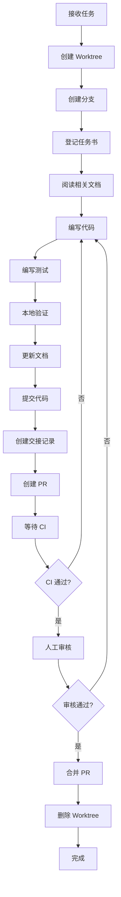

# AGENTS.md - AI 协作开发总规则

> 本文档是所有 AI 模型的必读文档
> 版本: 1.3
> 最后更新: 2026-10-23

---

## 📋 文档定位

本文档是**所有 AI 模型参与开发的总规则**，包括：
- 技术栈与工具链
- 项目目录结构与命名规范
- Git 工作流与分支策略
- 文档治理规则
- 开发流程与工作流
- 安全红线与禁止事项

**任何新对话开始前必须先阅读本文档（约 10 分钟）。**

---

## 1. 技术栈

### 1.1 后端

| 技术 | 版本 | 说明 |
|------|------|------|
| **Node.js** | 20.x | LTS 版本（小程序构建/测试按 Node 20 验证） |
| **TypeScript** | 5.9 | 严格模式（`backend/package.json`: ^5.9.3） |
| **NestJS** | 12.x | 后端框架（@nestjs/* ^12.0.1） |
| **Prisma** | 5.22 | ORM，类型安全查询 |
| **PostgreSQL** | 16 | 数据库（docker-compose: postgres:16-alpine） |
| **Redis** | 6+ | 会话和缓存 |
| **Vitest** | 4.x | 测试框架（`npm test` = `vitest run`，另见 `npm run test:e2e`） |
| **oxlint** | 1.x | 代码检查（`npm run lint` = `oxlint --type-aware src/ test/`） |

> 说明：NestJS 12 脚手架默认使用 **Vitest + oxlint**，不再使用 Jest/ESLint（依据 T001、T131 交接记录；2026-10-13 T150 核对 `backend/package.json`）。

### 1.2 前端

| 技术 | 版本 | 说明 |
|------|------|------|
| **Vue 3** | 3.5 / 3.4 | 网页后台（^3.5.42）+ 小程序（3.4.21） |
| **TypeScript** | 6.0（前端后台） | 前端类型安全（frontend-admin `~6.0.2`；后端为 5.9） |
| **uni-app** | 3.0.0-5020620260917001 | 小程序框架（`miniprogram/package.json`） |
| **Element Plus** | 2.x | 后台组件库（^2.14.7） |
| **Vite** | 8.x / 5.2 | 网页后台（^8.3.0）；小程序（5.2.8） |

### 1.3 基础设施

| 服务 | 说明 |
|------|------|
| **阿里云 OSS** | 对象存储（图片、附件） |
| **阿里云 RDS** | PostgreSQL 托管服务 |
| **GitHub Actions** | CI/CD |
| **Docker** | 本地开发环境 |

---

## 2. 项目目录结构

```
tenant-system/
├── .github/                    # GitHub 配置
│   ├── workflows/              # CI/CD 工作流
│   │   ├── docs-check.yml      # 文档检查
│   │   └── security-scan.yml   # 密钥扫描
│   ├── CODEOWNERS              # 代码所有者
│   └── pull_request_template.md # PR 模板
│
├── docs/                       # 📚 文档目录
│   ├── INDEX.md                # 文档索引（唯一注册表）
│   ├── 00-项目计划书.md
│   ├── 01-架构设计.md
│   ├── 02-数据模型.md
│   ├── 03-权限矩阵.md
│   ├── 04-状态机.md
│   ├── 05-接口规范.md
│   ├── 06-安全与合规清单.md
│   ├── 07-测试策略.md
│   ├── 09-待确认清单.md
│   ├── adr/                    # 架构决策记录
│   │   ├── 001-xxx.md
│   │   └── 002-xxx.md
│   ├── handoff/                # 交接记录
│   │   ├── 2026-10-12-T001-xxx.md
│   │   └── 2026-10-13-T002-xxx.md
│   └── archive/                # 已归档文档
│
├── tasks/                      # 任务书（仓库根目录，**不在** docs/ 下）
│   ├── T001-后端脚手架.md
│   └── T146-主题系统Vue3迁移.md
│
├── backend/                    # 后端子项目（仓库根目录没有 package.json/tsconfig.json）
│   ├── prisma/                 # 数据库
│   │   ├── schema.prisma       # Prisma schema（24 张表）
│   │   ├── migrations/         # 迁移文件
│   │   └── seed.ts             # 初始化数据
│   ├── .env.example            # 环境变量示例
│   └── src/                    # 后端源码
│       ├── main.ts             # 入口文件
│       ├── app.module.ts       # 根模块
│       ├── config/             # 配置
│       │   ├── database.config.ts
│       │   └── app.config.ts
│       ├── common/             # 公共模块
│       │   ├── decorators/
│       │   ├── guards/         # 守卫（权限控制）
│       │   ├── interceptors/   # 拦截器（日志、转换）
│       │   ├── filters/        # 异常过滤器
│       │   └── utils/
│       └── modules/            # 业务模块
│           ├── auth/           # 认证模块
│           ├── rooms/          # 房源模块（样板）
│           ├── tenants/        # 租客模块
│           ├── contracts/      # 合同模块
│           ├── bills/          # 账单模块
│           ├── prepay/         # 预付账户模块
│           ├── meters/         # 水电读数模块
│           ├── maintenance/    # 报修模块
│           ├── checkout/       # 退租模块
│           ├── notifications/  # 通知模块
│           ├── audit/          # 审计日志模块
│           ├── buildings/      # 楼栋模块
│           ├── dashboard/      # 仪表板模块
│           ├── files/          # 文件上传模块
│           └── scheduler/      # 定时任务模块
│
├── frontend-admin/             # 网页后台（独立项目）
│   ├── src/
│   ├── package.json
│   └── vite.config.ts
│
├── miniprogram/                # 微信小程序（uni-app，源码在根目录 pages/、api/ 等）
│   ├── pages/
│   ├── api/
│   ├── package.json
│   └── manifest.json
│
├── scripts/                    # 脚本
│   ├── check-docs.js           # 文档检查脚本
│   └── update-index.js         # 更新 INDEX.md
│
├── .gitignore
├── docker-compose.yml          # 本地开发环境
├── README.md
├── AGENTS.md                   # 本文档
└── STATUS.md                   # 项目状态跟踪
```

---

## 3. 命名规范

### 3.1 文件命名

| 类型 | 规范 | 示例 |
|------|------|------|
| **模块目录** | 复数小写，短横线分隔 | `rooms/`, `maintenance-requests/` |
| **DTO** | 大驼峰 + .dto.ts | `CreateRoomDto`, `UpdateRoomDto` |
| **Entity** | 大驼峰 + .entity.ts | `Room.entity.ts` |
| **Service** | 大驼峰 + .service.ts | `RoomsService` |
| **Controller** | 大驼峰 + .controller.ts | `RoomsController` |
| **Module** | 大驼峰 + .module.ts | `RoomsModule` |
| **测试** | 原文件名 + .spec.ts 或 .e2e.spec.ts | `rooms.service.spec.ts` |

### 3.2 代码命名

| 类型 | 规范 | 示例 |
|------|------|------|
| **变量** | 小驼峰 | `userName`, `roomList` |
| **函数** | 小驼峰，动词开头 | `createRoom()`, `findAllRooms()` |
| **类** | 大驼峰 | `RoomsService`, `RolesGuard` |
| **接口** | 大驼峰，I 前缀（可选） | `IUser`, `CreateRoomDto` |
| **枚举** | 大驼峰 | `RoomStatus`, `UserRole` |
| **枚举值** | 大写下划线 | `ROOM_STATUS.VACANT` |
| **常量** | 大写下划线 | `MAX_FILE_SIZE`, `DEFAULT_PAGE_SIZE` |

### 3.3 数据库命名

| 类型 | 规范 | 示例 |
|------|------|------|
| **表名** | 复数小写下划线 | `rooms`, `maintenance_requests` |
| **字段名** | 小驼峰（Prisma）| `roomNumber`, `createdAt` |
| **索引** | `idx_{表名}_{字段}` | `idx_rooms_status` |
| **外键** | `fk_{表名}_{字段}` | `fk_rooms_building_id` |

---

## 4. Git 工作流

### 4.1 分支策略

```
main (受保护)
  ├── develop (受保护)
  │   ├── feature/T001-scaffold      # 功能分支
  │   ├── feature/T002-auth          # 功能分支
  │   └── fix/T010-billing-bug       # 修复分支
  └── hotfix/urgent-security-patch   # 紧急修复
```

**分支命名规范**：
- `feature/T{编号}-{简述}` - 功能开发
- `fix/T{编号}-{简述}` - Bug 修复
- `hotfix/{简述}` - 紧急修复（直接从 main 分出）
- `docs/{简述}` - 纯文档变更

### 4.2 Git Worktree 使用

#### 为什么使用 Worktree？
- ✅ 每个任务独立工作目录，避免分支切换冲突
- ✅ 多个任务可并行开发（不同模型/对话）
- ✅ 不影响主仓库，易于清理

#### 目录结构

```
~/projects/
├── tenant-system/              # 主仓库
│   ├── .git/                   # Git 元数据
│   ├── docs/
│   ├── src/
│   └── ...
└── tenant-system-worktrees/    # 工作树目录（与主仓库同级）
    ├── T001-scaffold/          # 任务 T001 的工作树
    ├── T002-auth/              # 任务 T002 的工作树
    └── T003-rooms/             # 任务 T003 的工作树
```

#### 创建 Worktree

```bash
# 1. 进入主仓库
cd ~/projects/tenant-system

# 2. 创建新分支和工作树
git worktree add ../tenant-system-worktrees/T001-scaffold -b feature/T001-scaffold

# 说明:
# - ../tenant-system-worktrees/T001-scaffold: 工作树路径（任务编号命名）
# - -b feature/T001-scaffold: 创建新分支
# - 如果分支已存在，省略 -b 参数

# 3. 进入工作树
cd ../tenant-system-worktrees/T001-scaffold

# 4. 在任务书中登记（必须）
cat >> tasks/T001-脚手架搭建.md << EOF

## 开发信息
- 分支: feature/T001-scaffold
- 工作树: ~/projects/tenant-system-worktrees/T001-scaffold
- 模型: Claude Opus 5.5
- 开始时间: $(date +"%Y-%m-%d %H:%M:%S")
- 状态: in_progress
EOF

# 5. 提交任务登记
git add tasks/T001-脚手架搭建.md
git commit -m "docs(task): 登记 T001 任务开发信息"
```

#### 切换 Worktree

```bash
# 直接 cd 到对应工作树目录
cd ~/projects/tenant-system-worktrees/T002-auth

# 或使用别名（可写入 ~/.bashrc 或 ~/.zshrc）
alias goto-task='cd ~/projects/tenant-system-worktrees/$1'
goto-task T002-auth
```

#### 清理 Worktree

```bash
# 任务完成并合并后

# 1. 回到主仓库
cd ~/projects/tenant-system

# 2. 删除工作树
git worktree remove ../tenant-system-worktrees/T001-scaffold

# 或强制删除（如有未提交改动）
git worktree remove --force ../tenant-system-worktrees/T001-scaffold

# 3. 删除远程分支（PR 合并后自动删除，本地也需删除）
git branch -d feature/T001-scaffold

# 4. 在任务书中标记完成
cat >> tasks/T001-脚手架搭建.md << EOF

- 完成时间: $(date +"%Y-%m-%d %H:%M:%S")
- 状态: completed
- 合并PR: #1
EOF
```

#### 查看所有 Worktree

```bash
git worktree list

# 输出示例:
# /Users/user/projects/tenant-system              abc123 [main]
# /Users/user/projects/tenant-system-worktrees/T001-scaffold  def456 [feature/T001-scaffold]
# /Users/user/projects/tenant-system-worktrees/T002-auth      ghi789 [feature/T002-auth]
```

### 4.3 提交信息规范

```
<type>(<scope>): <subject>

<body>

Task: T{编号}
```

**Type**：
- `feat`: 新功能
- `fix`: Bug 修复
- `docs`: 纯文档变更
- `refactor`: 重构（不改变功能）
- `test`: 测试相关
- `chore`: 构建/工具相关
- `style`: 代码格式（不影响逻辑）

**Scope**（可选）：模块名，如 `auth`, `billing`, `rooms`

**Subject**：简短描述（<50字符）

**Body**（可选）：详细说明

**示例**：
```
feat(auth): 实现邀请码验证逻辑

- 创建 InviteCode 实体
- 实现验证和失效逻辑
- 添加单元测试

Task: T002
```

### 4.4 保护分支规则

| 分支 | 保护规则 |
|------|----------|
| **main** | 只能通过 PR 合并、必须通过 CI、需 1 人批准 |
| **develop** | 只能通过 PR 合并、必须通过 CI |
| **feature/** | 无保护 |

---

## 5. 文档治理规则

### 5.1 文档元信息（必须）

每份文档头部必须包含：

```yaml
---
status: draft | active | superseded | archived
owner_tier: human | strong | medium | cheap
applies_to:
  - 代码路径（glob 模式）
last_verified: YYYY-MM-DD
verified_commit: abc1234（前7位）
supersedes: null
superseded_by: null
version: 1.0
---
```

### 5.2 文档注册（必须）

- 所有文档必须在 `docs/INDEX.md` 中登记
- 未登记文档视为无效
- CI 会检查是否登记

### 5.3 文档同步规则

| 文档类型 | 同步要求 |
|----------|----------|
| **事实来源类** | 代码变更时必须同步更新 |
| **决策类** | 只新增不修改，通过 supersedes 取代 |
| **过程类** | 只追加不修改，完成后归档 |

**事实来源类文档**：
- 数据模型、权限矩阵、状态机、接口规范、架构设计

**决策类文档**：
- ADR、安全与合规清单、测试策略

**过程类文档**：
- 项目计划书、任务书、交接记录、周报

### 5.4 文档不一致处理

如果发现文档与代码不一致：

```markdown
## ⚠️ 发现不一致

**文档**：docs/02-数据模型.md（last_verified: 2026-10-11）
**代码**：prisma/schema.prisma

**不一致点**：
- 文档描述 Room 表有 `version` 字段
- 实际代码中没有此字段

**操作**：
1. ❌ 不得自行猜测哪个是正确的
2. ✅ 记录到 docs/09-待确认清单.md
3. ✅ 在 PR 中 @human-owner 通知人工
4. ⏸️  暂停相关开发，等待确认
```

---

## 6. 开发流程

### 6.1 新对话启动清单

1. **阅读 AGENTS.md**（本文档，10分钟）
2. **阅读 docs/INDEX.md**（找到需要的文档，5分钟）
3. **只依据 status=active 的文档**
4. **检查 docs/09-待确认清单.md**
5. **阅读任务书** `tasks/T{编号}.md`（仓库根目录，**不在** docs/ 下）
6. **创建 Worktree**（如果是新任务）
7. **开始工作**

### 6.2 任务开发流程



### 6.3 样板模块模式

**第一版开发**：
1. **强模型（Opus）**：完成核心架构和样板模块（房源模块）
2. **中等模型（Sonnet）**：照样板完成其他业务模块
3. **廉价模型（Haiku）**：完成 UI 页面和简单功能

**样板模块位置**：`src/modules/rooms/`

**样板模块包含**：
- 完整的 CRUD 接口
- DTO 验证
- 权限控制
- 状态管理
- 单元测试
- 集成测试
- OpenAPI 文档

**其他模块**：照样板实现，只改业务逻辑

---

## 7. 测试要求

### 7.1 测试覆盖率要求

| 模块类型 | 单元测试覆盖率 | 集成测试覆盖率 |
|----------|----------------|----------------|
| **核心业务** | ≥90% | ≥80% |
| **工具函数** | 100% | - |
| **其他模块** | ≥70% | ≥60% |

### 7.2 必须测试的场景

- 状态机所有合法和非法转换
- 权限控制（越权访问被拦截）
- 数据验证（边界条件）
- 幂等性（收款、退款等）
- 并发控制（房态修改冲突）

### 7.3 测试命令

> 后端命令均在 `backend/` 目录执行（仓库根目录没有 package.json）；脚本见 `backend/package.json`。

```bash
# 运行所有测试（vitest run）
npm test

# 运行端到端测试（vitest + supertest）
npm run test:e2e

# 生成覆盖率报告（@vitest/coverage-v8）
npm run test:cov

# 监听模式（开发时）
npm run test:watch

# 代码检查（oxlint）
npm run lint

# 小程序测试（miniprogram/ 下为 node --test tests/*.test.mjs）
npm --prefix miniprogram test
```

---

## 8. 安全红线（禁止事项）

### 8.1 代码安全

| 禁止行为 | 说明 | 正确做法 |
|----------|------|----------|
| ❌ 硬编码密钥 | 密钥、密码写在代码里 | 使用环境变量 |
| ❌ 明文存储密码 | 密码不加密 | 使用 bcrypt |
| ❌ SQL 拼接 | 字符串拼接查询 | 使用 Prisma 参数化查询 |
| ❌ 不验证输入 | 直接使用用户输入 | 使用 class-validator |
| ❌ 返回敏感信息 | 列表返回证件号等 | 使用 DTO 脱敏 |

### 8.2 Git 安全

| 禁止行为 | 说明 | 正确做法 |
|----------|------|----------|
| ❌ 提交密钥 | .env 文件、私钥提交 | 添加到 .gitignore |
| ❌ 直接推送到 main | 跳过 PR 流程 | 通过 PR 合并 |
| ❌ 强制推送 | `git push --force` | 创建新提交 |
| ❌ 提交大文件 | 超过 100MB 的文件 | 使用 OSS |

### 8.3 文档安全

| 禁止行为 | 说明 | 正确做法 |
|----------|------|----------|
| ❌ 修改 owner_tier=human 的文档 | 人工维护文档 | 提交建议，等待人工修改 |
| ❌ 跳过 INDEX.md 登记 | 文档未登记就提交 | 先登记再提交 |
| ❌ 猜测文档与代码的差异 | 不确定谁是正确的 | 记录不一致，通知人工 |

### 8.4 数据范围查询（越权防护）

| 禁止行为 | 说明 | 正确做法 |
|----------|------|----------|
| ❌ 手写范围过滤 | 直接写 `where: { tenantId: user.tenantId }` | 使用 `scopedWhere()` 范围助手（`backend/src/common/utils/scoped-where.ts`） |
| ❌ 让范围键变成 undefined | `{ tenantId: undefined }` 会被 Prisma 当作没有该条件，退化成全表查询 | 范围 id 为空时由助手抛 `ForbiddenException`，查询不发出 |
| ❌ 只靠前端隐藏 | 前端不显示 ≠ 后端已拦截 | 后端每个租客端查询都必须经过范围助手 |

**规则**：
1. 所有租客端（`TENANT` / `CLEANER`）查询一律透过 `scopedWhere(scopeId, where?, field?)` 产生范围条件；`grep 'tenantId: user\.'` 必须为 0 处。
2. 范围 id 缺失时直接 403，不得回退成「查全部」。
3. 新增租客端 GET 路由时，必须同步加入 `backend/test/authorization.e2e-spec.ts` 的越权矩阵（3 种角色 × 有/无租客档案）。
4. 本规则自 OPT-06（T179）起生效。

---

## 9. 交接记录规范

### 9.1 何时创建交接记录

- 任务完成并合并 PR 后
- 跨对话/跨阶段交接时
- 遇到阻塞问题需要人工介入时

### 9.2 交接记录模板

```markdown
# 交接记录：T{编号}-{简述}

---
日期: YYYY-MM-DD
任务: T{编号}-{简述}
对话ID: session-xxx
模型: Claude Opus 5.5
状态: completed | blocked | in_progress
---

## 完成内容

### 代码变更
- ✅ 功能 1
- ✅ 功能 2

### 文档变更
- ✅ 更新 docs/XX.md

### 测试
- ✅ 单元测试：覆盖率 XX%
- ✅ 集成测试：通过
- ✅ 手动测试：通过

## 遗留问题

### 需要后续处理
1. **问题描述**
   - 优先级：高/中/低
   - 建议：在 T{编号} 处理

### 已知 Bug
- 无

## 下一步

### 阻塞
- 无

### 建议
1. 继续 T{编号} 任务
2. 建议使用 {模型} 模型

## 附加信息

### 提交记录
- 主要提交：`abc1234` - 提交说明
- 分支：feature/T{编号}-{简述}
- PR：#{编号}

### 工作树清理
- ✅ 已删除工作树
- ✅ 已删除分支

### 资源
- 任务书：tasks/T{编号}.md
- 相关文档：docs/XX.md

---

**交接给**: 下一个任务的负责模型
**确认人**: @human-owner
```

### 9.3 交接记录存放

- 路径：`docs/handoff/YYYY-MM-DD-T{编号}-{简述}.md`
- 命名：日期 + 任务编号 + 简述
- 立即归档，不修改

---

## 10. 常见问题

### Q1: 如何知道使用哪个模型？

**A**: 查看任务书中的建议。一般规则：
- 核心架构、复杂业务逻辑 → Opus（强模型）
- 普通业务模块 → Sonnet（中等模型）
- UI 页面、简单功能 → Haiku（廉价模型）

### Q2: 发现文档过时怎么办？

**A**: 
1. 记录到 `docs/09-待确认清单.md`
2. 在 PR 中 @human-owner
3. 暂停相关开发，等待确认
4. **不要猜测，不要自行修改**

### Q3: Worktree 和普通分支有什么区别？

**A**: 
- 普通分支：切换分支会改变工作目录
- Worktree：每个分支有独立工作目录，互不干扰
- 好处：多个任务可并行，不用担心冲突

### Q4: PR 被拒绝了怎么办？

**A**:
1. 阅读审核意见
2. 在原分支修改代码
3. 提交新 commit（不要 amend）
4. CI 自动重新运行
5. 等待再次审核

### Q5: 如何测试需要数据库的功能？

**A**:
1. 使用 Docker Compose 启动本地数据库
2. 运行 `npx prisma migrate dev` 创建表
3. 运行 `npx prisma db seed` 初始化数据
4. 运行测试

### Q6: 任务编号从哪里来？

**A**: 任务编号由人工分配，查看仓库根目录 `tasks/` 下最新的编号 +1

---

## 11. 快速参考

### 常用命令

> 后端命令（prisma / npm）在后端子目录 `backend/` 下执行。

```bash
# 创建 Worktree
git worktree add ../tenant-system-worktrees/T{编号}-{简述} -b feature/T{编号}-{简述}

# 查看所有 Worktree
git worktree list

# 删除 Worktree
git worktree remove ../tenant-system-worktrees/T{编号}-{简述}

# 运行数据库迁移
npx prisma migrate dev

# 生成 Prisma Client
npx prisma generate

# 初始化数据
npx prisma db seed

# 运行测试
npm test

# 启动开发服务器
npm run start:dev

# 检查文档
node scripts/check-docs.js
```

### 常用路径

- 文档索引：`docs/INDEX.md`
- 任务书：`tasks/T{编号}.md`（仓库根目录）
- 交接记录：`docs/handoff/YYYY-MM-DD-T{编号}.md`
- 待确认清单：`docs/09-待确认清单.md`
- 样板模块：`backend/src/modules/rooms/`

---

## 12. 统筹者+子智能体并行协作

### 12.1 并行开发原则

**目标**：多个AI模型同时开发不同任务，提高效率，避免冲突。

**核心规则**：
1. **文件归属明确**：每个任务明确涉及的文件，不同任务不得修改同一文件
2. **数据库迁移串行**：所有涉及 Prisma Schema 和迁移的任务必须串行执行
3. **停止条件明确**：每个任务有明确的验收标准和交付物
4. **禁止自行合并**：所有任务完成后提交PR，由人工或统筹者审核合并

### 12.2 并行上限

**最多4个任务同时进行**（不同模型，不同文件）

原因：
- 减少合并冲突风险
- 便于跟踪进度
- 降低沟通成本

### 12.3 模型档位说明

| 档位 | 适用场景 | 相对成本 |
|------|----------|----------|
| **强** | 核心逻辑、架构设计、复杂业务、安全审查、状态机、数据库设计 | 1.0x |
| **普通** | 标准业务模块、普通接口、配置文件、单元测试 | 0.3x |
| **廉价** | UI页面、简单CRUD、文档整理、简单表单 | 0.1x |

**说明**：
- 任务书中统一使用档位（强/普通/廉价），不写具体模型名称
- 具体使用哪个模型由您根据可用资源决定
- 档位仅表示任务复杂度和所需能力要求
- 相对成本供参考，实际成本以您的模型使用情况为准

### 12.4 文件归属示例

#### 可并行任务（不同文件）

```
任务A (T104): JWT认证服务
├── src/modules/auth/jwt.service.ts
├── src/modules/auth/jwt.service.spec.ts
└── src/config/jwt.config.ts

任务B (T114): 文件上传服务（可与A并行）
├── src/modules/upload/upload.service.ts
├── src/modules/upload/upload.controller.ts
└── src/modules/upload/upload.service.spec.ts

任务C (T124): 后台布局（可与A、B并行）
├── frontend-admin/src/layouts/BasicLayout.vue
└── frontend-admin/src/router/index.ts
```

#### 禁止并行（修改同一文件）

```
任务A (T101): Prisma Schema定义
├── prisma/schema.prisma  ⚠️

任务B (T102): 初始化数据（依赖A，必须串行）
├── prisma/schema.prisma  ⚠️  冲突！
└── prisma/seed.ts
```

### 12.5 数据库迁移串行规则

**强制串行**：
- T101（Prisma Schema定义）
- T102（初始化数据）
- T103（数据库迁移验证）

**原因**：
- Schema变更必须有序
- 迁移文件依赖前序状态
- 种子数据依赖表结构

**流程**：
```
T101完成 → T102开始 → T102完成 → T103开始
```

### 12.6 停止条件

每个任务必须满足以下条件才算完成：

1. **功能验收**：所有验收标准通过
2. **代码质量**：通过 oxlint（`npm run lint`）、TypeScript 类型检查
3. **测试通过**：单元测试和集成测试通过
4. **文档同步**：相关文档已更新
5. **PR创建**：创建PR，填写完整的PR模板
6. **交接记录**：创建交接记录（如需要）

**未满足停止条件的处理**：
- 继续完善直到满足
- 如遇阻塞，记录到待确认清单
- 通知人工介入

### 12.7 并行协作流程

#### 步骤1：统筹者分配任务

```markdown
统筹者检查：
1. 查看任务依赖图（docs/08-任务拆分总览.md）
2. 识别可并行任务（文件不冲突）
3. 分配给不同模型：
   - 强模型 → T104（认证）
   - 普通模型 → T114（文件上传）
   - 廉价模型 → T124（前端布局）
4. 告知每个模型：任务编号、文件归属、停止条件
```

#### 步骤2：各模型独立开发

```markdown
每个模型：
1. 创建Worktree
2. 创建分支（feature/T{编号}-{简述}）
3. 按任务书实施
4. 自我验收
5. 创建PR
6. 创建交接记录
```

#### 步骤3：统筹者汇总审查

```markdown
统筹者：
1. 检查所有PR
2. 运行集成测试
3. 检查文档同步
4. 合并PR（或请求人工审核）
5. 删除Worktree
6. 更新进度（STATUS.md）
```

### 12.8 冲突处理

#### 文件冲突

```markdown
如果发现文件冲突：
1. 停止并行开发
2. 识别冲突文件
3. 重新分配任务顺序
4. 串行完成冲突任务
```

#### 接口冲突

```markdown
如果接口定义冲突：
1. 查看接口规范文档
2. 统一接口定义
3. 更新相关任务
```

#### 数据模型冲突

```markdown
如果数据模型冲突：
1. 立即暂停所有任务
2. 统一数据模型
3. 更新Prisma Schema
4. 重新执行迁移
5. 恢复任务开发
```

### 12.9 质量保证

#### 强模型审查机制

普通/廉价模型完成的核心逻辑，由强模型进行Code Review：

```markdown
审查清单：
1. 业务逻辑正确性
2. 安全漏洞检查
3. 性能问题识别
4. 代码规范遵守
5. 测试覆盖充分
```

#### 集成测试

所有并行任务完成后，运行完整的集成测试：

```bash
# 运行所有测试
npm run test

# 运行E2E测试
npm run test:e2e

# 检查测试覆盖率
npm run test:cov
```

### 12.10 示例：阶段1并行开发

**Week 1 (Day 3-7)**

| Day | 任务 | 模型档位 | 文件归属 | 可并行 |
|-----|------|----------|----------|--------|
| Day 3 | T101-T103 | 强 | prisma/* | 串行（数据库） |
| Day 4上午 | T104-T106 | 强 | src/modules/auth/* | 串行（认证链） |
| Day 4下午 | T124-T125 | 普通 | frontend-admin/* | **可与上午并行** |
| Day 5上午 | T107-T110 | 强+普通 | src/modules/auth/* | 串行（依赖Day 4） |
| Day 5下午 | T112-T115 | 强+普通 | src/common/*、src/modules/upload/* | **可与上午并行** |
| Day 6 | T116-T119 | 强 | src/modules/rooms/* | 串行（样板模块） |
| Day 7上午 | T120-T123 | 强+普通 | src/modules/rooms/* | 串行（完成样板） |
| Day 7下午 | T126 | 廉价 | frontend-admin/src/views/rooms/* | **可与上午并行** |

**并行度**：最多2-3个任务同时进行

---

## 13. 更新日志

- **2026-10-23 v1.3**: 增加第 14 节"生产化补充规则（第二轮路线图）"；任务书新增 `execution_status`/`plan_ref`/`blocked_by`/`acceptance_evidence` 字段与编号治理（T250 起）
- **2026-10-13 v1.2**: 技术栈纠错（NestJS 12 / TypeScript 5.9（后端）、Vitest 4 / oxlint，替代 NestJS 10 / Jest）；目录结构纠错（任务书在仓库根目录 `tasks/`，后端子项目在 `backend/`，根目录无 package.json）；测试命令对齐 `backend/package.json`（移除不存在的 `test:unit`）
- **2026-10-11 v1.1**: 增加"统筹者+子智能体并行协作"章节
- **2026-10-11 v1.0**: 初始版本，包含技术栈、Git 工作流、文档治理、安全红线

---

## 14. 生产化补充规则（第二轮路线图）

执行主体是 `docs/19-生产化路线图.md`。本节只约束 M1 起的实现；与第 1–13 节冲突时，以本节更严格者为准。

### 14.1 测试：真实数据库优先

- 涉及唯一索引、事务、并发、金额、状态机的改动，必须有 **BE-INT**（真实 PostgreSQL）用例，不能只靠 mock Prisma。
- 每个 P0 任务至少覆盖一条关键旅程（J1–J7），并在任务书 `acceptance_evidence` 记录命令与结果。
- 禁止把「mock 通过」写成「集成通过」；未运行的门禁一律写 NOT_RUN。

### 14.2 数据与迁移

- Schema 变更采用 expand/contract：先加可空列/新表，再双写/回填，最后删旧列；一个 PR 只做一步。
- 迁移必须可前滚、可重复执行；禁止在迁移里写业务逻辑。
- 财务记录（收款、退款、账单、押金台账）**只能作废/冲正，不得硬删除**。
- 金额一律以「分」整数存储与计算；日期计算一律经 `BusinessClock`，禁止 `new Date()` 直接算业务日。

### 14.3 生成物与契约

- `backend/openapi.json` 与 `frontend-admin/src/types/api.generated.ts` 只能由 `npm run openapi:generate` 生成，禁止手改；提交前跑 `npm run openapi:check`。
- 前端以错误码判断，不以中文 `message` 判断。
- 外部服务（邮件、支付、短信、OSS）不得在数据库事务内调用；用 Outbox/任务队列。

### 14.4 反模式（发现即拒绝合并）

- 空 `catch {}` 吞掉数据库/锁错误。
- `@Optional()` 或 `?? new X()` 静默降级关键依赖。
- `Math.random()` 生成 OTP、令牌、单号。
- 用本地时区计算业务日期。
- 硬删除财务数据；无幂等键的收款/退款/回调。
- 手写「100% 完成」「全部通过」；STATUS/README 与证据不符。
- 在任务书里写 YAML 列表块（`parseFrontMatter` 只解析单行 `key: value`）。

### 14.5 任务书新字段（T250 起）

```yaml
---
status: active
execution_status: active
task_id: T250
plan_ref: M0                  # M0–M5 或 SEC-01 / FIN-01 / OPS-08 / QLT-03
blocked_by: DEC-04, needs-human   # 单行逗号分隔；无则留空
acceptance_evidence: tasks/evidence/T250.md
branch: docs/T250-m0-closeout
depends_on: T255
handoff: docs/handoff/2026-10-23-T250-M0生产化收口.md
---
```

- `execution_status` 优先于 `status`；`completed` 必须有可验证的 merge 证据、handoff 文件、handoff 已登记 INDEX。
- `blocked_by` 只允许 `T\d{3}`、`DEC-0[1-9]`、`M[0-5]`、`needs-human`；completed 不得带 blockers。
- `acceptance_evidence` 固定放 `tasks/evidence/`（不受 docs-check 的 frontmatter/INDEX 强制）。
- 一个计划任务可拆多份任务书，但一份任务书只能有一个 `plan_ref`；拆出的新任务书另取后续空号。

### 14.6 编号治理

- `T230` 及以前为历史任务；`T231`–`T249` 已被其他分支/工作树占用，**不得复用**。
- 第二轮计划任务固定为 `T250`–`T314`，映射见 `docs/19`；新增任务从 `T315` 起。
- 任务书、分支、handoff、PR 标题使用同一任务号；不要一号多义。

### 14.7 停止规则

遇到以下情况立即停止并记录到 `docs/09`，不得猜测或绕过：

- 文档与代码不一致，且无法从测试/迁移判定谁正确。
- 需要 DEC 拍板、外部资质或人工凭据。
- 需要修改 `docs/06`、`docs/17`、`docs/18`、`tasks/T231–T248` 或其他工作树。
- 为让 CI 变绿而需要放宽安全/权限/金额校验。

---

**重要提醒**：
1. 任何新对话开始前必须阅读本文档
2. 遇到问题先查看本文档，再查看 docs/INDEX.md
3. 发现文档不一致立即记录，不要猜测
4. 提交 PR 前检查文档是否同步
5. 并行开发时严格遵守文件归属规则

**祝开发顺利！🚀**
