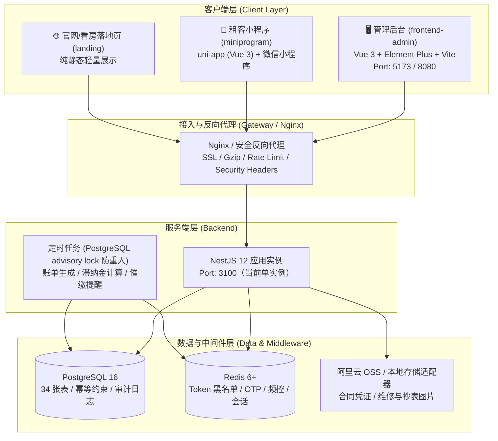

# 租客管理系统 (Tenant Management System)

> 企业级公寓与租客全生命周期数字化管理系统，涵盖多楼栋房源管理、电子合同、自动化账单、滞纳金核销、预付充值、水电读数计费、报修维保、清洁任务流转与退租结算。

---

## 🏗️ 架构概览

本系统采用现代前后端分离与移动端协同架构，共享状态下沉至 Redis，核心业务具备幂等性与字段级加密防护。当前部署形态为**单实例**（见 `docs/19-生产化路线图.md` DEC-07）；多实例与本地文件存储的无状态化在 OPS-06 完成前不作保证。



---

## 🧭 项目目录结构

```
tenant-system/
├── backend/                  # NestJS 12 + Prisma 5.22 + TypeScript 5.9 后端
│   ├── src/                  # 业务源码 (auth, rooms, tenants, contracts, bills, meters...)
│   ├── prisma/               # Prisma Schema (34 张表，以 schema 为准) 与数据库迁移
│   └── test/                 # 单元测试、集成测试与 e2e 测试 (Vitest)
├── frontend-admin/           # Vue 3.5 + Element Plus + Vite 8 管理后台
│   ├── src/                  # 视图、组件、Pinia Store、路由、OpenAPI 类型
│   └── e2e/                  # Playwright 关键业务流程端到端 UI 自动化测试
├── miniprogram/              # uni-app (Vue 3.4) 微信小程序租客端
│   ├── pages/                # 账单、报修、合同、个人中心、登录
│   └── api/                  # 按业务领域解耦的轻量 API 请求层
├── landing/                  # 官方看房与品牌落地页静态工件
├── docker/                   # 生产 Nginx 配置、反向代理与安全标头
├── docs/                     # 📚 架构设计、数据模型、API 规范与交接记录 (已编目于 docs/INDEX.md)
├── tasks/                    # 📋 任务开发书与执行记录 (T001 ~ T314，编号规划见 docs/19)
├── scripts/                  # 运维、测试基线、数据库灾备与文档门禁脚本
├── docker-compose.yml        # 本地基础服务开发环境 (PostgreSQL 16 + Redis 6)
├── docker-compose.prod.yml   # 生产一键编排配置 (后端、后台、数据库、Redis)
├── AGENTS.md                 # AI 与团队协作开发总规范
├── STATUS.md                 # 项目状态与指标跟踪看板
└── README.md                 # 项目主指南（本文档）
```

---

## ⚡ 15 分钟快速上手（本地三端启动）

### 1. 环境准备

- **Node.js**: `20.x` LTS（本地与 CI）；生产镜像自 T253 起为 `node:24-alpine`，统一版本由 OPS-08 处理
- **Docker & Docker Compose**: 运行中
- **包管理器**: `npm` (v10+)
- **微信开发者工具**（可选，调试小程序时需安装）

### 2. 启动基础服务（PostgreSQL + Redis）

在仓库根目录执行：

```bash
docker-compose up -d
```

默认端口与服务分配：
| 服务 | 容器内端口 | 宿主机端口 | 用户名 / 密码 / 库名 |
|------|-----------|-----------|--------------------|
| **PostgreSQL 16** | `5432` | `5432` (或环境变量映射 `5434`) | `postgres` / `postgres` / `tenant_system` |
| **Redis 6+** | `6379` | `6379` | 无密码（开发环境） |

### 3. 启动后端服务 (Backend)

```bash
cd backend

# 安装依赖
npm install

# 配置环境变量
cp .env.example .env

# 执行 Prisma 数据库迁移与数据种子
npx prisma migrate dev
npx prisma db seed

# 启动开发服务器（热更新模式）
npm run start:dev
```

- **后端主服务地址**: [http://localhost:3100](http://localhost:3100)
- **OpenAPI / Swagger 文档**: [http://localhost:3100/api/docs](http://localhost:3100/api/docs)
- **健康检查接口**: [http://localhost:3100/api/health](http://localhost:3100/api/health)
- **默认管理员凭据**:
  - 用户名：`admin@example.com`
  - 密码：`Admin@123`

### 4. 启动管理后台 (Frontend Admin)

新开终端窗口：

```bash
cd frontend-admin

# 安装依赖
npm install

# 启动开发服务器
npm run dev
```

- **管理后台访问地址**: [http://localhost:5173](http://localhost:5173)
- 登录后即可访问房源、租客、合同、账单、批量抄表、凭证核销与仪表板。

### 5. 启动租客小程序 (Miniprogram)

新开终端窗口：

```bash
cd miniprogram

# 安装依赖
npm ci

# 启动微信小程序构建监听
npm run dev:mp-weixin
```

- 打开 **微信开发者工具**，导入项目目录：`miniprogram/dist/dev/mp-weixin`。
- AppID 可填个人测试号；在微信开发者工具中勾选「不校验合法域名、web-view (业务域名)、TLS 版本以及 HTTPS 证书」即可直连 `http://localhost:3100/api`。

---

## 🛠️ 常用开发与测试命令

### 后端 (backend/)

```bash
# 运行全部单元测试 (Vitest)
npm test

# 运行覆盖率检查与门禁 (分支覆盖率 ≥80%，核心结算 ≥90%)
npm run test:cov

# 运行代码规范检查 (oxlint)
npm run lint

# 运行后端真实数据库端到端测试
npm run test:e2e

# 自动从 Swagger 导出 openapi.json
npm run openapi:export

# 执行 100 并发 k6 压力基线测试 (要求 P95 < 300ms, 错误率 < 0.1%)
npm run test:perf
```

### 管理后台 (frontend-admin/)

```bash
# TypeScript 类型检查 (严格模式)
npm run type-check

# 代码规范检查 (oxlint + ESLint)
npm run lint

# 组件单元测试
npm test

# 从后端 OpenAPI 规范自动重新生成前端 API 类型
npm run generate:api

# 执行 Playwright 端到端关键业务流程 UI 自动化测试
npm run test:e2e
```

### 小程序 (miniprogram/)

```bash
# 执行小程序自动化测试
npm test

# 生产环境编译打包
npm run build:mp-weixin
```

### 文档治理与一致性门禁 (根目录)

```bash
# 运行文档元信息与索引一致性检查（需要 glob：npm install -g glob）
node scripts/check-docs.js

# 执行所有 gate 并写出结构化证据（即使有 gate 失败也会写报告）
node scripts/collect-gates.mjs

# 由 gate 证据生成 STATUS.md（不重跑测试）
node scripts/generate-status.mjs --gates artifacts/gates.json

# CI 用：只比对 Gate/任务/模型数，不比较 branch、dirty 数等环境字段
node scripts/generate-status.mjs --gates artifacts/gates.json --check-gates

# 本机严格比对（byte-level，适合确认是否忘了重新生成）
node scripts/generate-status.mjs --check

# 检查任务书元信息与 strict 任务的 merge/handoff/INDEX 证据（--report 只报告不失败）
node scripts/task-check.mjs

# 只读审计 worktree（--check 有违规时 exit 1；不会删除或修改 worktree）
node scripts/worktree-audit.mjs --check
```

`STATUS.md` 现在是证据看板：任务是否完成由 merge commit、handoff 与 `docs/INDEX.md` 判定；`integration`、`security`、`manual-uat` 没有证据时一律显示 `not-run`，不会写成 pass。看板出现 `NO-GO` 时，先看 Gate 表与「阻擋發布」区块。

---

## 🚢 生产环境部署

系统提供开箱即用的多阶段无 root Docker 镜像与安全编排配置：

```bash
# 1. 准备生产环境变量
cp backend/.env.example backend/.env.production

# 2. 一键启动全栈生产容器（Postgres + Redis + Backend + Frontend-Admin Nginx）
docker-compose -f docker-compose.prod.yml up -d

# 3. 执行生产数据库迁移
docker-compose -f docker-compose.prod.yml run --rm backend-migration
```

- **后端容器**: 基于 Alpine Linux，体积 ≤ 250MB，使用普通用户 `node` 运行，内置 `/api/health` 存活探针。
- **前端后台容器**: 基于 Nginx Alpine，预配置安全响应头（X-Frame-Options、CSP、HSTS）、Gzip 静态压缩及 `/api` 反向代理。
- 更多灾难备份恢复演练与运维操作，详见 [部署与运维指南 (docs/12-部署与运维.md)](./docs/12-部署与运维.md)。

---

## 📚 开发规范与治理

- [AI 与工程师开发总规范 (AGENTS.md)](./AGENTS.md)：包含分支策略、Worktree 工作流、安全红线与提交规范。
- [全局文档唯一索引 (docs/INDEX.md)](./docs/INDEX.md)：所有设计与交接记录的唯一登记册。
- [项目进度跟踪 (STATUS.md)](./STATUS.md)：系统指标、测试覆盖率与开发进度实时看板。
- [架构设计与优化计划 (docs/13-架构与现有代码优化计划.md)](./docs/13-架构与现有代码优化计划.md)：OPT-01 ~ OPT-28 演进全记录。

---

## 📄 许可证

Private / Proprietary. All rights reserved.
