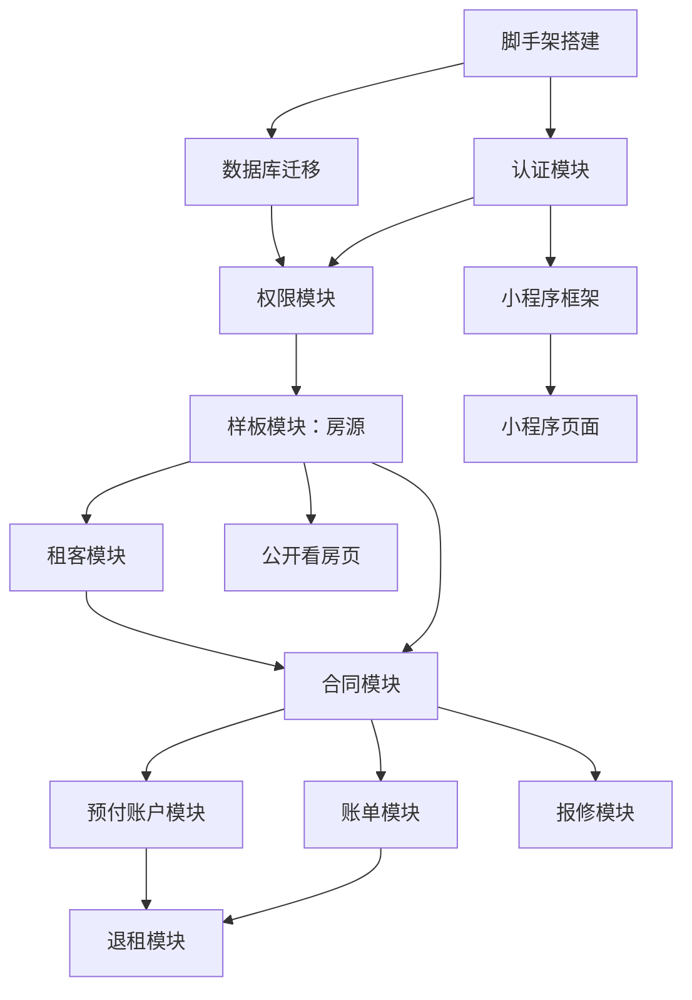

# 租客管理系统 - 项目计划书

> 版本: v0.1  
> 更新: 2026-10-11

---

## 1. 项目目标

### 1.1 核心目标
在 **1 个月内**（约 4 周）完成租客管理系统基本完整版（P0 功能），并投入真实试用。

### 1.2 业务价值
- **提升管理效率**：自动化账单生成、提醒、水电计费
- **减少人工错误**：系统化记录合同、账单、流水，避免遗漏和重复
- **改善租客体验**：租客可自助查看账单、报修、余额
- **数据可追溯**：审计日志记录所有操作，财务数据有据可查

### 1.3 成功标准
- ✅ 管理者可通过网页后台完成日常管理工作
- ✅ 至少 5 个租客通过小程序正常使用
- ✅ 系统稳定运行 2 周无重大故障
- ✅ 核心业务流程（签约→收租→报修→退租）走通

---

## 2. 项目范围

### 2.1 第一版功能范围（P0）

#### 必做功能（4 周内完成）

| 模块 | 功能 | 优先级 |
|------|------|--------|
| **认证与权限** | 邮箱注册/登录、邀请码绑定、JWT 鉴权 | P0 |
| **房源管理** | 房间 CRUD、房态管理、清洁状态 | P0 |
| **租客管理** | 租客档案 CRUD、标签管理 | P0 |
| **合同管理** | 合同 CRUD、续签、终止、附件上传 | P0 |
| **账单收租** | 账单生成、收租提醒、线下收款确认、滞纳金建议 | P0 |
| **预付账户** | 充值、自动扣费、余额查询、流水记录 | P0 |
| **水电读数** | 手动录入、读数历史、单价管理 | P0 |
| **报修工单** | 提交报修、状态流转、照片上传 | P0 |
| **退租结算** | 发起退租、生成结算单、确认退款 | P0 |
| **通知提醒** | 站内通知列表、未读标记 | P0 |
| **网页后台** | 管理者使用的完整后台界面 | P0 |
| **公开看房** | 访客无需登录查看空置房源 | P0 |

#### 尽量完成（时间允许）

| 模块 | 功能 | 优先级 |
|------|------|--------|
| **小程序** | 租客完整功能（查看合同、账单、报修、余额） | P1 |
| **保洁功能** | 保洁查看待清洁房间、标记已清洁 | P1 |
| **基础统计** | 出租率、收入、欠费、报修统计 | P1 |
| **标签系统** | 租客标签管理和筛选 | P1 |

### 2.2 明确不做的事（第二阶段）

| 功能 | 原因 | 预计时间 |
|------|------|----------|
| ❌ 智能水电表接入 | 需要硬件对接，第一版手动录入 | 第二阶段（上线后 2-4 周） |
| ❌ 在线支付 | 需要支付接口申请和测试 | 第二阶段 |
| ❌ 短信通知 | 需要短信签名审核（2-3 天） | 第二阶段 |
| ❌ 电子签章 | 非核心功能，纸质合同扫描件即可 | 第二阶段 |
| ❌ Android APP | 小程序已满足需求 | 第二阶段 |
| ❌ 水电对账 | 第一版数据量小，手动对账 | 第二阶段 |
| ❌ 导入现有资料 | 新租客从系统开始，旧租客手动补录 | 第二阶段 |
| ❌ 电子发票 | 非核心功能 | 第二阶段 |

---

## 3. 阶段划分与里程碑

### 3.1 阶段 0：准备与脚手架（第 1 周前 2 天）

**目标**：搭建项目基础设施，确保开发环境就绪

| 任务 | 产出 | 负责人 | 状态 |
|------|------|--------|------|
| 完成所有设计文档 | ADR、架构、数据模型、权限矩阵、状态机 | AI（Opus） | ✅ |
| 创建代码仓库 | GitHub / GitLab 仓库 | 负责人 | ⏳ |
| 初始化后端项目 | NestJS + Prisma 脚手架 | AI（Opus） | ⏳ |
| 配置 CI/CD | GitHub Actions 配置 | AI（Opus） | ⏳ |
| 搭建数据库 | PostgreSQL（本地 + 云端测试环境） | 负责人 | ⏳ |
| 初始化前端项目 | Vue3 后台 + uni-app 小程序脚手架 | AI（Opus） | ⏳ |

**完成标准**：
- ✅ 后端项目可启动，连接数据库成功
- ✅ 前端项目可启动，显示 Hello World
- ✅ CI 自动运行测试和类型检查
- ✅ Git 分支策略和提交规范文档完成

**风险**：
- 数据库云服务申请可能需要 1-2 天（提前准备）

---

### 3.2 阶段 1：核心骨架与样板模块（第 1 周）

**目标**：完成认证、权限、样板模块（房源），建立开发范式

| 任务 | 产出 | 建议模型 | 状态 |
|------|------|----------|------|
| 数据库迁移与种子数据 | Prisma schema + 迁移脚本 | Opus | ⏳ |
| 认证模块 | 邮箱注册/登录、JWT、邀请码验证 | Opus | ⏳ |
| 权限模块 | 角色 Guard、Building 隔离 | Opus | ⏳ |
| 审计日志模块 | 审计日志 Interceptor | Opus | ⏳ |
| 文件上传模块 | OSS 上传、签名 URL | Sonnet | ⏳ |
| **样板模块：房源** | 完整的 CRUD + 状态管理 + 测试 | Opus | ⏳ |
| 样板模块文档 | 给廉价模型的实现指南 | Opus | ⏳ |
| 后台框架搭建 | 布局、路由、登录页 | Sonnet | ⏳ |

**完成标准**：
- ✅ 管理者可登录后台
- ✅ 房源模块功能完整（CRUD + 房态管理 + 清洁状态）
- ✅ 单元测试覆盖率 >90%
- ✅ 样板模块文档清晰，廉价模型可照做

**风险**：
- 认证模块复杂度较高，可能需要 1.5-2 天

---

### 3.3 阶段 2：业务模块实现（第 2-3 周）

**目标**：完成所有核心业务模块（租客、合同、账单、预付、报修、退租）

#### 第 2 周任务

| 任务 | 产出 | 建议模型 | 状态 |
|------|------|----------|------|
| 租客模块 | 档案 CRUD、标签管理 | Sonnet | ⏳ |
| 合同模块 | 合同 CRUD、续签、终止 | Opus | ⏳ |
| 账单模块 | 生成、收款、滞纳金 | Opus | ⏳ |
| 预付账户模块 | 充值、扣费、流水 | Opus | ⏳ |
| 水电读数模块 | 录入、历史、单价管理 | Sonnet | ⏳ |
| 定时任务模块 | 账单生成、逾期检查、提醒 | Opus | ⏳ |
| 后台页面（租客/合同） | 列表、表单、详情页 | Haiku/廉价 | ⏳ |

#### 第 3 周任务

| 任务 | 产出 | 建议模型 | 状态 |
|------|------|----------|------|
| 报修模块 | 工单 CRUD、状态流转 | Sonnet | ⏳ |
| 退租模块 | 结算单生成、确认退款 | Opus | ⏳ |
| 通知模块 | 站内通知、渠道抽象 | Sonnet | ⏳ |
| 统计模块 | 出租率、收入、欠费统计 | Haiku/廉价 | ⏳ |
| 公开看房页 | 房源列表、详情（无需登录） | Haiku/廉价 | ⏳ |
| 后台页面（账单/报修/退租） | 列表、表单、详情页 | Haiku/廉价 | ⏳ |
| 集成测试 | 核心业务场景测试 | Opus | ⏳ |

**完成标准**：
- ✅ 所有 P0 后端接口实现完成
- ✅ 所有后台页面实现完成
- ✅ 集成测试覆盖率 >80%
- ✅ 核心业务流程手动测试通过

**风险**：
- 账单和预付账户逻辑复杂，可能需要额外 1-2 天
- 退租结算单计算逻辑需仔细测试

---

### 3.4 阶段 3：小程序与联调（第 4 周前半）

**目标**：完成小程序开发，前后端联调

| 任务 | 产出 | 建议模型 | 状态 |
|------|------|----------|------|
| 小程序框架搭建 | uni-app 项目、路由、布局 | Sonnet | ⏳ |
| 小程序页面（租客） | 首页、合同列表、账单列表 | Haiku/廉价 | ⏳ |
| 小程序页面（报修） | 报修列表、提交报修、工单详情 | Haiku/廉价 | ⏳ |
| 小程序页面（余额） | 预付账户、流水记录 | Haiku/廉价 | ⏳ |
| 前后端联调 | 接口对接、错误处理 | Opus | ⏳ |
| 保洁功能（小程序） | 待清洁列表、标记已清洁 | Haiku/廉价 | ⏳ |

**完成标准**：
- ✅ 租客可通过小程序查看合同、账单、报修
- ✅ 租客可提交报修工单
- ✅ 保洁可查看待清洁房间并标记完成
- ✅ 前后端数据交互正常，无明显 Bug

**风险**：
- uni-app 打包和调试可能遇到兼容性问题
- 微信小程序需要真实环境测试（需微信开发者工具）

---

### 3.5 阶段 4：测试、部署与试用（第 4 周后半）

**目标**：完成测试、部署，交付给真实用户试用

| 任务 | 产出 | 负责人 | 状态 |
|------|------|--------|------|
| 完整回归测试 | 测试报告 | AI + 人工 | ⏳ |
| 性能测试 | 压力测试报告 | AI | ⏳ |
| 安全测试 | 渗透测试报告 | AI + 人工 | ⏳ |
| 备份恢复演练 | 演练记录 | 负责人 | ⏳ |
| 部署到生产环境 | 生产环境可访问 | 负责人 | ⏳ |
| 编写用户手册 | 操作手册（管理者/租客） | AI | ⏳ |
| 数据补录（旧租客） | 补录现有租客和合同 | 负责人 | ⏳ |
| 试用用户培训 | 培训记录 | 负责人 | ⏳ |
| 小程序提审 | 微信小程序发布 | 负责人 | ⏳ |

**完成标准**：
- ✅ 所有测试通过，无阻断性 Bug
- ✅ 生产环境稳定运行
- ✅ 至少 5 个租客开始使用
- ✅ 小程序审核通过并发布

**风险**：
- 小程序审核可能需要 1-7 天（提前提审）
- 生产环境可能遇到配置问题

---

## 4. 每周目标

### 第 1 周目标
- ✅ 完成项目脚手架
- ✅ 完成认证、权限、审计、文件上传模块
- ✅ 完成样板模块（房源）并通过测试
- ✅ 完成后台框架搭建

**验收**：管理者可登录后台，管理房源

---

### 第 2 周目标
- ✅ 完成租客、合同、账单、预付账户、水电读数模块
- ✅ 完成对应后台页面
- ✅ 定时任务正常运行（账单生成、逾期检查）

**验收**：管理者可完成"签约→生成账单→收款"完整流程

---

### 第 3 周目标
- ✅ 完成报修、退租、通知、统计模块
- ✅ 完成对应后台页面
- ✅ 完成公开看房页
- ✅ 核心业务集成测试通过

**验收**：管理者可完成"报修处理"和"退租结算"流程

---

### 第 4 周目标
- ✅ 完成小程序所有页面
- ✅ 前后端联调完成
- ✅ 完成测试和部署
- ✅ 投入试用

**验收**：至少 5 个租客通过小程序正常使用

---

## 5. 风险清单与对策

### 5.1 技术风险

| 风险 | 概率 | 影响 | 对策 |
|------|------|------|------|
| **数据库迁移失败** | 中 | 高 | 提前在测试环境验证迁移脚本；使用 Prisma 自动迁移 |
| **认证模块复杂** | 中 | 高 | 使用成熟的 @nestjs/passport 库；邀请码机制单独测试 |
| **账单计算错误** | 中 | 高 | 编写详细的单元测试；人工验证计算结果 |
| **预付账户余额不一致** | 中 | 高 | 使用流水汇总计算余额；禁止直接修改余额字段 |
| **状态机死锁** | 低 | 中 | 状态流转表清晰定义；所有非法转换抛出异常 |
| **性能不达标** | 低 | 中 | 添加数据库索引；Redis 缓存热点数据 |
| **前端兼容性问题** | 中 | 中 | 使用 uni-app 官方组件；在多设备测试 |

### 5.2 外部依赖风险

| 风险 | 概率 | 影响 | 对策 |
|------|------|------|------|
| **小程序审核不通过** | 中 | 高 | 提前准备隐私政策和用户协议；避免敏感词汇；提前 3-5 天提审 |
| **小程序审核时间长** | 高 | 中 | 提前提审；准备好所有资质材料；联系微信客服加急 |
| **云服务申请延迟** | 低 | 中 | 提前申请阿里云账号和资源；本地开发优先使用 Docker |
| **对象存储配置问题** | 低 | 低 | 使用阿里云 OSS SDK；提前测试上传和签名 URL |
| **邮件服务不稳定** | 低 | 低 | 使用阿里云或腾讯云企业邮箱；备用方案：换服务商 |

### 5.3 时间风险

| 风险 | 概率 | 影响 | 对策 |
|------|------|------|------|
| **功能范围蔓延** | 高 | 高 | 严格遵守 P0/P1 划分；砍 P1 功能保 P0 |
| **AI 生成代码质量低** | 中 | 中 | 强模型做核心，廉价模型做页面；人工 Code Review |
| **测试时间不足** | 中 | 高 | 开发阶段同步编写测试；最后一周专注测试 |
| **部署遇到问题** | 中 | 中 | 提前搭建预发布环境；测试部署流程 |
| **用户培训耗时** | 低 | 低 | 提前准备操作手册和视频教程 |

### 5.4 业务风险

| 风险 | 概率 | 影响 | 对策 |
|------|------|------|------|
| **需求理解偏差** | 中 | 高 | 每周与房东确认进度；核心功能演示后再继续 |
| **租客不愿使用** | 低 | 中 | 强制绑定邀请码；管理者引导使用 |
| **现有数据补录困难** | 中 | 低 | 优先服务新租客；旧租客逐步补录 |

---

## 6. 任务拆分原则

### 6.1 拆分粒度

| 任务类型 | 时间估算 | 文件数量 | 建议模型 |
|----------|----------|----------|----------|
| **核心架构** | 1-2 天 | 10-20 个文件 | Opus（强模型） |
| **核心业务模块** | 4-8 小时 | 5-10 个文件 | Opus / Sonnet |
| **普通业务模块** | 2-4 小时 | 3-5 个文件 | Sonnet（中等模型） |
| **页面开发** | 1-2 小时 | 1-3 个文件 | Haiku / 廉价模型 |
| **单元测试** | 1-2 小时 | 1-2 个文件 | Sonnet |

### 6.2 依赖关系



### 6.3 并行任务

可并行执行的任务（不同模型同时做，但不得改同一文件）：

**第 2 周并行**：
- 租客模块（Sonnet）+ 后台租客页面（Haiku）
- 合同模块（Opus）+ 后台合同页面（Haiku）

**第 3 周并行**：
- 报修模块（Sonnet）+ 后台报修页面（Haiku）
- 退租模块（Opus）+ 统计模块（Haiku）

---

## 7. 模型分工策略

### 7.1 强模型（Opus）职责

- ✅ 架构设计和核心基础设施
- ✅ 认证、权限、审计模块
- ✅ 样板模块设计和实现
- ✅ 复杂业务逻辑（账单计费、预付账户、退租结算）
- ✅ 状态机实现
- ✅ 核心业务测试

**估算工作量**：约 40% 的开发工作

---

### 7.2 中等模型（Sonnet）职责

- ✅ 普通业务模块（租客、水电读数、报修、通知）
- ✅ 定时任务调度
- ✅ 文件上传模块
- ✅ 单元测试编写

**估算工作量**：约 30% 的开发工作

---

### 7.3 廉价模型（Haiku）职责

- ✅ 后台 UI 页面（按样板实现）
- ✅ 小程序 UI 页面
- ✅ 公开看房页
- ✅ 简单统计模块
- ✅ DTO 和实体类生成

**估算工作量**：约 30% 的开发工作

---

## 8. 人工验收节点

| 阶段 | 验收内容 | 验收人 | 标准 |
|------|----------|--------|------|
| **阶段 1** | 样板模块演示 | 负责人 | 房源 CRUD 正常，状态流转正确 |
| **阶段 2** | 核心业务流程演示 | 负责人 + 房东 | 签约→生成账单→收款→报修→退租流程走通 |
| **阶段 3** | 小程序试用 | 负责人 + 2-3 个测试租客 | 租客可查看合同、账单、提交报修 |
| **阶段 4** | 上线前总验收 | 负责人 + 房东 | 所有 P0 功能正常，无阻断性 Bug |

---

## 9. 进度追踪机制

### 9.1 每日检查点

- 📝 更新 STATUS.md（完成的任务、阻塞问题、下一步）
- 🧪 运行自动化测试（单元测试 + 集成测试）
- 🔍 Code Review（人工检查 AI 生成的核心代码）

### 9.2 每周里程碑

- 🎯 周五下午：演示本周完成的功能
- 📊 输出本周进度报告（完成率、风险、下周计划）
- 🚨 识别阻塞问题，调整下周计划

### 9.3 状态报告模板

```markdown
# 项目状态报告 - Week X

## 本周完成
- [x] 任务 1
- [x] 任务 2
- [ ] 任务 3（未完成，原因：XXX）

## 本周风险
- 🔴 高风险：XXX（影响上线）
- 🟡 中风险：XXX（需关注）

## 下周计划
- [ ] 任务 A
- [ ] 任务 B

## 需要决策的问题
1. 问题 1：XXX，建议方案 A / B
```

---

## 10. 调整策略

### 10.1 进度落后时的应对

**第 2 周末评估**：
- ✅ 进度正常：继续按计划执行
- ⚠️ 落后 < 20%：加班追赶，砍部分 P1 功能
- 🔴 落后 > 20%：立即调整，砍所有 P1 功能，专注 P0

**可砍的 P1 功能（按优先级）**：
1. 基础统计（留到第二阶段）
2. 保洁功能（管理者代为操作）
3. 标签系统（手动筛选）
4. 小程序完整功能（先上线后台，小程序延后）

### 10.2 保底目标（最小可用版本）

如果时间严重不足，保底完成：

- ✅ 网页后台（管理者使用）
- ✅ 房源、租客、合同、账单、收款
- ✅ 手动录入水电读数和扣费
- ❌ 报修工单（微信沟通）
- ❌ 退租结算（手动计算）
- ❌ 小程序（延后上线）

**保底目标时间**：3 周

---

## 11. 成本估算

### 11.1 开发成本

| 项目 | 说明 | 费用 |
|------|------|------|
| **AI 模型调用** | Opus + Sonnet + Haiku（1个月） | 约 ¥500-1000 |
| **开发工具** | GitHub Copilot / Cursor | 约 ¥100-200/月 |

**开发总成本**：约 ¥600-1200

### 11.2 基础设施成本

| 项目 | 规格 | 费用 |
|------|------|------|
| **云服务器** | 2核4G（阿里云 ECS） | ¥300/月 |
| **数据库** | PostgreSQL（2核4G RDS） | ¥400/月 |
| **Redis** | 1核2G | ¥100/月 |
| **对象存储** | OSS 50GB | ¥50/月 |
| **域名+SSL** | .com 域名 + Let's Encrypt 免费证书 | ¥50/年 |

**基础设施总成本**：约 ¥850/月

### 11.3 其他成本

| 项目 | 说明 | 费用 |
|------|------|------|
| **小程序认证** | 微信小程序企业认证 | ¥300/年 |
| **短信服务** | 阿里云短信（第二阶段） | 按量计费，约 ¥0.05/条 |
| **ICP 备案** | 域名备案（如需要） | 免费，时间成本 10-20 天 |

**第一个月总成本**：约 ¥2000-2500

---

## 12. 项目成功的关键因素

### 12.1 技术层面
- ✅ 架构设计清晰，模块边界明确
- ✅ 样板模块质量高，廉价模型可复制
- ✅ 自动化测试覆盖核心业务逻辑
- ✅ 数据库设计合理，预留扩展点

### 12.2 管理层面
- ✅ 严格控制范围，不做 P0 之外的功能
- ✅ 每周验收，及时调整计划
- ✅ 风险前置处理（提前申请资源、提前提审）
- ✅ 人工验收关键节点（不完全依赖 AI）

### 12.3 协作层面
- ✅ 强模型做核心，廉价模型做页面
- ✅ 明确的任务拆分和依赖关系
- ✅ 充分的文档和规范（AGENTS.md）
- ✅ 快速的反馈循环（每日检查、每周演示）

---

## 13. 下一步行动

| 序号 | 行动 | 负责人 | 截止时间 |
|------|------|--------|----------|
| 1 | 创建 GitHub 仓库并初始化 | 负责人 | 今天 |
| 2 | 申请阿里云账号和资源 | 负责人 | 2天内 |
| 3 | 生成项目脚手架（后端 + 前端） | AI | 2天内 |
| 4 | 编写 AGENTS.md 和 STATUS.md | AI | 2天内 |
| 5 | 完成样板模块（房源） | AI | 第1周结束 |
| 6 | 第一次演示（样板模块） | 负责人 + AI | 第1周周五 |

---

**下一步**: 查看 [AGENTS.md 总规则](../AGENTS.md) 和 [任务拆分清单](./08-任务拆分总览.md)
