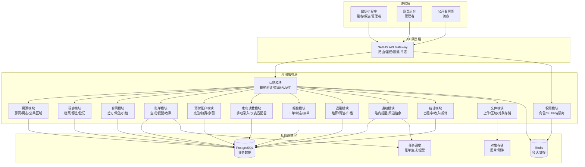
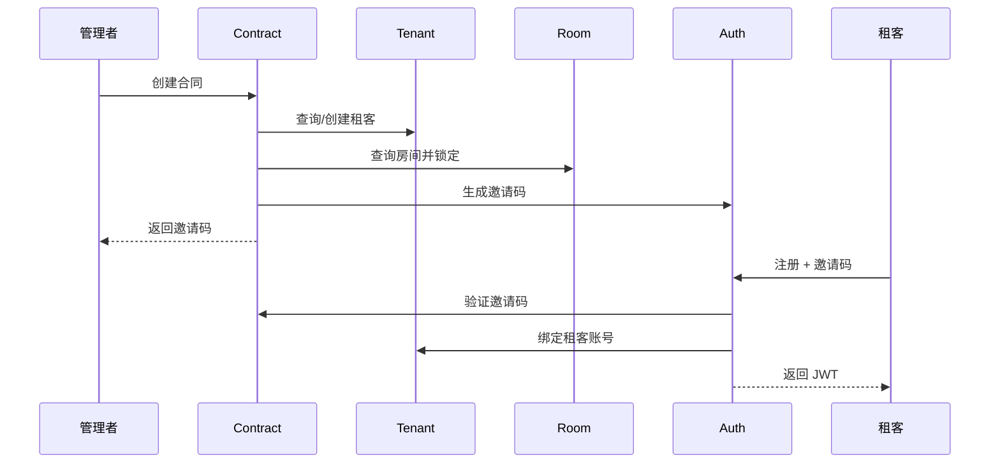
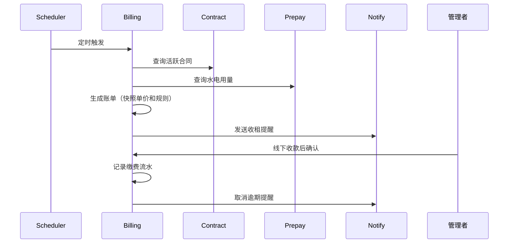
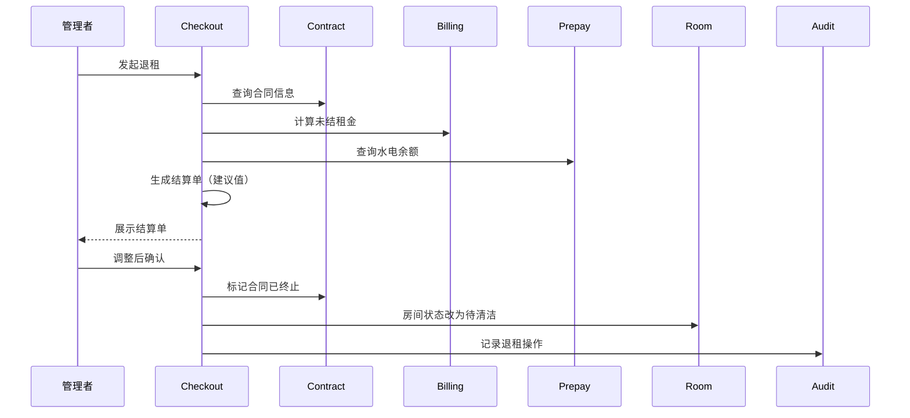
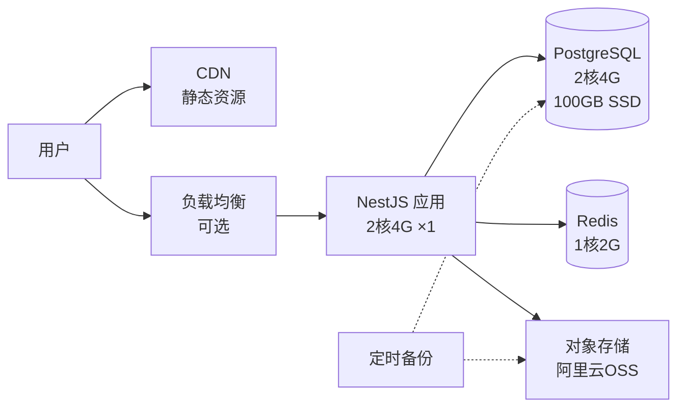
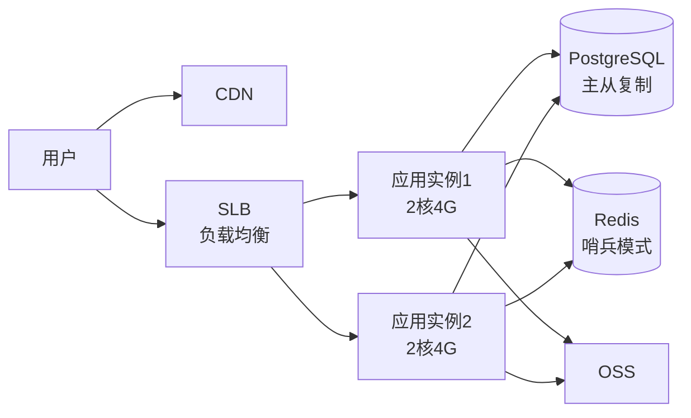
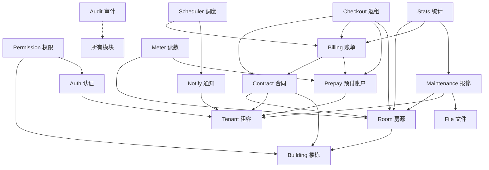

# 租客管理系统 - 架构设计

> 版本: v0.1  
> 更新: 2026-10-11

---

## 1. 总体架构

### 1.1 架构图



### 1.2 架构风格
- **单体模块化架构**：所有模块在单一 NestJS 应用内，通过 Module 边界隔离
- **领域驱动分层**：每个模块内部分层为 Controller → Service → Repository
- **水平扩展预留**：无状态设计（会话存 Redis），支持多实例部署
- **异步解耦预留**：关键业务节点预留事件发布点（Event Emitter），第二阶段可改为消息队列

---

## 2. 模块边界与职责

### 2.1 核心业务模块

| 模块 | 职责 | 边界 | 依赖 |
|------|------|------|------|
| **房源模块 (Room)** | 楼层、房间、公共区域、房态管理 | 不包含租客信息和合同 | Building |
| **租客模块 (Tenant)** | 租客档案、标签、可选登记信息 | 不包含合同和账单 | - |
| **合同模块 (Contract)** | 合同签订、续签、归档、附件 | 不包含账单生成逻辑 | Room, Tenant, Building |
| **账单模块 (Billing)** | 账单生成（快照）、收租提醒、滞纳金建议 | 不包含支付接口 | Contract, Prepay |
| **预付账户模块 (Prepay)** | 充值、扣费流水、余额查询、低余额提醒 | 不直接修改余额字段 | Tenant, Meter |
| **水电读数模块 (Meter)** | 手动录入、仪表适配器接口、读数历史 | 不包含计费逻辑 | Room, Prepay |
| **报修模块 (Maintenance)** | 工单创建、状态流转、派单、照片上传 | 不包含费用结算 | Room, Tenant, File |
| **退租模块 (Checkout)** | 退租流程、结算单生成（建议值）、清洁流转 | 调用其他模块的查询接口 | Contract, Billing, Prepay, Room |
| **通知模块 (Notify)** | 站内提醒、渠道抽象（邮件/短信/推送） | 不包含业务逻辑触发 | Tenant |
| **统计模块 (Stats)** | 出租率、收入、欠费、报修统计 | 只读查询，不修改业务数据 | 所有业务模块 |
| **文件模块 (File)** | 上传、压缩、缩略图、对象存储接口 | 不关心业务语义 | - |

### 2.2 基础设施模块

| 模块 | 职责 | 依赖 |
|------|------|------|
| **认证模块 (Auth)** | 邮箱验证、邀请码绑定、JWT 签发/验证、可插拔认证策略 | Tenant |
| **权限模块 (Permission)** | 角色判断、Building 隔离、资源访问控制 | Building, Auth |
| **任务调度模块 (Scheduler)** | 定时生成账单、提醒检查、数据归档 | Billing, Notify |
| **审计日志模块 (Audit)** | 所有写操作的日志记录（谁/何时/改了什么） | - |

---

## 3. 分层规范

### 3.1 单个模块的标准结构（以房源模块为例）

```
src/modules/rooms/
├── dto/                    # 数据传输对象
│   ├── create-room.dto.ts
│   ├── update-room.dto.ts
│   └── room-query.dto.ts
├── entities/               # Prisma 实体类型导出
│   └── room.entity.ts
├── rooms.controller.ts     # 路由和请求处理
├── rooms.service.ts        # 业务逻辑
├── rooms.repository.ts     # 数据访问（Prisma 封装）
├── rooms.module.ts         # 模块定义
└── tests/
    ├── rooms.service.spec.ts
    └── rooms.e2e.spec.ts
```

### 3.2 依赖规则（严格单向）

```
Controller → Service → Repository → Prisma
    ↓           ↓
   DTO        Entity
```

**禁止**：
- Repository 调用 Service
- Controller 直接访问 Repository
- Service 之间循环依赖（通过事件解耦）

### 3.3 跨模块调用

**允许**：Service 注入其他模块的 Service（通过 `@Module.imports`）

**示例**：退租模块调用账单模块
```typescript
// checkout.service.ts
@Injectable()
export class CheckoutService {
  constructor(
    private readonly billingService: BillingService,  // ✅ 允许
    private readonly prepayService: PrepayService,
  ) {}
}
```

**禁止**：直接访问其他模块的 Repository

---

## 4. 数据流规范

### 4.1 关键业务流程数据流

#### 流程1：租客入住


#### 流程2：账单生成与收租


#### 流程3：退租结算


### 4.2 数据一致性保证

| 场景 | 策略 |
|------|------|
| **账单生成** | 事务内完成快照保存和状态更新 |
| **预付账户扣费** | 流水表插入 + 余额触发器/计算字段 |
| **退租结算** | 两阶段：草稿状态 → 确认后事务提交 |
| **报修工单** | 状态机严格控制流转（见状态机文档） |
| **房态变更** | 乐观锁（version 字段）防止并发冲突 |

---

## 5. 扩展点设计

### 5.1 仪表适配器接口

**目标**：第二阶段接入智能水电表，不修改计费核心逻辑

```typescript
// src/modules/meters/adapters/meter-adapter.interface.ts
export interface MeterReading {
  meterId: string;
  value: number;
  timestamp: Date;
  source: 'manual' | 'device';
}

export interface IMeterAdapter {
  fetchReading(meterId: string): Promise<MeterReading>;
  subscribeLiveData?(meterId: string, callback: (reading: MeterReading) => void): void;
}
```

**第一版实现**：
```typescript
export class ManualMeterAdapter implements IMeterAdapter {
  async fetchReading(meterId: string): Promise<MeterReading> {
    // 从数据库读取最新手动录入的读数
    return this.prisma.meterReading.findFirst({
      where: { meterId, source: 'manual' },
      orderBy: { timestamp: 'desc' },
    });
  }
}
```

**第二阶段实现**（智能表）：
```typescript
export class SmartMeterAdapter implements IMeterAdapter {
  async fetchReading(meterId: string): Promise<MeterReading> {
    // 调用智能表厂商 API
    const data = await this.httpClient.get(`${API_URL}/${meterId}`);
    return {
      meterId,
      value: data.currentValue,
      timestamp: new Date(data.timestamp),
      source: 'device',
    };
  }
}
```

**注入点**：
```typescript
@Module({
  providers: [
    {
      provide: 'METER_ADAPTER',
      useClass: process.env.METER_MODE === 'smart' 
        ? SmartMeterAdapter 
        : ManualMeterAdapter,
    },
  ],
})
export class MetersModule {}
```

---

### 5.2 通知渠道抽象

**目标**：第二阶段增加短信、推送，不修改业务代码

```typescript
// src/modules/notify/channels/channel.interface.ts
export interface INotificationChannel {
  send(recipient: string, message: NotificationMessage): Promise<void>;
}

export interface NotificationMessage {
  title: string;
  body: string;
  priority: 'normal' | 'urgent';
  data?: Record<string, any>;
}
```

**第一版实现**（站内通知）：
```typescript
export class InAppChannel implements INotificationChannel {
  async send(userId: string, message: NotificationMessage) {
    await this.prisma.notification.create({
      data: {
        userId,
        title: message.title,
        body: message.body,
        priority: message.priority,
        isRead: false,
      },
    });
  }
}
```

**第二阶段实现**（短信）：
```typescript
export class SmsChannel implements INotificationChannel {
  async send(phone: string, message: NotificationMessage) {
    await this.smsService.sendSms({
      phone,
      template: message.data?.templateId,
      params: { content: message.body },
    });
  }
}
```

**业务代码调用**（保持不变）：
```typescript
// billing.service.ts
async sendRentReminder(tenantId: string) {
  await this.notifyService.send(tenantId, {
    title: '收租提醒',
    body: '您的租金将于3天后到期',
    priority: 'normal',
    channels: ['in-app', 'sms'],  // 支持多渠道
  });
}
```

---

### 5.3 水电对账预留

**数据模型预留**：
```prisma
// 供电/供水公司账单（第二阶段）
model UtilityBill {
  id          String   @id @default(cuid())
  buildingId  String
  building    Building @relation(...)
  type        UtilityType  // ELECTRICITY / WATER
  period      String       // "2024-10"
  totalAmount Decimal      // 供电公司账单总额
  totalUsage  Decimal      // 总用量
  billDate    DateTime
  paidAt      DateTime?
  
  createdAt   DateTime @default(now())
}

// 对账记录
model ReconciliationRecord {
  id              String   @id @default(cuid())
  buildingId      String
  utilityBillId   String   // 关联供电公司账单
  period          String
  
  // 统计值
  sumOfMeterReadings Decimal  // 所有分表读数之和
  lossRate           Decimal  // 损耗率 = (供电总量 - 分表总量) / 供电总量
  revenueDiff        Decimal  // 收入差额 = 向租客收费总额 - 供电公司账单
  
  status      ReconciliationStatus  // PENDING / BALANCED / LOSS_EXCEED
  notes       String?
  createdAt   DateTime @default(now())
}
```

**接口预留**：
```typescript
// src/modules/meters/meters.service.ts
export class MetersService {
  // 第二阶段实现
  async reconcileUtilityBill(buildingId: string, period: string) {
    // 1. 查询供电公司账单
    // 2. 查询所有分表读数
    // 3. 计算损耗率和收支差额
    // 4. 生成对账记录
  }
}
```

---

### 5.4 支付接口预留

```typescript
// src/modules/billing/payment/payment.interface.ts
export interface IPaymentProvider {
  createOrder(params: CreateOrderParams): Promise<PaymentOrder>;
  queryOrder(orderId: string): Promise<PaymentStatus>;
  refund(orderId: string, amount: number): Promise<RefundResult>;
}

// 第一版实现（线下收款）
export class OfflinePaymentProvider implements IPaymentProvider {
  async createOrder(params: CreateOrderParams) {
    // 仅生成订单记录，不调用外部接口
    return { orderId: uuid(), status: 'pending', qrCode: null };
  }
}

// 第二阶段实现（微信支付）
export class WechatPaymentProvider implements IPaymentProvider {
  async createOrder(params: CreateOrderParams) {
    const result = await this.wechatApi.createOrder({
      amount: params.amount,
      description: params.description,
    });
    return { orderId: result.orderId, status: 'pending', qrCode: result.qrCode };
  }
}
```

---

## 6. 部署方案

### 6.1 第一版最小部署架构（适合100并发）



**资源配置**：
- **应用服务器**：2核4G（阿里云ECS/腾讯云CVM），单实例足够
- **数据库**：PostgreSQL 14+，2核4G，100GB SSD，开启自动备份
- **缓存**：Redis 6+，1核2G（主要存储会话，数据量小）
- **对象存储**：OSS 标准存储，初期 50GB 足够
- **带宽**：5Mbps 出口带宽

**成本估算**（按阿里云）：
- ECS：约 ¥300/月
- RDS PostgreSQL：约 ¥400/月
- Redis：约 ¥100/月
- OSS：约 ¥50/月（50GB存储 + 少量流量）
- **总计**：约 ¥850/月

---

### 6.2 扩展方案（第二阶段或并发增长）



**触发条件**：
- CPU 持续超过 70%
- 响应时间 P95 超过 500ms
- 并发连接数超过 500

**扩展步骤**：
1. 增加应用实例（无状态，直接扩容）
2. 数据库主从读写分离（读多写少场景）
3. Redis 哨兵模式（高可用）

---

### 6.3 监控与告警

**监控指标**：
| 类型 | 指标 | 阈值 | 动作 |
|------|------|------|------|
| **应用** | CPU 使用率 | >80% 持续5分钟 | 告警 + 扩容评估 |
| **应用** | 内存使用率 | >85% | 告警 + 内存泄漏排查 |
| **应用** | 接口错误率 | >1% | 告警 |
| **应用** | 接口响应时间(P95) | >500ms | 性能分析 |
| **数据库** | 连接数 | >80% 最大连接数 | 告警 + 连接池调优 |
| **数据库** | 慢查询 | >1秒 | 记录日志 + 索引优化 |
| **数据库** | 磁盘使用率 | >80% | 告警 + 扩容 |
| **Redis** | 内存使用率 | >80% | 告警 + 清理过期数据 |
| **对象存储** | 存储空间 | >80% 配额 | 告警 + 扩容 |

**告警渠道**：
- 第一版：邮件告警（阿里云/腾讯云自带）
- 第二阶段：接入钉钉/企业微信机器人

**日志方案**：
- 应用日志：按日期分割，保留 30 天
- 审计日志：永久保留（定期归档到 OSS）
- 访问日志：保留 7 天（用于故障排查）

---

### 6.4 备份策略

| 数据类型 | 备份频率 | 保留周期 | 恢复目标 |
|----------|----------|----------|----------|
| **数据库** | 每日全量 + 实时增量 | 30天 | RTO: 1小时, RPO: 5分钟 |
| **对象存储** | 版本控制（自动） | 永久 | 立即恢复 |
| **配置文件** | Git 版本管理 | 永久 | 立即恢复 |
| **审计日志** | 每月归档到 OSS | 永久 | 按需恢复 |

**上线前验收**：必须完成一次完整的备份恢复演练（见测试策略文档）

---

## 7. 安全设计

### 7.1 认证与鉴权
- **JWT 有效期**：7天（access token），30天（refresh token）
- **密码策略**：bcrypt 加密，salt rounds = 10
- **邀请码**：UUID v4，一次性使用，48小时过期
- **会话管理**：Redis 存储，支持主动踢出

### 7.2 数据安全
- **敏感字段加密**：证件号使用 AES-256-GCM 加密存储
- **列表接口脱敏**：默认不返回手机号、邮箱、证件信息
- **详情接口权限**：必须是本人或管理者才能查看完整信息
- **审计日志**：所有写操作记录操作人、时间、IP、修改内容

### 7.3 接口安全
- **幂等性**：收款、退款接口使用幂等键（idempotency key）
- **限流**：公开接口 100次/分钟/IP，认证接口 1000次/分钟/用户
- **输入验证**：所有 DTO 使用 class-validator 严格验证
- **SQL 注入防护**：Prisma 自动参数化查询
- **XSS 防护**：前端框架自动转义，后端额外校验

### 7.4 文件上传安全
- **文件类型白名单**：只允许 JPG/PNG/WebP/PDF
- **大小限制**：图片 10MB，附件 20MB
- **病毒扫描**：第二阶段集成（第一版做文件类型和魔数校验）
- **访问控制**：OSS 私有桶，通过签名 URL 访问（1小时有效期）

---

## 8. 性能优化策略

### 8.1 数据库优化
- **索引策略**：所有外键、查询条件字段、排序字段建索引
- **慢查询监控**：>1秒的查询记录日志并告警
- **连接池**：最大连接数 20（单实例场景）
- **读写分离**：第二阶段实施

### 8.2 缓存策略
| 数据类型 | 缓存位置 | TTL | 失效策略 |
|----------|----------|-----|----------|
| **用户会话** | Redis | 7天 | 主动登出时删除 |
| **房源列表** | Redis | 5分钟 | 房源变更时删除 |
| **公开房源** | CDN | 1小时 | 主动刷新 |
| **统计数据** | Redis | 10分钟 | 按需刷新 |

### 8.3 前端优化
- **图片 CDN**：所有静态资源通过 CDN 分发
- **懒加载**：列表图片懒加载，缩略图优先
- **分页**：默认每页 20 条，最大 100 条
- **前端缓存**：静态资源强缓存 1 年（文件名哈希）

---

## 9. 技术债务与约束

### 9.1 第一版已知限制
| 限制 | 影响 | 解决时间 |
|------|------|----------|
| 无智能水电表 | 手动录入效率低 | 第二阶段 |
| 无在线支付 | 收款需线下确认 | 第二阶段 |
| 无短信通知 | 依赖租客主动查看 | 第二阶段 |
| 单楼栋硬编码 | 无法管理多栋楼 | 第二阶段 |
| 无电子签章 | 合同只能上传扫描件 | 第二阶段 |

### 9.2 不做的事（明确排除）
- ❌ 不做微服务拆分（过度设计，维护成本高）
- ❌ 不做 GraphQL（REST 已满足需求）
- ❌ 不做前端 SSR（SEO 需求低，公开页面静态化即可）
- ❌ 不做实时聊天（报修通过工单系统，无需即时通讯）
- ❌ 不做多语言（目标用户仅中国内地）

---

## 10. 验收标准

### 10.1 架构验收
- [ ] 所有模块遵循 Controller → Service → Repository 三层结构
- [ ] 模块间无循环依赖（通过 madge 工具检测）
- [ ] 所有扩展点有接口定义和第一版实现
- [ ] 单元测试覆盖率 >70%（核心模块 >90%）

### 10.2 性能验收
- [ ] 接口响应时间 P95 < 300ms（100 并发场景）
- [ ] 数据库查询 P95 < 100ms
- [ ] 图片上传并压缩 < 3秒（5MB 图片）

### 10.3 安全验收
- [ ] 通过 OWASP Top 10 自查清单
- [ ] 通过依赖漏洞扫描（npm audit）
- [ ] 完成备份恢复演练
- [ ] 所有敏感操作有审计日志

---

## 附录：模块依赖图



---

**下一步**: 查看 [数据模型设计](./02-数据模型.md)
