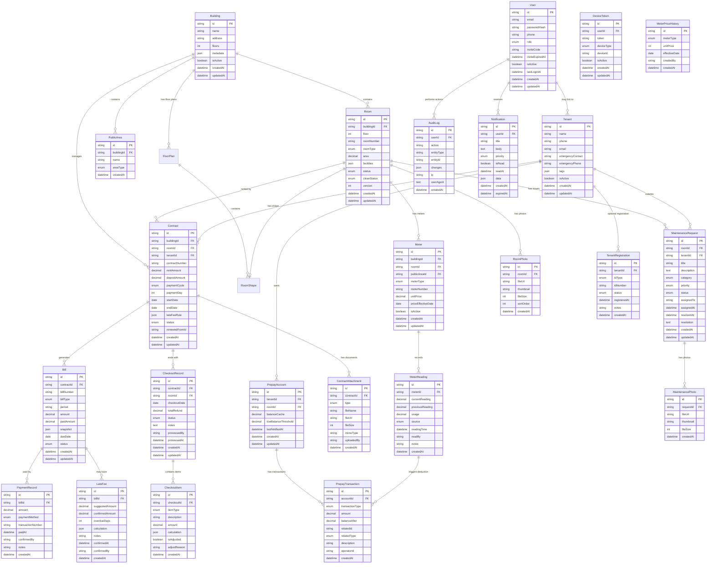

# 租客管理系统 - 数据模型设计

> 版本: v0.5  
> 最后更新: 2026-10-17

**变更历史**：
- 2026-10-11: 初始版本（当时表数标注有误，实际清单为 24 张）
- 2026-10-13（T159）: 新增 `FileAsset`（文件归属）表，表数 24 -> 25；用于 `GET /files/:key` 的下载授权
- 2026-10-13: 对齐 `backend/prisma/schema.prisma`：表数更正为 24（命令口径 `grep -c '^model ' backend/prisma/schema.prisma`）；ER 图补齐 RoomPhoto/MeterPriceHistory/ContractAttachment/MaintenancePhoto；滞纳金 `cap` 示例单位统一为「分」；补充 §2.24 MeterPriceHistory（T150）
- 2026-10-15（T173）: 新增 `UserCapabilityOverride`（租客账号能力覆写）表与 `CapabilityEffect` 枚举，表数 25 -> 26；支持管理员单独禁用登入与覆写租客功能能力
- 2026-10-16（T183）: 新增 `JobRun`（定时任务执行记录）表，以及 `JobRunStatus`、`JobTrigger` 枚举
- 2026-10-16（T191）: 新增 `InviteCode`（独立邀请码）表与 `InviteCodeStatus` 枚举，从 User 表解耦邀请码，支持批量生成与单码核销生命周期追踪；表数增至 28 张
- 2026-10-21（T230）: `RoomPhoto` 从预留转为启用：房源新增/编辑支持上传、排序、删除照片，最多 20 张，首张为封面
- 2026-10-17（T201）: OPT-28 数据模型与实际 Prisma schema 严密对齐收口，明确 28 张表清单（18 P0 + 2 P1 + 4 预留 + 4 安全运维治理）
- 2026-10-21（T221）: 新增 `FloorPlan`（楼层平面图）与 `RoomShape`（房间形状），支持 AUTO/AUTHORED 空间模型；表数 32 -> 34
- 2026-10-24（T260）: 新增 `UserIdentity`（外部身份绑定）与 `IdentityProvider` 枚举，`User` 增加 `emailVerifiedAt`；表数 34 -> 35

---

## 0. 数据表优先级分类

| 优先级 | 说明 | 数量 |
|--------|------|------|
| **P0** | 第一版必须实现 | 18张 |
| **P1** | 第一版尽量实现 | 2张 |
| **预留** | 第二阶段实现，第一版只建表结构 | 4张 |
| **安全、治理与运维控制** | 文件鉴权、能力覆写、任务锁与邀请码 | 8张 |
| **空间模型** | 楼层平面图与房间形状（T221） | 2张 |

> 统计口径：以 `grep -c '^model ' backend/prisma/schema.prisma` 为准，实际为 **35 张表**（18 + 2 + 4 + 8 + 2 + 1 = 35），与本文件下列清单逐一对应。
> 2026-10-18（T215）：新增 `Tag`（租客标签字典）与 `TenantTag`（租客-标签关联），对应 docs/00 §2.1 P0「标签管理」；原 `Tenant.tags` JSON 列在迁移中回填后删除。
> 2026-10-18（T217）：新增 `PublicUtilityBill`（公共水电费用单据）与 `PublicUtilityAllocation`（分摊明细），对应 docs/09 §7 的分摊规则落地。

### P0 表（第一版必须实现）
1. Building（楼栋）
2. Room（房间）
3. PublicArea（公共区域）
4. Tenant（租客）
5. User（用户账号）
6. Contract（合同）
7. ContractAttachment（合同附件）
8. Bill（账单）
9. PaymentRecord（收款记录）
10. LateFee（滞纳金）
11. PrepayAccount（预付账户）
12. PrepayTransaction（预付流水）
13. Meter（水电表）
14. MeterReading（读数记录）
15. MaintenanceRequest（报修工单）
16. MaintenancePhoto（报修照片）
17. CheckoutRecord（退租记录）
18. CheckoutItem（退租明细）

### P1 表（第一版尽量实现）
19. Notification（通知）
20. AuditLog（审计日志）

### 预留表（第二阶段）
21. TenantRegistration（租客登记，第一版默认关闭）
22. DeviceToken（设备令牌，第二阶段推送功能）
23. RoomPhoto（房源照片，第二阶段）
24. MeterPriceHistory（单价历史，第一版简化为单价字段）

### 安全、治理与运维控制表
25. FileAsset（上传文件归属，T159 安全修复引入）
26. UserCapabilityOverride（租客功能能力覆写，T173 引入）
27. JobRun（定时任务执行记录，T183 引入）
28. InviteCode（独立邀请码生命周期管理，T191 引入）
29. Tag（租客标签字典，T215 引入）
30. TenantTag（租客-标签关联，T215 引入）
31. PublicUtilityBill（公共水电费用单据，T217 引入）
32. PublicUtilityAllocation（公共水电分摊明细，T217 引入）

### 空间模型表（T221 引入）
33. FloorPlan（楼层平面图）
34. RoomShape（房间形状）

### 身份与安全表（T260 引入）
35. UserIdentity（外部身份绑定）

---

## 1. 实体关系图（ER图）



---

## 2. 核心实体详细设计

### 2.1 Building（楼栋）【P0】

```prisma
model Building {
  id        String   @id @default(cuid())
  name      String   // "XX号楼"
  address   String?  // 详细地址
  floors    Int      // 楼层数（如 7）
  metadata  Json?    // 扩展信息（预留房东信息等）
  isActive  Boolean  @default(true)
  createdAt DateTime @default(now())
  updatedAt DateTime @updatedAt

  // 关联
  rooms        Room[]
  publicAreas  PublicArea[]
  contracts    Contract[]
  meters       Meter[]

  @@map("buildings")
}
```

**字段说明**：
- `metadata`: 预留 JSON 字段，第一版可存储 `{ "landlordName": "张三", "contactPhone": "138****1234" }`
- `isActive`: 软删除标记，第一版始终为 true

**第一版初始化**：
```typescript
// 通过配置服务获取默认楼栋ID，不硬编码
const DEFAULT_BUILDING_ID = this.configService.get('DEFAULT_BUILDING_ID') || 'building-001';

await prisma.building.upsert({
  where: { id: DEFAULT_BUILDING_ID },
  update: {},
  create: {
    id: DEFAULT_BUILDING_ID,
    name: '默认楼栋',
    floors: 7,
    isActive: true,
  },
});
```

**索引**：
```prisma
@@index([isActive])
```

---

### 2.2 Room（房间）【P0】

```prisma
enum RoomType {
  SINGLE      // 单间
  ONE_BED     // 一室
  TWO_BED     // 两室
  THREE_BED   // 三室
  STUDIO      // 开间
}

enum RoomStatus {
  VACANT          // 空置
  RESERVED        // 预订（已签合同未入住）
  OCCUPIED        // 已租
  MAINTENANCE     // 维修中
}

enum CleanStatus {
  CLEAN           // 已清洁（可出租）
  PENDING_CLEAN   // 待清洁
  CLEANING        // 清洁中
}

model Room {
  id         String      @id @default(cuid())
  buildingId String
  building   Building    @relation(fields: [buildingId], references: [id])
  
  floor      Int         // 楼层（1-7）
  roomNumber String      // 房间号（如 "101", "201A"）
  roomType   RoomType
  area       Decimal?    @db.Decimal(6, 2)  // 面积（平方米）
  
  facilities Json?       // 设施列表 ["空调", "洗衣机", "独卫"]
  description String?    @db.Text  // 房间描述
  
  status     RoomStatus  @default(VACANT)
  cleanStatus CleanStatus @default(CLEAN)
  
  // 乐观锁版本号（防止并发修改房态冲突）
  version    Int         @default(0)
  
  createdAt  DateTime    @default(now())
  updatedAt  DateTime    @updatedAt

  // 关联
  contracts           Contract[]
  meters              Meter[]
  maintenanceRequests MaintenanceRequest[]
  photos              RoomPhoto[]
  checkoutRecords     CheckoutRecord[]

  @@unique([buildingId, floor, roomNumber])
  @@index([buildingId, status])
  @@index([status, cleanStatus])
  @@map("rooms")
}
```

**字段说明**：
- `version`: 乐观锁字段，每次更新自动递增，防止并发修改房态冲突
- `facilities`: JSON 数组，存储设施列表，第二阶段可改为关联表
- `status` 和 `cleanStatus` 分离：
  - 退租后 `status = VACANT`, `cleanStatus = PENDING_CLEAN`
  - 保洁标记完成后 `cleanStatus = CLEAN`
  - 只有 `status = VACANT && cleanStatus = CLEAN` 才可出租

**乐观锁使用示例**：
```typescript
async updateRoomStatus(id: string, status: RoomStatus, expectedVersion: number) {
  const result = await prisma.room.updateMany({
    where: { id, version: expectedVersion },
    data: { status, version: { increment: 1 } },
  });
  
  if (result.count === 0) {
    throw new ConflictException('房间状态已被其他用户修改，请刷新后重试');
  }
}
```

---

### 2.3 PublicArea（公共区域）【P0】

```prisma
enum PublicAreaType {
  HALLWAY      // 走廊
  STAIRWELL    // 楼梯间
  ELEVATOR     // 电梯
  ROOF         // 天台
  ENTRANCE     // 入口
  OTHER        // 其他
}

model PublicArea {
  id         String         @id @default(cuid())
  buildingId String
  building   Building       @relation(fields: [buildingId], references: [id])
  
  name       String         // "1楼走廊"
  areaType   PublicAreaType
  floor      Int?           // 所在楼层（可选）
  
  createdAt  DateTime       @default(now())

  // 关联
  meters Meter[]

  @@index([buildingId])
  @@map("public_areas")
}
```

**设计说明**：
- 公共区域不出租，但可挂水电表
- 第一版公共区域水电不向租客分摊，记为运营成本
- 第二阶段可增加 `costAllocationRule` 字段配置分摊规则

---

### 2.4 Tenant（租客）【P0】

```prisma
model Tenant {
  id               String    @id @default(cuid())
  name             String    // 姓名
  phone            String    @unique  // 手机号
  email            String?   @unique  // 邮箱（可选）
  
  emergencyContact String?   // 紧急联系人
  emergencyPhone   String?   // 紧急联系电话
  
  tags             Json?     // 标签数组 ["VIP", "长租"]
  notes            String?   @db.Text  // 备注
  
  isActive         Boolean   @default(true)
  
  createdAt        DateTime  @default(now())
  updatedAt        DateTime  @updatedAt

  // 关联
  user                 User?  @relation(fields: [userId], references: [id])
  userId               String? @unique
  
  contracts            Contract[]
  prepayAccounts       PrepayAccount[]
  maintenanceRequests  MaintenanceRequest[]
  registration         TenantRegistration?

  @@index([isActive])
  @@index([phone])
  @@map("tenants")
}
```

**字段说明**：
- `userId`: 可选，只有租客通过邀请码注册后才关联到 User
- `tags`: JSON 数组，后台可自由添加标签（如 "员工租客", "外包保洁"）
- `phone` 和 `email` 至少有一个非空（通过应用层校验）

---

### 2.5 TenantRegistration（租客登记，可选）【预留】

```prisma
enum IdType {
  ID_CARD       // 身份证
  PASSPORT      // 护照
  OTHER         // 其他
}

enum RegistrationStatus {
  NOT_REGISTERED    // 未登记
  PENDING           // 待申报
  REGISTERED        // 已登记
  REJECTED          // 被驳回
}

model TenantRegistration {
  id           String             @id @default(cuid())
  tenantId     String             @unique
  tenant       Tenant             @relation(fields: [tenantId], references: [id])
  
  idType       IdType
  idNumber     String             // 加密存储（AES-256-GCM）
  
  status       RegistrationStatus @default(NOT_REGISTERED)
  registeredAt DateTime?          // 登记日期
  
  notes        String?            @db.Text
  
  createdAt    DateTime           @default(now())
  updatedAt    DateTime           @updatedAt

  @@index([tenantId])
  @@index([status])
  @@map("tenant_registrations")
}
```

**安全要求**：
- `idNumber` 字段级加密，使用 Prisma 中间件实现
- 列表接口默认不返回此表数据
- 查看详情需管理者权限，并记录审计日志
- **第一版通过环境变量 `ENABLE_TENANT_REGISTRATION=false` 默认关闭功能**

---

### 2.6 Contract（合同）【P0】

```prisma
enum PaymentCycle {
  MONTHLY       // 月付
  QUARTERLY     // 季付
  SEMI_ANNUAL   // 半年付
  ANNUAL        // 年付
}

enum ContractStatus {
  DRAFT         // 草稿
  ACTIVE        // 生效中
  EXPIRED       // 已到期
  TERMINATED    // 已终止（提前退租）
  RENEWED       // 已续签（被新合同替代）
}

model Contract {
  id             String         @id @default(cuid())
  buildingId     String
  building       Building       @relation(fields: [buildingId], references: [id])
  roomId         String
  room           Room           @relation(fields: [roomId], references: [id])
  tenantId       String
  tenant         Tenant         @relation(fields: [tenantId], references: [id])
  
  contractNumber String         @unique  // 合同编号（自动生成）
  
  // 租金信息（单位：分）
  rentAmount     Int            // 月租金
  depositAmount  Int            // 押金
  
  // 付款信息
  paymentCycle   PaymentCycle
  paymentDay     Int            // 每月收租日（1-28）
  
  // 租期
  startDate      DateTime       @db.Date
  endDate        DateTime       @db.Date
  
  // 滞纳金规则
  lateFeeRule    Json           // { "graceDays": 3, "dailyRate": 0.003, "cap": 50000 }  // 金额单位统一为「分」（50000 分 = 500 元，与 LateFeeUtil 一致）
  
  status         ContractStatus @default(DRAFT)
  
  // 续签关联
  renewedFromId  String?        // 如果是续签，指向上一份合同
  renewedFrom    Contract?      @relation("ContractRenewal", fields: [renewedFromId], references: [id])
  renewedTo      Contract?      @relation("ContractRenewal")
  
  createdAt      DateTime       @default(now())
  updatedAt      DateTime       @updatedAt

  // 关联
  bills           Bill[]
  attachments     ContractAttachment[]
  checkoutRecords CheckoutRecord[]

  @@index([buildingId, status])
  @@index([tenantId, status])
  @@index([roomId, status])
  @@index([status, endDate])  // 用于查询即将到期的合同
  @@map("contracts")
}
```

**字段说明**：
- `rentAmount` 和 `depositAmount` 以分为单位存储
- `paymentDay`: 每月几号收租（1-28），避免月末天数差异
- `lateFeeRule`: JSON 存储滞纳金规则
  ```json
  {
    "graceDays": 3,        // 宽限天数
    "dailyRate": 0.003,    // 日比例（千分之三）
    "fixedDaily": null,    // 或固定金额（元/天）
    "cap": 50000           // 封顶金额（分）
  }
  ```
- `renewedFromId`: 自关联，构建续签链条

**同一房源只能有一份「未结束」的合同（T211）**

Prisma schema 不支持部分唯一索引，因此这条约束以原生 SQL 迁移实现
（`backend/prisma/migrations/20261018120000_one_unfinished_contract_per_room`）：

```sql
CREATE UNIQUE INDEX "idx_contracts_room_id_unfinished"
  ON "contracts" ("roomId") WHERE "status" IN ('DRAFT', 'ACTIVE');
```

- 应用层在 `create()` 与「状态流转到 ACTIVE」时都会先校验并返回 409（T207 / 并行会话补的流转校验）；
- 索引是**并发下的最终保证**：月账单幂等键是 `contractId + period`（不含 roomId），
  同一房间两份未结束合同会各出一笔租金账单；
- 上线该迁移前先跑 `cd backend && npx tsx scripts/check-duplicate-business-keys.ts`
  （列出冲突并以退出码 1 结束，**不会自动改数据**）；库里已有重复时迁移会失败并报冲突，不会静默通过。

**合同编号生成规则**：
```
格式：CT-{YYYYMMDD}-{楼栋简码}-{房间号}-{序号}
示例：CT-20261011-A-101-001
```

---

### 2.7 ContractAttachment（合同附件）【P0】

```prisma
enum AttachmentType {
  CONTRACT_SCAN   // 合同扫描件
  ID_PHOTO        // 证件照片（第二阶段）
  OTHER           // 其他
}

model ContractAttachment {
  id         String         @id @default(cuid())
  contractId String
  contract   Contract       @relation(fields: [contractId], references: [id], onDelete: Cascade)
  
  type       AttachmentType
  fileName   String         // 原始文件名
  fileUrl    String         // OSS URL
  fileSize   Int            // 文件大小（字节）
  mimeType   String         // MIME 类型
  
  uploadedBy String         // 上传者 userId
  createdAt  DateTime       @default(now())

  @@index([contractId])
  @@map("contract_attachments")
}
```

---

### 2.8 Bill（账单）【P0】

```prisma
enum BillType {
  RENT        // 租金账单
  UTILITY     // 水电费账单（预付账户不足时补缴）
  OTHER       // 其他费用
}

enum BillStatus {
  PENDING     // 待缴费
  PARTIAL     // 部分缴费
  PAID        // 已缴清
  OVERDUE     // 逾期
  CANCELLED   // 已取消
}

model Bill {
  id           String     @id @default(cuid())
  contractId   String
  contract     Contract   @relation(fields: [contractId], references: [id])
  
  billNumber   String     @unique  // 账单编号
  billType     BillType
  period       String     // 账期（如 "2024-10"）
  
  amount       Int        // 应缴金额（分）
  paidAmount   Int        @default(0)  // 已缴金额（分）
  
  // 快照数据（生成时保存，历史账单不受后续改价影响）
  snapshot     Json       // { "rentAmount": 200000, "unitPrices": {...}, "reason": "..." }
  
  dueDate      DateTime   @db.Date  // 应缴日期
  status       BillStatus @default(PENDING)
  
  createdAt    DateTime   @default(now())
  updatedAt    DateTime   @updatedAt

  // 关联
  paymentRecords PaymentRecord[]
  lateFees       LateFee[]

  @@index([contractId, status])
  @@index([status, dueDate])  // 用于定时任务查询逾期账单
  @@map("bills")
}
```

**账单编号生成规则**：
```
格式：BILL-{账期}-{合同编号后6位}-{类型}
示例：BILL-202410-101-001-RENT
```

**snapshot 示例**（租金账单）：
```json
{
  "rentAmount": 200000,
  "period": "2024-10",
  "reason": "月租金"
}
```

---

### 2.9 LateFee（滞纳金）【P0】

```prisma
model LateFee {
  id               String    @id @default(cuid())
  billId           String
  bill             Bill      @relation(fields: [billId], references: [id])
  
  suggestedAmount  Int       // 系统计算的建议金额（分）
  confirmedAmount  Int?      // 管理者确认的金额（分）
  overdueDays      Int       // 逾期天数
  
  calculation      Json      // 计算过程记录
  notes            String?   @db.Text
  
  confirmedAt      DateTime?
  confirmedBy      String?   // userId
  
  settledAmount    Int?      // 已核销金额（分，部分核销累加）
  settledAt        DateTime? // 结清时间
  settledBy        String?   // 结清操作人（userId）
  
  createdAt        DateTime  @default(now())

  @@index([billId])
  @@map("late_fees")
}
```

**重要说明**：
- `suggestedAmount`: 系统自动计算的建议值，**不会自动入账**
- `confirmedAmount`: 管理者审核后确认的金额，可调整
- 只有管理者确认后（填写 `confirmedAmount` 和 `confirmedBy`），滞纳金才生效
- `settledAmount/settledAt/settledBy`（T141 核销）：收款时先入账单本金，余额按确认时间先后核销滞纳金；部分核销累加 `settledAmount`，结清时写 `settledAt/settledBy`；确认金额为 0（减免）直接视为结清

**calculation 示例**：
```json
{
  "rule": {
    "graceDays": 3,
    "dailyRate": 0.003,
    "cap": 50000
  },
  "overdueDays": 5,
  "effectiveDays": 2,
  "baseAmount": 200000,
  "calculated": 1200,
  "capped": false
}
```

---

### 2.10 PaymentRecord（收款记录）【P0】

```prisma
enum PaymentMethod {
  CASH          // 现金
  BANK_TRANSFER // 银行转账
  WECHAT        // 微信
  ALIPAY        // 支付宝
  OTHER         // 其他
}

model PaymentRecord {
  id                String        @id @default(cuid())
  billId            String
  bill              Bill          @relation(fields: [billId], references: [id])
  
  amount            Int           // 收款金额（分）
  paymentMethod     PaymentMethod
  transactionNumber String?       // 交易流水号（银行转账、支付宝等）
  
  paidAt            DateTime      @db.Timestamp  // 实际缴费时间
  confirmedBy       String        // 确认人 userId
  notes             String?       @db.Text
  
  createdAt         DateTime      @default(now())

  @@unique([billId, transactionNumber]) // 同一账单内交易号幂等（T135）
  @@index([billId])
  @@index([paidAt])
  @@map("payment_records")
}
```

**约束**：`(billId, transactionNumber)` 唯一 —— 同一账单内交易号不可重复（收款登记幂等保护，重复提交返回 409）。现金收款可不填交易号（NULL 不受约束影响）。

---

### 2.11 PrepayAccount（预付账户）【P0】

```prisma
model PrepayAccount {
  id                    String   @id @default(cuid())
  tenantId              String
  tenant                Tenant   @relation(fields: [tenantId], references: [id])
  roomId                String   // 关联房间（一个租客在不同房间有不同账户）
  
  balanceCache          Int      @default(0)  // 余额缓存（分），由流水汇总
  lowBalanceThreshold   Int      @default(10000)  // 低余额阈值（分），默认100元
  
  lastNotifiedAt        DateTime?  // 最后一次低余额提醒时间
  
  createdAt             DateTime @default(now())
  updatedAt             DateTime @updatedAt

  // 关联
  transactions PrepayTransaction[]

  @@unique([tenantId, roomId])
  @@index([tenantId])
  @@index([balanceCache])  // 用于查询低余额账户
  @@map("prepay_accounts")
}
```

**设计说明**：
- `balanceCache` 为冗余字段，由流水表汇总计算（触发器或应用层更新）
- **不允许直接修改 `balanceCache`**，只能通过创建流水记录来改变余额
- `lowBalanceThreshold` 可按租客/房间配置

---

### 2.12 PrepayTransaction（预付流水）【P0】

```prisma
enum PrepayTransactionType {
  RECHARGE      // 充值
  DEDUCTION     // 扣费
  REFUND        // 退款
  ADJUSTMENT    // 调整（管理员手动）
}

enum RelatedType {
  METER_READING      // 关联读数
  CHECKOUT           // 关联退租
  MANUAL_ADJUSTMENT  // 手动调整
}

model PrepayTransaction {
  id            String                 @id @default(cuid())
  accountId     String
  account       PrepayAccount          @relation(fields: [accountId], references: [id])
  
  type          PrepayTransactionType
  amount        Int                    // 金额（分），正数为增加，负数为减少
  balanceAfter  Int                    // 操作后余额（分）
  
  relatedId     String?                // 关联业务ID（如 meterReadingId, checkoutId）
  relatedType   RelatedType?
  description   String                 // 描述（如 "2024-10 电费扣费"）
  
  operatorId    String                 // 操作人 userId
  
  createdAt     DateTime               @default(now())

  @@index([accountId, createdAt])
  @@index([relatedId, relatedType])
  @@map("prepay_transactions")
}
```

**余额计算规则**：
```sql
-- 实时计算余额（查询时）
SELECT SUM(amount) as balance 
FROM prepay_transactions 
WHERE account_id = ? 
ORDER BY created_at;

-- 更新缓存（写入流水时）
UPDATE prepay_accounts 
SET balance_cache = (SELECT SUM(amount) FROM prepay_transactions WHERE account_id = ?)
WHERE id = ?;
```

---

### 2.13 Meter（水电表）【P0】

```prisma
enum MeterType {
  ELECTRICITY   // 电表
  WATER         // 水表
  GAS           // 燃气表（预留）
}

model Meter {
  id                 String      @id @default(cuid())
  buildingId         String
  building           Building    @relation(fields: [buildingId], references: [id])
  
  // 安装位置（二选一）
  roomId             String?
  room               Room?       @relation(fields: [roomId], references: [id])
  publicAreaId       String?
  publicArea         PublicArea? @relation(fields: [publicAreaId], references: [id])
  
  meterType          MeterType
  meterNumber        String      // 表号
  
  // 单价（第一版简化为单一字段，第二阶段改为历史表）
  unitPrice          Int         // 当前单价（分/度 或 分/吨）
  priceEffectiveDate DateTime    @db.Date  // 单价生效日期
  
  isActive           Boolean     @default(true)
  
  createdAt          DateTime    @default(now())
  updatedAt          DateTime    @updatedAt

  // 关联
  readings       MeterReading[]

  @@index([buildingId, meterType])
  @@index([roomId])
  @@index([publicAreaId])
  @@unique([meterNumber])
  @@map("meters")
}
```

**约束检查**（应用层）：
- `roomId` 和 `publicAreaId` 必须有且只有一个非空

**第二阶段扩展**：
- `MeterPriceHistory` 表结构已在 `backend/prisma/schema.prisma` 落地（见 §2.24）；当前仅建表，读写逻辑尚未接入（T150 核对）
- 查询某时间段的单价时从历史表获取

---

### 2.14 MeterReading（读数记录）【P0】

```prisma
enum ReadingSource {
  MANUAL    // 手动录入
  DEVICE    // 智能设备（第二阶段）
}

model MeterReading {
  id              String        @id @default(cuid())
  meterId         String
  meter           Meter         @relation(fields: [meterId], references: [id])
  
  currentReading  Decimal       @db.Decimal(10, 2)  // 当前读数
  previousReading Decimal       @db.Decimal(10, 2)  // 上次读数
  usage           Decimal       @db.Decimal(10, 2)  // 用量（自动计算）
  
  source          ReadingSource // 读数来源
  readingTime     DateTime      // 读数时间
  readBy          String?       // 录入人 userId（手动录入时）
  
  notes           String?       @db.Text
  
  createdAt       DateTime      @default(now())

  @@index([meterId, readingTime])
  @@map("meter_readings")
}
```

**业务逻辑**：
1. 创建读数记录时，自动查询上一条读数作为 `previousReading`
2. 计算 `usage = currentReading - previousReading`
3. 如果房间关联了预付账户，自动扣费：
   - 查询当前单价
   - 计算金额 = `usage * unitPrice`
   - 创建预付流水（DEDUCTION）
4. 余额不足时（T137 定案）：先扣尽可用余额，差额生成 `UTILITY` 补缴账单（`dueDate` = 读数日 + 7 天，快照含用量/单价/已扣/差额）
5. 不扣费的情形：公共区域表（运营成本）、未找到生效合同、租客无预付账户、用量为 0（响应中返回原因）
6. 读数回退（小于上次读数）拒绝：400

---

### 2.15 MaintenanceRequest（报修工单）【P0】

```prisma
enum MaintenanceCategory {
  PLUMBING      // 水管
  ELECTRICAL    // 电路
  APPLIANCE     // 电器
  FURNITURE     // 家具
  DOOR_WINDOW   // 门窗
  OTHER         // 其他
}

enum MaintenancePriority {
  LOW           // 低
  NORMAL        // 普通
  URGENT        // 紧急
}

enum MaintenanceStatus {
  SUBMITTED     // 已提交
  ACKNOWLEDGED  // 已受理
  ASSIGNED      // 已派单
  IN_PROGRESS   // 维修中
  PENDING_CONFIRM // 待确认（等租客确认完成）
  COMPLETED     // 已完成
  CANCELLED     // 已取消
}

model MaintenanceRequest {
  id          String              @id @default(cuid())
  roomId      String
  room        Room                @relation(fields: [roomId], references: [id])
  tenantId    String
  tenant      Tenant              @relation(fields: [tenantId], references: [id])
  
  title       String              // 标题（如 "卫生间漏水"）
  description String              @db.Text
  category    MaintenanceCategory
  priority    MaintenancePriority @default(NORMAL)
  
  status      MaintenanceStatus   @default(SUBMITTED)
  
  assignedTo  String?             // 维修方名称（第一版不关联 User）
  assignedAt  DateTime?
  
  resolvedAt  DateTime?
  resolution  String?             @db.Text  // 解决方案描述
  
  createdAt   DateTime            @default(now())
  updatedAt   DateTime            @updatedAt

  // 关联
  photos MaintenancePhoto[]

  @@index([roomId, status])
  @@index([tenantId, status])
  @@index([status, createdAt])
  @@map("maintenance_requests")
}
```

**自动确认规则**：
- 只有状态为 `PENDING_CONFIRM` 且超过 3 天无响应的工单才会自动确认为 `COMPLETED`
- 其他状态（SUBMITTED, ACKNOWLEDGED, ASSIGNED, IN_PROGRESS）不会自动流转

---

### 2.16 MaintenancePhoto（报修照片）【P0】

```prisma
model MaintenancePhoto {
  id        String             @id @default(cuid())
  requestId String
  request   MaintenanceRequest @relation(fields: [requestId], references: [id], onDelete: Cascade)
  
  fileUrl   String             // OSS URL
  thumbnail String?            // 缩略图 URL
  fileSize  Int                // 文件大小（字节）
  
  createdAt DateTime           @default(now())

  @@index([requestId])
  @@map("maintenance_photos")
}
```

**限制**：
- 每个报修工单最多 9 张照片（应用层校验）
- 单张图片最大 10MB

---

### 2.17 CheckoutRecord（退租记录）【P0】

```prisma
enum CheckoutStatus {
  DRAFT       // 草稿（管理者填写结算单）
  PENDING     // 待处理（已提交结算单，等待打款）
  COMPLETED   // 已完成
  CANCELLED   // 已取消
}

model CheckoutRecord {
  id           String         @id @default(cuid())
  contractId   String
  contract     Contract       @relation(fields: [contractId], references: [id])
  roomId       String
  room         Room           @relation(fields: [roomId], references: [id])
  
  checkoutDate DateTime       @db.Date  // 退租日期
  totalRefund  Int            // 总退款金额（分），由 items 汇总
  
  status       CheckoutStatus @default(DRAFT)
  notes        String?        @db.Text
  
  processedBy  String         // 处理人 userId
  processedAt  DateTime?
  
  createdAt    DateTime       @default(now())
  updatedAt    DateTime       @updatedAt

  // 关联
  items CheckoutItem[]

  @@index([contractId])
  @@index([status])
  @@map("checkout_records")
}
```

---

### 2.18 CheckoutItem（退租结算明细）【P0】

```prisma
enum CheckoutItemType {
  RENT_REFUND       // 租金退还
  DEPOSIT_REFUND    // 押金退还
  DEPOSIT_DEDUCTION // 押金扣除
  UTILITY_REFUND    // 水电余额退还
  OTHER_FEE         // 其他费用
  OTHER_REFUND      // 其他退款
}

enum RentCalculationMethod {
  ACTUAL_DAYS       // 实际天数 ÷ 当月天数
  FIXED_30_DAYS     // 固定按30天
}

model CheckoutItem {
  id           String                  @id @default(cuid())
  checkoutId   String
  checkout     CheckoutRecord          @relation(fields: [checkoutId], references: [id], onDelete: Cascade)
  
  itemType     CheckoutItemType
  description  String                  // 描述（如 "10月租金（10天未住）"）
  amount       Int                     // 金额（分），正数为退款，负数为扣除
  
  calculation  Json?                   // 计算过程记录
  
  isAdjusted   Boolean                 @default(false)  // 是否经过人工调整
  adjustReason String?                 @db.Text         // 调整原因
  
  createdAt    DateTime                @default(now())

  @@index([checkoutId])
  @@map("checkout_items")
}
```

**calculation 示例**（租金折算）：
```json
{
  "method": "ACTUAL_DAYS",
  "rentAmount": 200000,
  "checkoutDate": "2024-10-15",
  "daysInMonth": 31,
  "daysUnoccupied": 16,
  "refundAmount": 103226,
  "formula": "200000 * (16 / 31)"
}
```

**calculation 示例**（押金扣除）：
```json
{
  "category": "损坏",
  "description": "门锁损坏",
  "originalAmount": 200000,
  "deductionAmount": 50000,
  "remainingAmount": 150000
}
```

---

### 2.19 User（用户账号）【P0】

```prisma
enum UserRole {
  ADMIN       // 管理者
  CLEANER     // 保洁
  TENANT      // 租客
}

model User {
  id               String    @id @default(cuid())
  email            String?   @unique
  phone            String?   @unique
  passwordHash     String    // bcrypt hash
  
  role             UserRole
  
  // 邀请关联
  invitedBy        String?            // 邀请人 userId
  
  isActive         Boolean   @default(true)
  lastLoginAt      DateTime?
  
  createdAt        DateTime  @default(now())
  updatedAt        DateTime  @updatedAt

  // 关联
  tenant              Tenant?
  auditLogs           AuditLog[]
  notifications       Notification[]
  capabilityOverrides UserCapabilityOverride[]
  createdInviteCodes  InviteCode[]             @relation("CreatedInviteCodes")
  usedInviteCode      InviteCode?              @relation("UsedInviteCodes")

  @@index([email])
  @@index([phone])
  @@index([role, isActive])
  @@map("users")
}
```

**字段说明**：
- `email` 或 `phone` 至少有一个非空（应用层校验）
- `invitedBy`: 记录该用户由哪位管理员发放的邀请码关联
- 邀请码已解耦至独立表 `invite_codes`（T191），支持单码/批量生成与独立核销生命周期追踪

---

### 2.20 Notification（通知）【P1】

```prisma
enum NotificationPriority {
  NORMAL    // 普通
  URGENT    // 紧急
}

model Notification {
  id        String               @id @default(cuid())
  userId    String
  user      User                 @relation(fields: [userId], references: [id])
  
  title     String               // 标题
  body      String               @db.Text  // 内容
  priority  NotificationPriority @default(NORMAL)
  
  isRead    Boolean              @default(false)
  readAt    DateTime?
  
  data      Json?                // 扩展数据（如跳转链接等）
  
  createdAt DateTime             @default(now())
  expiredAt DateTime             // 过期时间（创建时间 + 180天）

  @@index([userId, isRead])
  @@index([userId, createdAt])
  @@index([expiredAt])  // 用于定时清理
  @@map("notifications")
}
```

**data 示例**：
```json
{
  "type": "BILL_REMINDER",
  "billId": "xxx",
  "dueDate": "2024-10-25",
  "amount": 200000
}
```

---

### 2.21 AuditLog（审计日志）【P1】

```prisma
model AuditLog {
  id         String   @id @default(cuid())
  userId     String
  user       User     @relation(fields: [userId], references: [id])
  
  action     String   // 操作类型（如 "CREATE_CONTRACT", "UPDATE_BILL"）
  entityType String   // 实体类型（如 "Contract", "Bill"）
  entityId   String   // 实体ID
  
  changes    Json?    // 变更内容（before/after）
  
  ip         String?  // 客户端IP
  userAgent  String?  @db.Text  // User-Agent
  
  createdAt  DateTime @default(now())

  @@index([userId, createdAt])
  @@index([entityType, entityId])
  @@index([createdAt])
  @@map("audit_logs")
}
```

**changes 示例**：
```json
{
  "before": { "status": "PENDING" },
  "after": { "status": "PAID", "paidAmount": 200000 }
}
```

---

### 2.22 DeviceToken（设备令牌，第二阶段预留）【预留】

```prisma
enum DeviceType {
  ANDROID
  IOS
  WEB
}

model DeviceToken {
  id        String     @id @default(cuid())
  userId    String
  
  token     String     @unique  // FCM/APNs token
  deviceType DeviceType
  deviceId  String?    // 设备唯一标识
  
  isActive  Boolean    @default(true)
  
  createdAt DateTime   @default(now())
  updatedAt DateTime   @updatedAt

  @@index([userId, isActive])
  @@map("device_tokens")
}
```

**说明**：
- 第一版只建表结构，不实现推送功能
- 提供空的注册接口供 APP 调用
- 第二阶段集成推送服务（FCM/极光/个推）

---

### 2.23 RoomPhoto（房源照片）【T230 启用】

```prisma
model RoomPhoto {
  id        String   @id @default(cuid())
  roomId    String
  room      Room     @relation(fields: [roomId], references: [id], onDelete: Cascade)
  
  fileUrl   String   // OSS URL
  thumbnail String?  // 缩略图 URL
  fileSize  Int
  
  sortOrder Int      @default(0)  // 排序（用于展示顺序）
  
  createdAt DateTime @default(now())

  @@index([roomId, sortOrder])
  @@map("room_photos")
}
```

**限制**：
- 每个房间最多 20 张照片（后端 DTO 与服务层双重校验）
- 照片地址只接受文件上传接口返回的 `/api/files/...` 站内路径
- 公开看房接口只返回 `fileUrl` / `thumbnail` / `sortOrder`，不返回内部字段

**实现状态（T230）**：表结构已落地；T143 保洁「标记完成 + 可选照片」已实际写入 `room_photos`；T230 起房源新增/编辑支持上传、排序与删除照片（`POST /rooms`、`PATCH /rooms/:id` 的 `photos` 字段，数组顺序即 `sortOrder`），管理端详情面板与公开看房接口复用同一批照片。

---

### 2.24 MeterPriceHistory（单价历史，第二阶段）【预留】

```prisma
model MeterPriceHistory {
  id            String    @id @default(cuid())
  meterType     MeterType
  unitPrice     Int       // 单价（分/度 或 分/吨）
  effectiveDate DateTime  @db.Date

  createdBy     String    // 记录人 userId
  createdAt     DateTime  @default(now())

  @@index([meterType, effectiveDate])
  @@map("meter_price_history")
}
```

**说明**：
- 第一版 `Meter` 只保留当前单价 `unitPrice`；历史表已建表，写读逻辑待接入
- 与 `Meter` 无外键关联，按 `meterType + effectiveDate` 查询历史单价

### 2.25 FileAsset（文件归属）【安全支撑】

```prisma
model FileAsset {
  id        String   @id @default(cuid())
  key       String   @unique
  purpose   String
  uploaderId String
  tenantId  String?
  roomId    String?
  createdAt DateTime @default(now())

  @@index([uploaderId])
  @@index([tenantId])
  @@map("file_assets")
}
```

**说明**：
- T159 安全修复引入，用于 `GET /files/:key` 的严格租户/用户归属隔离鉴权与防路径穿越。

### 2.26 UserCapabilityOverride（租客功能能力覆写）【安全与权限控制】

```prisma
enum CapabilityEffect {
  ALLOW
  DENY
}

model UserCapabilityOverride {
  id         String           @id @default(cuid())
  userId     String
  user       User             @relation(fields: [userId], references: [id], onDelete: Cascade)
  capability String           // 合法代码以程序 TenantCapabilityCatalog 为准
  effect     CapabilityEffect // 第一版统一落库 DENY
  reason     String?          // 屏蔽原因（可选）
  grantedBy  String           // 操作者 userId
  createdAt  DateTime         @default(now())
  updatedAt  DateTime         @updatedAt

  @@unique([userId, capability])
  @@index([userId])
  @@map("user_capability_overrides")
}
```

**说明**：
- T173 租客账号能力开关引入，实现对单个租客账号的细粒度功能屏蔽例外（非 RBAC，不改变用户角色，不开放管理员能力）。
- 唯一约束 `(userId, capability)` 确保每个用户对同一项能力只有一条覆盖规则。
- 外键关联 `User`，删除用户账号时级联删除覆写记录。
- 第一版仅支持屏蔽（`DENY`），若无覆写记录则全部采用默认放行策略。

### 2.27 JobRun（定时任务执行记录）

```prisma
enum JobRunStatus {
  RUNNING
  SUCCESS
  FAILED
  SKIPPED
}

enum JobTrigger {
  CRON
  MANUAL
}

model JobRun {
  id           String       @id @default(cuid())
  jobName      String
  status       JobRunStatus @default(RUNNING)
  trigger      JobTrigger
  errorSummary String?      @db.Text
  startedAt    DateTime     @default(now())
  finishedAt   DateTime?

  @@index([jobName, startedAt])
  @@map("job_runs")
}
```

**说明**：

- 每个定时任务开始时写一条 `RUNNING`。抢不到 PostgreSQL 咨询锁时改为 `SKIPPED`。失败时 `errorSummary` 只保留错误摘要。
- 通知超过 180 天的物理删除由任务 `notification-cleanup` 执行。

---

### 2.28 InviteCode（邀请码）【安全与入驻管控】

```prisma
enum InviteCodeStatus {
  UNUSED    // 未使用
  USED      // 已使用
  REVOKED   // 已作废
}

model InviteCode {
  id        String           @id @default(cuid())
  code      String           @unique
  role      UserRole         @default(TENANT)
  status    InviteCodeStatus @default(UNUSED)
  notes     String?
  creatorId String?
  creator   User?            @relation("CreatedInviteCodes", fields: [creatorId], references: [id], onDelete: SetNull)
  usedById  String?          @unique
  usedBy    User?            @relation("UsedInviteCodes", fields: [usedById], references: [id], onDelete: SetNull)
  usedAt    DateTime?
  expiresAt DateTime?
  createdAt DateTime         @default(now())
  updatedAt DateTime         @updatedAt

  @@index([code])
  @@index([status])
  @@index([creatorId])
  @@map("invite_codes")
}
```

**说明**：
- `code` 全局唯一，格式为 `INVITE-{timestamp}-{random}`。
- 支持单码与批量生成（最多 100 个/次），每个邀请码为独立记录。
- 核销时采用原子更新 `status: USED, usedById, usedAt`，保证一码仅兑换一次。
- 支持管理员作废未使用的邀请码（`status: REVOKED`）。

---

### 2.29 Tag / TenantTag（租客标签）【档案分类】

```prisma
model Tag {
  id        String      @id @default(cuid())
  name      String      @unique
  sort      Int         @default(0)
  createdAt DateTime    @default(now())
  updatedAt DateTime    @updatedAt
  tenants   TenantTag[]

  @@index([sort])
  @@map("tags")
}

model TenantTag {
  tenantId  String
  tenant    Tenant @relation(fields: [tenantId], references: [id], onDelete: Cascade)
  tagId     String
  tag       Tag    @relation(fields: [tagId], references: [id], onDelete: Cascade)
  createdAt DateTime @default(now())

  @@id([tenantId, tagId])
  @@index([tagId])
  @@map("tenant_tags")
}
```

**说明**：
- 对应 docs/00 §2.1 P0「租客标签管理」。字典由管理者维护（`/tags` 增删改仅 ADMIN，读取对三种角色开放）。
- `name` 唯一，避免「学生 / 学生党 / 在校生」并存后无法筛选。
- 删除标签级联删除关联行，不影响租客本身；接口返回受影响租客数供界面确认。
- 租客列表支持 `?tagId=` 筛选（`TenantTag` 存在即可）。
- 迁移 `20261018170000_tenant_tags` 会先把旧 `Tenant.tags` 字符串数组回填为字典与关联再删列；非字符串数组的旧值忽略。

### 2.30 PublicUtilityBill / PublicUtilityAllocation（公共水电分摊）【成本核算】

- docs/09 §7 的「分摊规则放第二阶段」在此落地：公共区域水电按**面积**分摊给计费月内生效中的合同。
- 金额全部以分为单位整数运算；每笔向下取整，余额补给基数最大的一笔，**分摊合计 == 单据总额**。
- 「生成补缴账单」才真正开 `UTILITY` 账单，幂等键 `UTILITY:ALLOC:{allocationId}`，重复点击不会重复开单。
- 已生成账单的单据不可删除（避免账单失去来源）。
- 字段：`buildingId / meterType / period` 唯一；`allocations.contractId / roomId / baseAreaHundredths / amount`。

### 2.31 UserIdentity（外部身份绑定）【T260 / SEC-04】

```prisma
enum IdentityProvider {
  GOOGLE   // Google sub
  EMAIL    // 规范化邮箱
}

model UserIdentity {
  id             String            @id @default(cuid())
  userId         String
  provider       IdentityProvider
  providerUserId String            // GOOGLE=sub；EMAIL=规范化邮箱
  email          String?
  emailVerifiedAt DateTime?
  createdAt      DateTime          @default(now())
  lastUsedAt     DateTime?
  @@unique([provider, providerUserId])
  @@index([userId])
  @@map("user_identities")
}
```

- 一个 `User` 可绑定多个外部身份，后续微信/手机号身份在同一张表扩展，不再往 `User` 加列。
- `@@unique([provider, providerUserId])` 保证同一外部身份只能绑定一个账号。
- `emailVerifiedAt` 只在 OTP 验证成功或 Google 返回 `email_verified=true` 时写入；密码注册时为空。
- 迁移 `20261024160000_add_user_identities` 会把既有 `users.googleId` 回填为 `GOOGLE` 身份并设置 `User.emailVerifiedAt`。
- `User.googleId` 暂保留为兼容查询列，删除属于后续 contract 任务。

---

## 3. 索引策略

### 3.1 查询热点索引

| 表 | 索引字段 | 用途 |
|----|----------|------|
| rooms | (buildingId, status) | 按楼栋查询空置房间 |
| rooms | (status, cleanStatus) | 查询待清洁房间 |
| contracts | (status, endDate) | 查询即将到期合同 |
| bills | (status, dueDate) | 定时任务查询逾期账单 |
| prepay_accounts | (balanceCache) | 查询低余额账户 |
| meter_readings | (meterId, readingTime) | 查询历史读数 |
| maintenance_requests | (status, createdAt) | 按状态和时间查询工单 |
| audit_logs | (createdAt) | 按时间范围导出日志 |

### 3.2 唯一约束

| 表 | 字段 | 说明 |
|----|------|------|
| rooms | (buildingId, floor, roomNumber) | 同一楼栋内房号唯一 |
| tenants | phone, email | 手机号和邮箱全局唯一 |
| contracts | contractNumber | 合同编号唯一 |
| bills | billNumber | 账单编号唯一 |
| meters | meterNumber | 表号唯一 |
| prepay_accounts | (tenantId, roomId) | 租客在每个房间只有一个账户 |
| users | email, phone | 邮箱、手机号唯一 |
| invite_codes | code | 邀请码全局唯一 |
| user_capability_overrides | (userId, capability) | 每个用户对同一项能力最多一条覆写规则 |

---

## 4. 数据完整性约束

### 4.1 外键约束

所有外键使用 `onDelete` 策略：

| 关系 | 策略 | 说明 |
|------|------|------|
| Room → Building | RESTRICT | 禁止删除有房间的楼栋 |
| Contract → Room/Tenant | RESTRICT | 禁止删除有合同的房间/租客 |
| Bill → Contract | RESTRICT | 禁止删除有账单的合同 |
| ContractAttachment → Contract | CASCADE | 删除合同时级联删除附件 |
| MaintenancePhoto → MaintenanceRequest | CASCADE | 删除工单时级联删除照片 |
| CheckoutItem → CheckoutRecord | CASCADE | 删除退租记录时级联删除明细 |
| UserCapabilityOverride → User | CASCADE | 删除用户账号时级联删除能力覆写记录 |

### 4.2 应用层校验

| 实体 | 校验规则 |
|------|----------|
| Tenant | phone 或 email 至少一个非空 |
| Meter | roomId 或 publicAreaId 有且只有一个非空 |
| User | email 或 phone 至少有一个非空 |
| Room | 状态机约束（见状态机文档） |
| Contract | startDate < endDate |
| Contract | paymentDay 范围 1-28 |
| Bill | amount >= paidAmount |
| PrepayAccount | balanceCache 只能通过流水汇总，不能直接修改 |

---

## 5. 敏感数据加密

### 5.1 字段级加密

使用 Prisma 中间件实现透明加密/解密：

```typescript
// prisma/middleware/encryption.ts
prisma.$use(async (params, next) => {
  if (params.model === 'TenantRegistration') {
    if (params.action === 'create' || params.action === 'update') {
      if (params.args.data.idNumber) {
        params.args.data.idNumber = encrypt(params.args.data.idNumber);
      }
    }
    
    const result = await next(params);
    
    if (result && result.idNumber) {
      result.idNumber = decrypt(result.idNumber);
    }
    
    return result;
  }
  
  return next(params);
});
```

**加密算法**：AES-256-GCM  
**密钥管理**：环境变量 `ENCRYPTION_KEY`（32字节），部署时从密钥管理服务获取

### 5.2 脱敏规则

列表接口默认脱敏字段：

| 实体 | 脱敏字段 | 脱敏规则 |
|------|----------|----------|
| Tenant | phone | 138****1234 |
| Tenant | email | t***@example.com |
| TenantRegistration | idNumber | 不返回（完全隐藏） |
| User | email | u***@example.com |

---

## 6. 数据归档策略（第二阶段）

| 数据类型 | 归档条件 | 归档目标 | 原表操作 |
|----------|----------|----------|----------|
| 已终止合同 | 终止 > 2年 | 归档表或 OSS | 软删除 |
| 审计日志 | 创建 > 1年 | OSS 对象存储 | 物理删除 |
| 通知记录 | 创建 > 180天 | 物理删除 | 物理删除 |
| 已完成工单 | 完成 > 1年 | 归档表 | 软删除 |

**实现方式**：通知清理由每日 01:20（Asia/Shanghai）的 `notification-cleanup` 执行。其余归档尚未实现。

---

## 7. Prisma Schema 文件结构

```
prisma/
├── schema.prisma           # 主 schema 文件
├── seed.ts                 # 数据初始化脚本
└── migrations/             # 迁移文件
    └── 20261011_init/
        └── migration.sql
```

**初始化数据**（seed.ts）：
```typescript
async function main() {
  // 1. 从配置获取默认楼栋ID
  const DEFAULT_BUILDING_ID = process.env.DEFAULT_BUILDING_ID || 'building-001';
  
  // 2. 创建默认楼栋
  await prisma.building.upsert({
    where: { id: DEFAULT_BUILDING_ID },
    update: {},
    create: {
      id: DEFAULT_BUILDING_ID,
      name: '默认楼栋',
      floors: 7,
      isActive: true,
    },
  });

  // 3. 创建管理员账号
  await prisma.user.upsert({
    where: { email: 'admin@example.com' },
    update: {},
    create: {
      email: 'admin@example.com',
      passwordHash: await bcrypt.hash('Admin@123', 10),
      role: 'ADMIN',
      isActive: true,
    },
  });
}
```

### 2.31 FloorPlan / RoomShape（空间模型）【T221 引入】

**FloorPlan（楼层平面图）**

| 字段 | 类型 | 说明 |
|---|---|---|
| `id` | String | 主键 cuid |
| `buildingId` | String | 所属楼栋 |
| `floor` | Int | 楼层 |
| `width` / `depth` | Float | 平面画布尺寸（抽象单位） |
| `backgroundUrl` | String? | 可选底图 |
| `version` | Int | 编辑器乐观锁 |
| `createdAt` / `updatedAt` | DateTime | 时间戳 |

约束：`@@unique([buildingId, floor])`，同一楼栋同一楼层只能有一张平面图。

**RoomShape（房间形状）**

| 字段 | 类型 | 说明 |
|---|---|---|
| `id` | String | 主键 cuid |
| `floorPlanId` | String | 所属平面图；删除时级联删除 |
| `roomId` | String? | 绑定的房间；可空，允许先排版 |
| `kind` | ShapeKind | `RECT` / `POLYGON` |
| `x` / `y` | Float | 左上角平面坐标 |
| `width` / `depth` | Float | 矩形尺寸；POLYGON 时作为边界框 |
| `polygon` | Json? | POLYGON 顶点数组 |
| `rotation` | Float | 旋转角度，默认 0 |

约束：`roomId` 唯一；同一房间只能绑定一个形状。3D renderer 以 `y` 作为深度方向挤出。

---

## 8. 验收标准

### 8.1 数据模型验收
- [ ] 所有实体有主键和必要的索引
- [ ] 所有外键有正确的 onDelete 策略
- [ ] 唯一约束覆盖所有业务唯一性要求
- [ ] Prisma schema 文件通过 `prisma validate` 验证
- [ ] 迁移脚本可在空数据库执行成功

### 8.2 业务验收
- [ ] 每个 P0 功能的核心实体都已建模
- [ ] 预付账户余额计算逻辑正确（通过流水汇总）
- [ ] 账单快照包含所有历史数据（单价、读数、规则）
- [ ] 状态机覆盖所有业务流转（见状态机文档）
- [ ] 敏感字段加密逻辑通过测试

### 8.3 扩展性验收
- [ ] Building 实体支持第二阶段扩展到多楼栋
- [ ] 预留表（TenantRegistration, DeviceToken, RoomPhoto, MeterPriceHistory）结构完整
- [ ] JSON 扩展字段预留合理

---

**下一步**: 查看 [权限矩阵设计](./03-权限矩阵.md)
