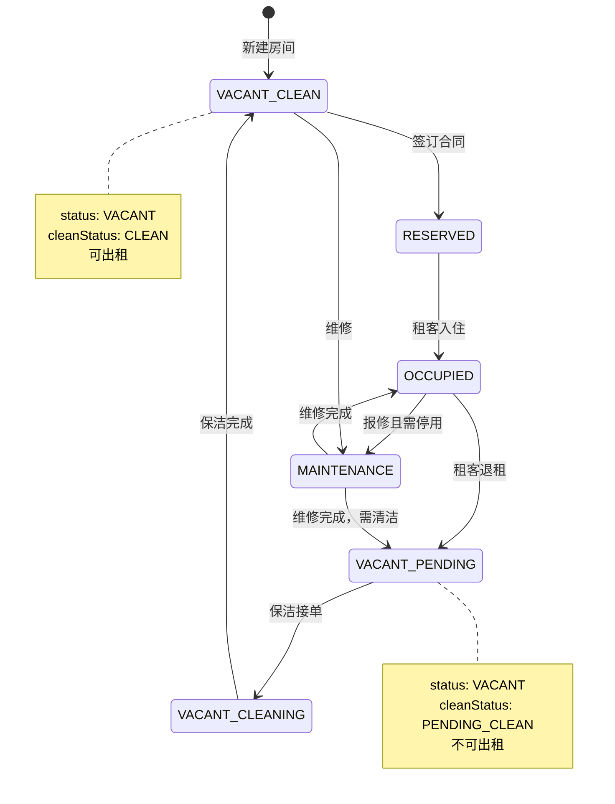
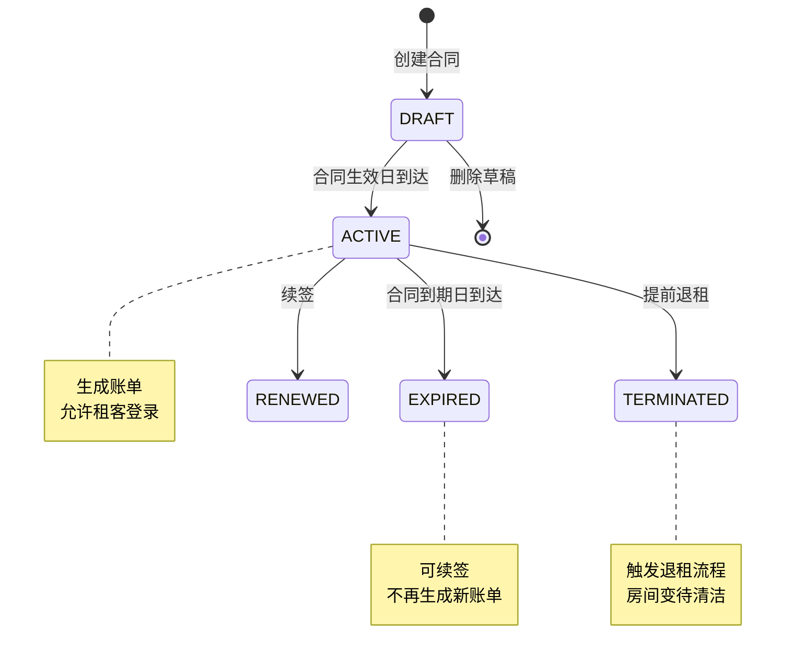
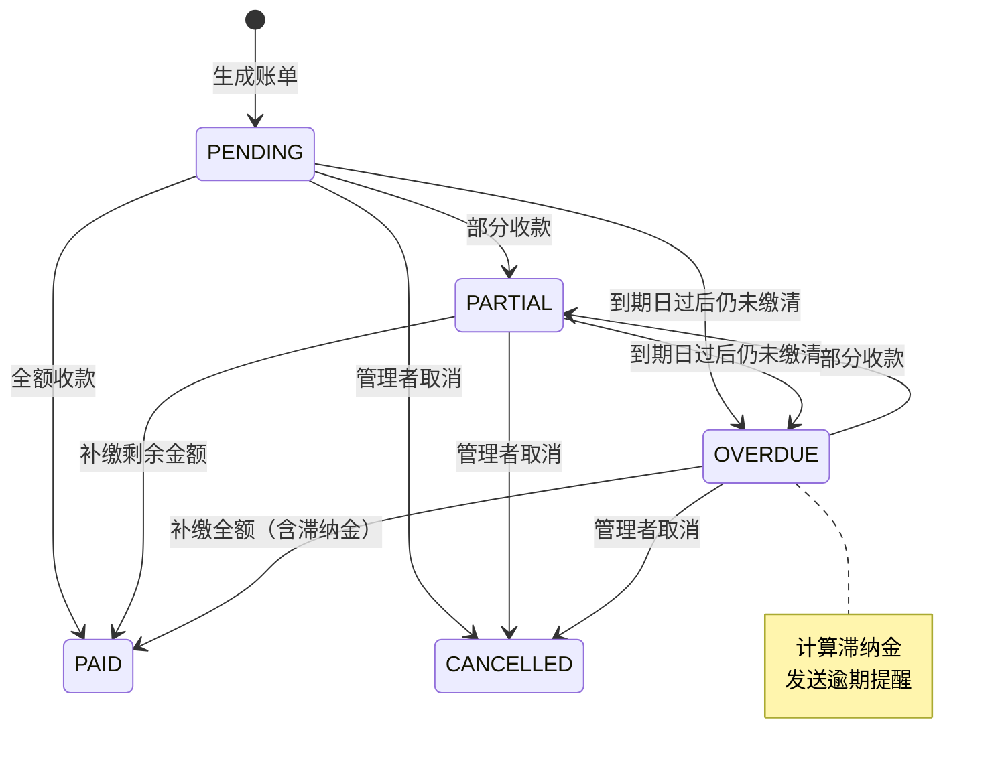
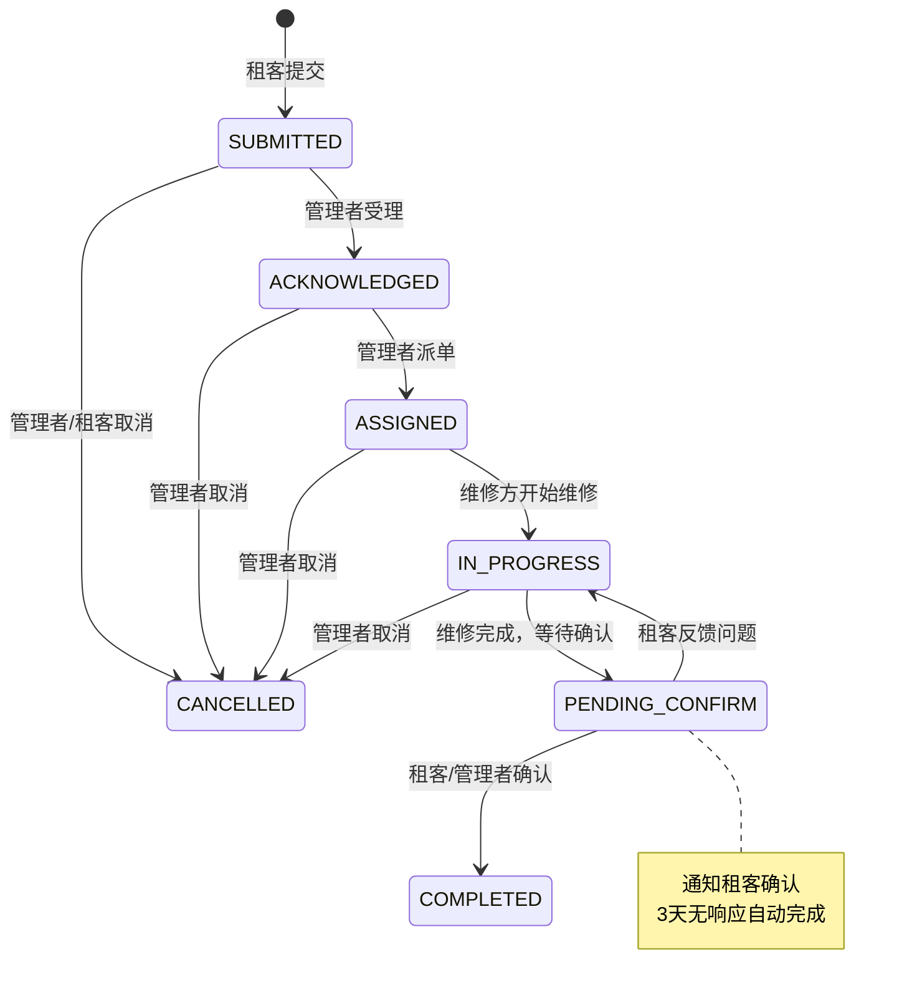
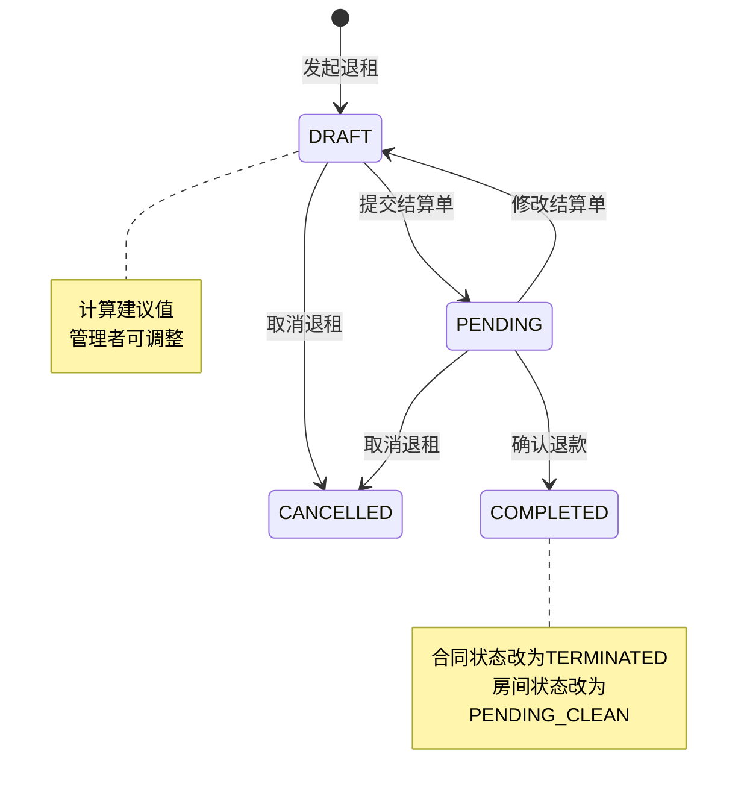

# 租客管理系统 - 状态机设计

> 版本: v0.1  
> 更新: 2026-10-11

---

## 1. 房间状态机

### 1.1 状态定义

```typescript
enum RoomStatus {
  VACANT          // 空置
  RESERVED        // 预订（已签合同未入住）
  OCCUPIED        // 已租
  MAINTENANCE     // 维修中
}

enum CleanStatus {
  CLEAN           // 已清洁（可出租）
  PENDING_CLEAN   // 待清洁
  CLEANING        // 清洁中
}
```

### 1.2 状态流转图



### 1.3 状态流转表

| 当前状态 | 清洁状态 | 触发事件 | 下一状态 | 清洁状态 | 可操作角色 | 副作用 |
|----------|----------|----------|----------|----------|------------|--------|
| VACANT | CLEAN | 签订合同 | RESERVED | CLEAN | 管理者 | 合同关联房间 |
| RESERVED | CLEAN | 租客入住（合同生效日到达） | OCCUPIED | CLEAN | 系统自动 | - |
| OCCUPIED | CLEAN | 租客退租 | VACANT | PENDING_CLEAN | 管理者 | 创建退租记录 |
| VACANT | PENDING_CLEAN | 保洁接单 | VACANT | CLEANING | 保洁 | 可选上传照片 |
| VACANT | CLEANING | 保洁标记完成 | VACANT | CLEAN | 保洁 | 可选上传照片 |
| OCCUPIED | CLEAN | 报修且需停用 | MAINTENANCE | CLEAN | 管理者 | 创建报修工单 |
| MAINTENANCE | CLEAN | 维修完成 | OCCUPIED | CLEAN | 管理者 | 更新工单状态 |
| VACANT | CLEAN | 维修 | MAINTENANCE | CLEAN | 管理者 | 创建报修工单 |
| MAINTENANCE | CLEAN | 维修完成（无租客） | VACANT | PENDING_CLEAN | 管理者 | 需重新清洁 |

### 1.4 业务规则

**可出租条件**：
```typescript
function isAvailableForRent(room: Room): boolean {
  return room.status === RoomStatus.VACANT && room.cleanStatus === CleanStatus.CLEAN;
}
```

**状态变更约束**：
- VACANT → RESERVED：必须有关联的合同（status = DRAFT）
- RESERVED → OCCUPIED：合同 startDate ≤ 当前日期
- OCCUPIED → VACANT：必须先创建退租记录
- 任何状态 → MAINTENANCE：必须有报修工单
- CLEANING → CLEAN：保洁账号可操作，管理者也可代为操作

**并发控制**：
- 使用乐观锁（version 字段）防止并发修改房态
- 分配房间时检查版本号，冲突时提示"房间已被其他管理者分配"

```typescript
async updateRoomStatus(id: string, status: RoomStatus, expectedVersion: number) {
  const result = await prisma.room.updateMany({
    where: { id, version: expectedVersion },
    data: { status, version: { increment: 1 } },
  });
  
  if (result.count === 0) {
    throw new ConflictException('房间状态已被其他用户修改，请刷新后重试');
  }
}
```

---

## 2. 合同状态机

### 2.1 状态定义

```typescript
enum ContractStatus {
  DRAFT         // 草稿（刚创建，未生效）
  ACTIVE        // 生效中
  EXPIRED       // 已到期
  TERMINATED    // 已终止（提前退租）
  RENEWED       // 已续签（被新合同替代）
}
```

### 2.2 状态流转图



### 2.3 状态流转表

| 当前状态 | 触发事件 | 下一状态 | 可操作角色 | 副作用 |
|----------|----------|----------|------------|--------|
| DRAFT | 合同生效日到达 | ACTIVE | 系统自动 | 房间状态改为 OCCUPIED |
| ACTIVE | 合同到期日到达 | EXPIRED | 系统自动 | 发送到期提醒 |
| ACTIVE | 提前退租 | TERMINATED | 管理者 | 创建退租记录、房间改为 PENDING_CLEAN |
| ACTIVE | 续签 | RENEWED | 管理者 | 创建新合同（renewedFromId 指向当前） |
| EXPIRED | 续签 | RENEWED | 管理者 | 创建新合同 |
| DRAFT | 删除 | （删除） | 管理者 | 释放房间（改为 VACANT） |

### 2.4 业务规则

**自动流转**（定时任务，每天凌晨执行）：
```typescript
async autoUpdateContractStatus() {
  const today = new Date();
  
  // DRAFT → ACTIVE（合同生效日到达）
  await prisma.contract.updateMany({
    where: {
      status: ContractStatus.DRAFT,
      startDate: { lte: today },
    },
    data: { status: ContractStatus.ACTIVE },
  });
  
  // ACTIVE → EXPIRED（合同到期日到达）
  const expiredContracts = await prisma.contract.findMany({
    where: {
      status: ContractStatus.ACTIVE,
      endDate: { lt: today },
    },
  });
  
  for (const contract of expiredContracts) {
    await prisma.contract.update({
      where: { id: contract.id },
      data: { status: ContractStatus.EXPIRED },
    });
    
    // 发送到期通知
    await notifyService.send(contract.tenantId, {
      title: '合同已到期',
      body: `您的合同已于 ${contract.endDate} 到期`,
      priority: 'NORMAL',
    });
  }
}
```

**续签逻辑（T263 / FIN-01 修订）**：

```typescript
// 1) 续签只创建 DRAFT，旧合同保持 ACTIVE，便于先审阅新合同
const draft = await prisma.contract.create({
  data: {
    ...newContractData,
    renewedFromId: oldContractId,
    status: ContractStatus.DRAFT,
  },
});

// 2) 激活新合同时，同一事务内先终止旧的 ACTIVE，再激活新的
await prisma.$transaction(async (tx) => {
  await tx.contract.update({
    where: { id: oldContractId },
    data: { status: ContractStatus.RENEWED },
  });
  await tx.contract.update({
    where: { id: draft.id },
    data: { status: ContractStatus.ACTIVE },
  });
});
```

**约束**：
- 新合同起始日必须**晚于**旧合同到期日（日期不重叠）；默认取旧合同到期日次日；
- DRAFT 合同不能续签；TERMINATED / RENEWED 不能再次续签；
- 同一房间任一时刻最多一份 ACTIVE；续签窗口内允许「旧 ACTIVE + 新 DRAFT」共存；
- 定时任务在激活续签 DRAFT 时同样先置旧合同 RENEWED，避免并发下两份 ACTIVE。

---

## 3. 账单状态机

### 3.1 状态定义

```typescript
enum BillStatus {
  PENDING     // 待缴费
  PARTIAL     // 部分缴费
  PAID        // 已缴清
  OVERDUE     // 逾期
  CANCELLED   // 已取消
}
```

### 3.2 状态流转图



### 3.3 状态流转表

| 当前状态 | 触发事件 | 下一状态 | 可操作角色 | 副作用 |
|----------|----------|----------|------------|--------|
| PENDING | 部分收款 | PARTIAL | 管理者 | 创建收款记录 |
| PENDING | 全额收款 | PAID | 管理者 | 创建收款记录 |
| PENDING | 到期日过后 | OVERDUE | 系统自动 | 计算滞纳金、发送提醒 |
| PARTIAL | 补缴剩余 | PAID | 管理者 | 创建收款记录 |
| PARTIAL | 到期日过后 | OVERDUE | 系统自动 | 计算滞纳金、发送提醒 |
| OVERDUE | 部分收款 | PARTIAL | 管理者 | 创建收款记录 |
| OVERDUE | 全额收款（含滞纳金） | PAID | 管理者 | 创建收款记录、确认滞纳金 |
| PENDING/PARTIAL/OVERDUE | 管理者取消 | CANCELLED | 管理者 | 记录取消原因 |

### 3.4 业务规则

**作废优先于删除（FIN-06 / T265）**：
- 账单、退租结算单等财务凭证不得硬删除；过期/录错一律走 `CANCELLED` 作废，保留历史。
- 关联了账单/退租的合同也不得删除；外键冲突统一 409。

**状态自动更新**（收款后）：
```typescript
async confirmPayment(billId: string, amount: number) {
  return prisma.$transaction(async (tx) => {
    // 1. 创建收款记录
    await tx.paymentRecord.create({
      data: {
        billId,
        amount,
        paidAt: new Date(),
        confirmedBy: currentUser.id,
      },
    });
    
    // 2. 更新账单已缴金额
    const bill = await tx.bill.findUnique({ where: { id: billId } });
    const newPaidAmount = bill.paidAmount + amount;
    
    // 3. 根据已缴金额更新状态
    let newStatus: BillStatus;
    if (newPaidAmount >= bill.amount) {
      newStatus = BillStatus.PAID;
    } else if (newPaidAmount > 0) {
      newStatus = BillStatus.PARTIAL;
    } else {
      newStatus = bill.status;
    }
    
    await tx.bill.update({
      where: { id: billId },
      data: {
        paidAmount: newPaidAmount,
        status: newStatus,
      },
    });
    
    // 4. 如果已缴清，取消逾期提醒
    if (newStatus === BillStatus.PAID) {
      await notifyService.cancelReminder(billId);
    }
  });
}
```

**逾期检查**（定时任务，每天凌晨执行）：
```typescript
async checkOverdueBills() {
  const today = new Date();
  
  const overdueBills = await prisma.bill.findMany({
    where: {
      status: { in: [BillStatus.PENDING, BillStatus.PARTIAL] },
      dueDate: { lt: today },
    },
    include: { contract: { include: { tenant: true } } },
  });
  
  for (const bill of overdueBills) {
    // 1. 更新状态为 OVERDUE
    await prisma.bill.update({
      where: { id: bill.id },
      data: { status: BillStatus.OVERDUE },
    });
    
    // 2. 计算滞纳金
    const overdueDays = Math.floor(
      (today.getTime() - bill.dueDate.getTime()) / (1000 * 60 * 60 * 24)
    );
    
    const lateFee = this.calculateLateFee(
      bill.contract.lateFeeRule,
      bill.amount - bill.paidAmount,
      overdueDays
    );
    
    await prisma.lateFee.create({
      data: {
        billId: bill.id,
        suggestedAmount: lateFee,
        overdueDays,
      },
    });
    
    // 3. 发送逾期提醒
    await notifyService.send(bill.contract.tenantId, {
      title: '账单逾期提醒',
      body: `您有账单逾期 ${overdueDays} 天，请尽快缴费`,
      priority: 'URGENT',
    });
  }
}
```

**约束**：
- PAID 和 CANCELLED 状态不可逆
- 只有 PENDING、PARTIAL、OVERDUE 可以收款
- 取消账单需填写原因

**收款与滞纳金核销规则（T141）**：
- 收款上限 = 账单未缴金额 + 未核销滞纳金合计（超出拒绝）
- 分配顺序：**先入账单本金，余额按确认时间先后核销滞纳金**（支持部分核销，结清写 `settledAt/settledBy`）
- 账单状态变为 `PAID` 的条件：**账单全额缴清 且 滞纳金全部核销**；账单已满但滞纳金未清时保持 `PARTIAL`（仍可继续收款）

**作废与冲正（FIN-05 / T264）**：
- 作废收款不删除原记录：原记录置 `VOIDED`，另建一条金额为负的 `REVERSAL`，通过 `reversalOfId` 关联；
- 账单 `paidAmount` 按原收款的 `billPortion` 回退，滞纳金按 `lateFeeAllocations` 精确回滚；
- 回退后状态：未缴且已过期 → `OVERDUE`，部分缴 → `PARTIAL`，全部回退且未过期 → `PENDING`；
- 重复作废幂等返回已有冲正；`CANCELLED` 账单不可作废收款。
- 同一账单并发收款通过行锁串行化；`Idempotency-Key` 同键同金额重放返回原记录。

---

## 4. 报修工单状态机

### 4.1 状态定义

```typescript
enum MaintenanceStatus {
  SUBMITTED     // 已提交
  ACKNOWLEDGED  // 已受理
  ASSIGNED      // 已派单
  IN_PROGRESS   // 维修中
  PENDING_CONFIRM // 待确认（等租客确认完成）
  COMPLETED     // 已完成
  CANCELLED     // 已取消
}
```

### 4.2 状态流转图



### 4.3 状态流转表

| 当前状态 | 触发事件 | 下一状态 | 可操作角色 | 副作用 |
|----------|----------|----------|------------|--------|
| SUBMITTED | 管理者受理 | ACKNOWLEDGED | 管理者 | 发送受理通知 |
| SUBMITTED | 取消 | CANCELLED | 管理者或租客（提交人） | 记录取消原因 |
| ACKNOWLEDGED | 管理者派单 | ASSIGNED | 管理者 | 填写 assignedTo、assignedAt |
| ACKNOWLEDGED | 取消 | CANCELLED | 管理者 | 记录取消原因 |
| ASSIGNED | 开始维修 | IN_PROGRESS | 管理者 | 发送进度通知 |
| ASSIGNED | 取消 | CANCELLED | 管理者 | 记录取消原因 |
| IN_PROGRESS | 维修完成 | PENDING_CONFIRM | 管理者 | 发送确认通知给租客 |
| IN_PROGRESS | 取消 | CANCELLED | 管理者 | 记录取消原因 |
| PENDING_CONFIRM | 确认完成 | COMPLETED | 租客或管理者 | 填写 resolvedAt |
| PENDING_CONFIRM | 反馈问题 | IN_PROGRESS | 租客 | 通知管理者 |

### 4.4 业务规则

**自动确认**（定时任务，每天执行）：
```typescript
async autoConfirmMaintenance() {
  const threeDaysAgo = new Date();
  threeDaysAgo.setDate(threeDaysAgo.getDate() - 3);
  
  const pendingRequests = await prisma.maintenanceRequest.findMany({
    where: {
      status: MaintenanceStatus.PENDING_CONFIRM,
      updatedAt: { lt: threeDaysAgo },
    },
  });
  
  for (const request of pendingRequests) {
    await prisma.maintenanceRequest.update({
      where: { id: request.id },
      data: {
        status: MaintenanceStatus.COMPLETED,
        resolvedAt: new Date(),
        resolution: '租客3天内未反馈，系统自动确认完成',
      },
    });
  }
}
```

**优先级自动升级**（定时任务）：
```typescript
async upgradePriority() {
  const threeDaysAgo = new Date();
  threeDaysAgo.setDate(threeDaysAgo.getDate() - 3);
  
  // 超过3天未处理的普通工单自动升级为紧急
  await prisma.maintenanceRequest.updateMany({
    where: {
      status: MaintenanceStatus.SUBMITTED,
      priority: MaintenancePriority.NORMAL,
      createdAt: { lt: threeDaysAgo },
    },
    data: { priority: MaintenancePriority.URGENT },
  });
}
```

**约束**：
- COMPLETED 和 CANCELLED 状态不可逆
- 派单时必须填写 `assignedTo`（维修方名称）
- 租客只能在 SUBMITTED 状态取消自己提交的工单
- 管理者可以在任何状态（除 COMPLETED/CANCELLED）取消工单

---

## 5. 退租流程状态机

### 5.1 状态定义

```typescript
enum CheckoutStatus {
  DRAFT       // 草稿（管理者填写结算单）
  PENDING     // 待处理（已提交结算单，等待打款）
  COMPLETED   // 已完成
  CANCELLED   // 已取消
}
```

### 5.2 状态流转图



### 5.3 状态流转表

| 当前状态 | 触发事件 | 下一状态 | 可操作角色 | 副作用 |
|----------|----------|----------|------------|--------|
| DRAFT | 提交结算单 | PENDING | 管理者 | 锁定结算单，不可再修改 |
| DRAFT | 取消退租 | CANCELLED | 管理者 | 合同恢复 ACTIVE |
| PENDING | 确认退款 | COMPLETED | 管理者 | 合同改 TERMINATED、房间改 PENDING_CLEAN、预付账户退款 |
| PENDING | 修改结算单 | DRAFT | 管理者 | 解锁结算单，允许修改 |
| PENDING | 取消退租 | CANCELLED | 管理者 | 合同恢复 ACTIVE |

### 5.3.1 完成退租的单一事务（FIN-07 / T273）

`PATCH /checkout/:id {status:'COMPLETED'}` 在**同一事务**内完成：

1. 校验状态流转（PENDING → COMPLETED；兼容历史 UI 的 DRAFT → COMPLETED）与结算等式：
   `总退款 = 退款项合计 - 扣款项合计`；不成立返回 400，状态不变。仅含扣款项的历史数据豁免等式校验。
2. 押金台账结清：`押金扣除 + 现金退还 = 台账余额`；
   - `DEPOSIT_REFUND` 为应退押金总额，现金退还 = 应退 - `DEPOSIT_DEDUCTION`；
   - 写 `DEDUCT` / `REFUND` 流水，余额归零、状态 `REFUNDED`。
3. 合同 `ACTIVE → TERMINATED`。
4. 房间 `OCCUPIED → VACANT + PENDING_CLEAN`（与合同状态机共用规则）。
5. 任一步失败整体回滚；重复 COMPLETED 幂等，不二次扣减押金。

**约束**：完成前必须有结算明细；有押金台账时，押金明细之和必须等于台账余额；无台账的历史合同跳过押金结算并由人工核对。

### 5.4 业务规则

**生成结算单**（建议值）：
```typescript
async generateCheckoutDraft(contractId: string, checkoutDate: Date) {
  const contract = await prisma.contract.findUnique({
    where: { id: contractId },
    include: {
      bills: { where: { status: { not: BillStatus.PAID } } },
      tenant: { include: { prepayAccounts: true } },
    },
  });
  
  const items: CheckoutItemInput[] = [];
  
  // 1. 租金折算（未住满天数退款）
  const rentRefund = this.calculateRentRefund(contract, checkoutDate);
  if (rentRefund > 0) {
    items.push({
      itemType: CheckoutItemType.RENT_REFUND,
      description: `${checkoutDate.getMonth() + 1}月租金（未住满退款）`,
      amount: rentRefund,
      calculation: { method: 'ACTUAL_DAYS', /* ... */ },
    });
  }
  
  // 2. 押金退还
  items.push({
    itemType: CheckoutItemType.DEPOSIT_REFUND,
    description: '押金退还',
    amount: contract.depositAmount,
    calculation: { originalAmount: contract.depositAmount },
  });
  
  // 3. 未缴账单扣除
  for (const bill of contract.bills) {
    const unpaid = bill.amount - bill.paidAmount;
    if (unpaid > 0) {
      items.push({
        itemType: CheckoutItemType.DEPOSIT_DEDUCTION,
        description: `欠费账单 ${bill.billNumber}`,
        amount: -unpaid,
        calculation: { billId: bill.id, unpaidAmount: unpaid },
      });
    }
  }
  
  // 4. 预付账户余额退还
  const prepayAccount = contract.tenant.prepayAccounts.find(
    acc => acc.roomId === contract.roomId
  );
  if (prepayAccount && prepayAccount.balanceCache > 0) {
    items.push({
      itemType: CheckoutItemType.UTILITY_REFUND,
      description: '水电预付余额退还',
      amount: prepayAccount.balanceCache,
      calculation: { accountId: prepayAccount.id },
    });
  }
  
  const totalRefund = items.reduce((sum, item) => sum + item.amount, 0);
  
  return prisma.checkoutRecord.create({
    data: {
      contractId,
      roomId: contract.roomId,
      checkoutDate,
      totalRefund,
      status: CheckoutStatus.DRAFT,
      processedBy: currentUser.id,
      items: { create: items },
    },
  });
}
```

**确认退款**（事务）：
```typescript
async confirmCheckout(checkoutId: string) {
  return prisma.$transaction(async (tx) => {
    const checkout = await tx.checkoutRecord.findUnique({
      where: { id: checkoutId },
      include: { contract: true, items: true },
    });
    
    // 1. 更新退租记录状态
    await tx.checkoutRecord.update({
      where: { id: checkoutId },
      data: {
        status: CheckoutStatus.COMPLETED,
        processedAt: new Date(),
      },
    });
    
    // 2. 更新合同状态
    await tx.contract.update({
      where: { id: checkout.contractId },
      data: { status: ContractStatus.TERMINATED },
    });
    
    // 3. 更新房间状态
    await tx.room.update({
      where: { id: checkout.roomId },
      data: {
        status: RoomStatus.VACANT,
        cleanStatus: CleanStatus.PENDING_CLEAN,
      },
    });
    
    // 4. 预付账户退款（如有余额）
    const utilityRefundItem = checkout.items.find(
      item => item.itemType === CheckoutItemType.UTILITY_REFUND
    );
    if (utilityRefundItem && utilityRefundItem.amount > 0) {
      const accountId = utilityRefundItem.calculation.accountId;
      await tx.prepayTransaction.create({
        data: {
          accountId,
          type: PrepayTransactionType.REFUND,
          amount: -utilityRefundItem.amount,  // 负数为扣除
          description: '退租余额退还',
          relatedId: checkoutId,
          relatedType: RelatedType.CHECKOUT,
          operatorId: currentUser.id,
        },
      });
    }
    
    // 5. 发送通知
    await notifyService.send(checkout.contract.tenantId, {
      title: '退租已完成',
      body: `您的退租手续已办理完成，退款金额 ${checkout.totalRefund / 100} 元`,
      priority: 'NORMAL',
    });
  });
}
```

**约束**：
- COMPLETED 状态不可逆
- CANCELLED 后可重新发起退租
- 只有 DRAFT 状态可以修改结算单
- 确认退款后，房间自动变为 PENDING_CLEAN

---

## 6. 通知状态（隐式状态机）

虽然通知表没有显式的 status 字段，但通过 `isRead` 可以视为简单的状态机：

| 当前状态 | 触发事件 | 下一状态 | 可操作角色 |
|----------|----------|----------|------------|
| 未读 (isRead=false) | 标记已读 | 已读 (isRead=true) | 通知所有者 |
| 已读 (isRead=true) | 标记未读 | 未读 (isRead=false) | 通知所有者 |
| 任何状态 | 过期时间到 | （自动删除） | 系统 |

**自动清理**（定时任务，每天执行）：
```typescript
async cleanExpiredNotifications() {
  await prisma.notification.deleteMany({
    where: { expiredAt: { lt: new Date() } },
  });
}
```

---

## 7. 状态机实现模式

### 7.1 状态转换服务

```typescript
// rooms/room-state.service.ts
@Injectable()
export class RoomStateService {
  async transition(
    roomId: string,
    targetStatus: RoomStatus,
    targetCleanStatus?: CleanStatus,
    context?: any
  ) {
    const room = await this.prisma.room.findUnique({ where: { id: roomId } });
    
    // 验证状态转换是否合法
    this.validateTransition(room, targetStatus, targetCleanStatus);
    
    // 执行副作用
    await this.executeEffects(room, targetStatus, targetCleanStatus, context);
    
    // 更新状态（乐观锁）
    return this.prisma.room.update({
      where: { id: roomId, version: room.version },
      data: {
        status: targetStatus,
        cleanStatus: targetCleanStatus ?? room.cleanStatus,
        version: { increment: 1 },
      },
    });
  }

  private validateTransition(
    room: Room,
    targetStatus: RoomStatus,
    targetCleanStatus?: CleanStatus
  ) {
    // 定义允许的状态转换
    const allowedTransitions = {
      [RoomStatus.VACANT]: [RoomStatus.RESERVED, RoomStatus.MAINTENANCE],
      [RoomStatus.RESERVED]: [RoomStatus.OCCUPIED, RoomStatus.VACANT],
      [RoomStatus.OCCUPIED]: [RoomStatus.VACANT, RoomStatus.MAINTENANCE],
      [RoomStatus.MAINTENANCE]: [RoomStatus.VACANT, RoomStatus.OCCUPIED],
    };

    if (!allowedTransitions[room.status]?.includes(targetStatus)) {
      throw new BadRequestException(
        `无法从 ${room.status} 转换到 ${targetStatus}`
      );
    }
    
    // 验证清洁状态约束
    if (targetStatus === RoomStatus.RESERVED || targetStatus === RoomStatus.OCCUPIED) {
      if (room.cleanStatus !== CleanStatus.CLEAN) {
        throw new BadRequestException('房间未清洁，无法出租');
      }
    }
  }

  private async executeEffects(
    room: Room,
    targetStatus: RoomStatus,
    targetCleanStatus: CleanStatus,
    context: any
  ) {
    // 根据状态转换执行副作用
    if (targetStatus === RoomStatus.VACANT && room.status === RoomStatus.OCCUPIED) {
      // 退租副作用：房间变为待清洁
      if (!targetCleanStatus) {
        targetCleanStatus = CleanStatus.PENDING_CLEAN;
      }
      
      // 通知保洁
      await this.notifyCleaners(room.id);
    }
  }
}
```

### 7.2 装饰器模式

```typescript
// common/decorators/state-machine.decorator.ts
export function StateMachine(entity: string) {
  return function (
    target: any,
    propertyKey: string,
    descriptor: PropertyDescriptor
  ) {
    const originalMethod = descriptor.value;
    
    descriptor.value = async function (...args: any[]) {
      const result = await originalMethod.apply(this, args);
      
      // 记录状态变更审计日志
      await this.auditService.log({
        entity,
        action: propertyKey,
        changes: { /* state change */ },
      });
      
      return result;
    };
    
    return descriptor;
  };
}

// 使用示例
@StateMachine('Room')
async updateRoomStatus(id: string, status: RoomStatus) {
  // ...
}
```

---

## 8. 验收标准

### 8.1 状态机验收
- [ ] 所有状态转换遵循状态流转表定义
- [ ] 非法状态转换被正确拦截并返回错误
- [ ] 所有副作用（通知、关联更新）正确执行
- [ ] 并发状态修改通过乐观锁正确处理

### 8.2 自动化测试场景

**房间状态机**：
- [ ] 新建房间默认为 VACANT + CLEAN
- [ ] 签订合同后房间变为 RESERVED
- [ ] 合同生效日到达后房间自动变为 OCCUPIED
- [ ] 退租后房间自动变为 VACANT + PENDING_CLEAN
- [ ] 保洁标记完成后房间变为 CLEAN
- [ ] 并发分配房间时乐观锁生效

**合同状态机**：
- [ ] 合同生效日到达后自动变为 ACTIVE
- [ ] 合同到期日到达后自动变为 EXPIRED
- [ ] 提前退租后合同变为 TERMINATED，房间变为 PENDING_CLEAN
- [ ] 续签后旧合同变为 RENEWED，新合同创建成功

**账单状态机**：
- [ ] 收款后账单状态正确更新（PENDING → PARTIAL → PAID）
- [ ] 到期日过后账单自动变为 OVERDUE
- [ ] 逾期后滞纳金自动计算
- [ ] 缴清后逾期提醒取消

**报修工单状态机**：
- [ ] 租客提交后状态为 SUBMITTED
- [ ] 管理者受理后状态变为 ACKNOWLEDGED
- [ ] 派单后状态变为 ASSIGNED
- [ ] 完成后进入 PENDING_CONFIRM，通知租客
- [ ] 3天无响应自动确认为 COMPLETED

**退租流程状态机**：
- [ ] 发起退租生成 DRAFT 状态结算单
- [ ] 提交后变为 PENDING，结算单锁定
- [ ] 确认退款后变为 COMPLETED，合同变 TERMINATED，房间变 PENDING_CLEAN
- [ ] 预付账户余额正确退还

---

**下一步**: 查看 [接口规范设计](./05-接口规范.md)
