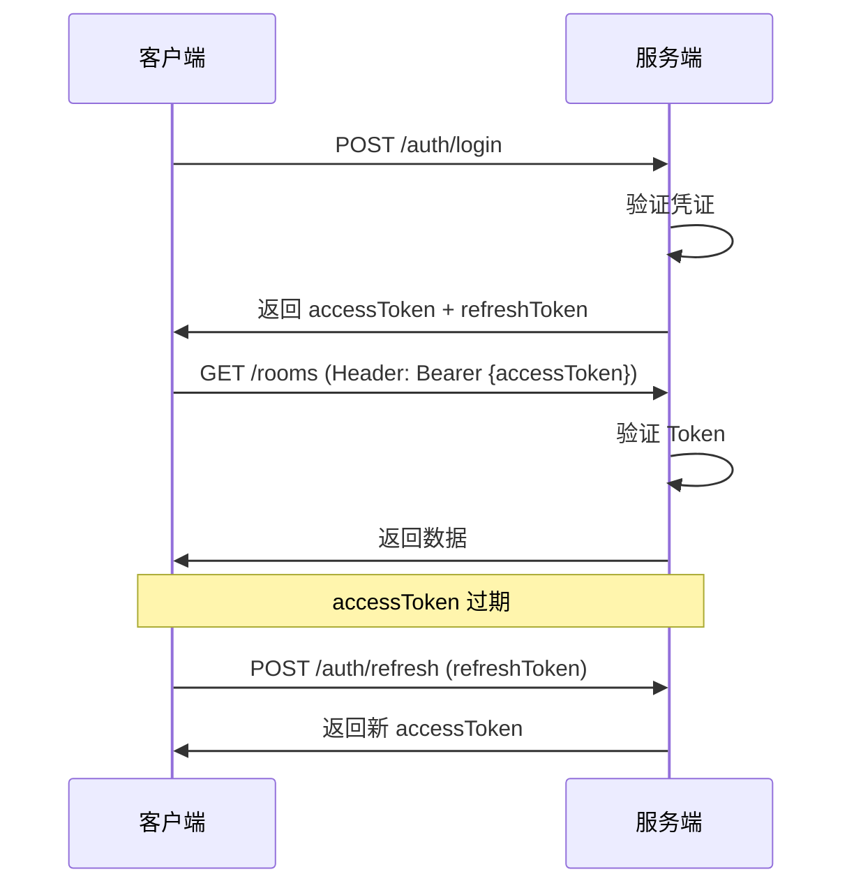

# 租客管理系统 - 接口规范

> 版本: v0.1  
> 更新: 2026-10-11

---

## 1. 接口设计原则

### 1.1 RESTful 规范

- **资源导向**：URL 表示资源，HTTP 方法表示操作
- **无状态**：每个请求包含所有必要信息，不依赖服务端会话
- **统一接口**：标准的 HTTP 方法和状态码
- **分层系统**：客户端无需知道是否直接连接到服务器

### 1.2 命名规范

| 规则 | 说明 | 示例 |
|------|------|------|
| **URL 小写** | 使用小写字母和短横线 | `/api/v1/maintenance-requests` |
| **复数名词** | 集合资源使用复数 | `/rooms`, `/contracts` |
| **资源嵌套** | 最多2层嵌套 | `/contracts/{id}/bills` |
| **查询参数** | 使用驼峰命名 | `?sortBy=createdAt&orderBy=desc` |
| **响应字段** | 使用驼峰命名 | `{ "roomNumber": "101" }` |

### 1.3 HTTP 方法语义

| 方法 | 语义 | 幂等性 | 示例 |
|------|------|--------|------|
| GET | 查询资源 | ✅ | `GET /rooms/{id}` |
| POST | 创建资源 | ❌ | `POST /contracts` |
| PUT | 完整更新资源 | ✅ | `PUT /rooms/{id}` |
| PATCH | 部分更新资源 | ❌ | `PATCH /rooms/{id}/status` |
| DELETE | 删除资源 | ✅ | `DELETE /contracts/{id}` |

---

## 2. URL 结构

### 2.1 基础结构

```
https://{domain}/api/v1/{resource}[/{id}][/{sub-resource}]
```

**示例**：
```
https://api.tenant-system.com/api/v1/rooms
https://api.tenant-system.com/api/v1/rooms/abc123
https://api.tenant-system.com/api/v1/contracts/xyz789/bills
```

### 2.2 版本策略

- **URL 版本**：`/api/v1/`（第一版）
- **版本升级原则**：
  - 向后兼容的变更（新增字段）：不升版本
  - 破坏性变更（移除字段、改变语义）：升版本为 v2
- **版本支持周期**：旧版本至少支持6个月

### 2.3 特殊端点

| 端点 | 说明 |
|------|------|
| `/api/v1/health` | 健康检查（无需鉴权） |
| `/api/v1/auth/login` | 登录 |
| `/api/v1/auth/register` | 注册 |
| `/api/v1/auth/refresh` | 刷新 Token |
| `/api/v1/public/rooms` | 公开房源（无需鉴权） |

---

## 3. 请求规范

### 3.1 请求头

| Header | 必填 | 说明 | 示例 |
|--------|------|------|------|
| `Authorization` | 是* | JWT Token | `Bearer eyJhbGc...` |
| `Content-Type` | 是** | 请求体格式 | `application/json` |
| `Accept` | 否 | 期望响应格式 | `application/json` |
| `X-Request-ID` | 否 | 请求唯一标识（用于追踪） | `uuid` |
| `X-Idempotency-Key` | 是*** | 幂等键（特定接口） | `uuid` |

**说明**：
- \* 公开接口除外
- \** POST/PUT/PATCH 请求必填
- \*** 收款、退款等接口必填

### 3.2 查询参数

#### 分页参数

| 参数 | 类型 | 默认值 | 说明 |
|------|------|--------|------|
| `page` | number | 1 | 页码（从1开始） |
| `pageSize` | number | 20 | 每页条数（最大100） |

#### 排序参数

| 参数 | 类型 | 说明 | 示例 |
|------|------|------|------|
| `sortBy` | string | 排序字段 | `createdAt` |
| `orderBy` | string | 排序方向（asc/desc） | `desc` |

#### 过滤参数

| 参数 | 类型 | 说明 | 示例 |
|------|------|------|------|
| `status` | string | 状态过滤 | `?status=ACTIVE` |
| `startDate` | ISO8601 | 开始日期 | `?startDate=2024-10-01` |
| `endDate` | ISO8601 | 结束日期 | `?endDate=2024-10-31` |
| `search` | string | 关键词搜索 | `?search=张三` |

**示例**：
```
GET /api/v1/contracts?page=2&pageSize=20&status=ACTIVE&sortBy=createdAt&orderBy=desc
```

### 3.3 请求体

**创建合同示例**：
```json
{
  "roomId": "abc123",
  "tenantId": "def456",
  "rentAmount": 200000,
  "depositAmount": 200000,
  "paymentCycle": "MONTHLY",
  "paymentDay": 25,
  "startDate": "2024-11-01",
  "endDate": "2025-10-31",
  "lateFeeRule": {
    "graceDays": 3,
    "dailyRate": 0.003,
    "cap": 50000
  }
}
```

---

## 4. 响应规范

### 4.1 响应结构

#### 成功响应（单个资源）

```json
{
  "success": true,
  "data": {
    "id": "abc123",
    "roomNumber": "101",
    "status": "VACANT",
    "createdAt": "2024-10-11T08:00:00Z"
  },
  "meta": {
    "requestId": "req-uuid-123",
    "timestamp": "2024-10-11T10:30:00Z"
  }
}
```

#### 成功响应（列表）

```json
{
  "success": true,
  "data": [
    { "id": "abc123", "roomNumber": "101" },
    { "id": "def456", "roomNumber": "102" }
  ],
  "meta": {
    "pagination": {
      "page": 1,
      "pageSize": 20,
      "total": 45,
      "totalPages": 3
    },
    "requestId": "req-uuid-123",
    "timestamp": "2024-10-11T10:30:00Z"
  }
}
```

#### 错误响应

```json
{
  "success": false,
  "error": {
    "code": "ROOM_NOT_AVAILABLE",
    "message": "房间不可用：房间状态为维修中",
    "details": {
      "roomId": "abc123",
      "currentStatus": "MAINTENANCE"
    }
  },
  "meta": {
    "requestId": "req-uuid-123",
    "timestamp": "2024-10-11T10:30:00Z"
  }
}
```

### 4.2 HTTP 状态码

| 状态码 | 说明 | 使用场景 |
|--------|------|----------|
| **2xx 成功** |
| 200 | OK | 查询、更新成功 |
| 201 | Created | 创建资源成功 |
| 204 | No Content | 删除成功（无返回内容） |
| **4xx 客户端错误** |
| 400 | Bad Request | 请求参数错误、验证失败 |
| 401 | Unauthorized | 未登录或 Token 失效 |
| 403 | Forbidden | 无权限访问 |
| 404 | Not Found | 资源不存在 |
| 409 | Conflict | 资源冲突（如房间已被占用） |
| 422 | Unprocessable Entity | 业务逻辑错误（如房间未清洁无法出租） |
| 429 | Too Many Requests | 请求频率超限 |
| **5xx 服务端错误** |
| 500 | Internal Server Error | 服务器内部错误 |
| 503 | Service Unavailable | 服务暂不可用（维护中） |

---

## 5. 错误码体系

### 5.1 错误码结构

```
{模块}_{错误类型}_{具体错误}
```

**示例**：
- `AUTH_INVALID_CREDENTIALS` - 认证模块，凭证无效
- `ROOM_NOT_AVAILABLE` - 房源模块，房间不可用
- `CONTRACT_ALREADY_EXISTS` - 合同模块，合同已存在

### 5.2 错误码列表

#### 通用错误码（COMMON）

| 错误码 | HTTP 状态码 | 说明 |
|--------|-------------|------|
| `COMMON_VALIDATION_ERROR` | 400 | 请求参数验证失败 |
| `COMMON_RESOURCE_NOT_FOUND` | 404 | 资源不存在 |
| `COMMON_INTERNAL_ERROR` | 500 | 服务器内部错误 |
| `COMMON_RATE_LIMIT_EXCEEDED` | 429 | 请求频率超限 |

#### 认证错误码（AUTH）

| 错误码 | HTTP 状态码 | 说明 |
|--------|-------------|------|
| `AUTH_INVALID_CREDENTIALS` | 401 | 邮箱或密码错误 |
| `AUTH_TOKEN_EXPIRED` | 401 | Token 已过期 |
| `AUTH_TOKEN_INVALID` | 401 | Token 无效 |
| `AUTH_INVITE_CODE_INVALID` | 400 | 邀请码无效或已使用 |
| `AUTH_INVITE_CODE_EXPIRED` | 400 | 邀请码已过期 |
| `AUTH_EMAIL_ALREADY_EXISTS` | 409 | 邮箱已被注册 |

#### 权限错误码（PERM）

| 错误码 | HTTP 状态码 | 说明 |
|--------|-------------|------|
| `PERM_FORBIDDEN` | 403 | 无权限访问 |
| `PERM_INSUFFICIENT_ROLE` | 403 | 角色权限不足 |
| `PERM_BUILDING_ACCESS_DENIED` | 403 | 无权访问该楼栋 |

#### 房源错误码（ROOM）

| 错误码 | HTTP 状态码 | 说明 |
|--------|-------------|------|
| `ROOM_NOT_AVAILABLE` | 422 | 房间不可用 |
| `ROOM_NOT_CLEAN` | 422 | 房间未清洁 |
| `ROOM_ALREADY_OCCUPIED` | 409 | 房间已被占用 |
| `ROOM_VERSION_CONFLICT` | 409 | 房间状态被其他用户修改 |

#### 合同错误码（CONTRACT）

| 错误码 | HTTP 状态码 | 说明 |
|--------|-------------|------|
| `CONTRACT_ROOM_OCCUPIED` | 422 | 房间已有生效合同 |
| `CONTRACT_INVALID_DATE_RANGE` | 400 | 合同日期范围无效 |
| `CONTRACT_CANNOT_TERMINATE` | 422 | 合同不可终止（状态不允许） |
| `CONTRACT_ALREADY_RENEWED` | 422 | 合同已续签 |

#### 账单错误码（BILL）

| 错误码 | HTTP 状态码 | 说明 |
|--------|-------------|------|
| `BILL_ALREADY_PAID` | 422 | 账单已缴清 |
| `BILL_PAYMENT_EXCEEDS_AMOUNT` | 400 | 收款金额超过应缴金额 |
| `BILL_CANNOT_CANCEL` | 422 | 账单不可取消 |

#### 预付账户错误码（PREPAY）

| 错误码 | HTTP 状态码 | 说明 |
|--------|-------------|------|
| `PREPAY_INSUFFICIENT_BALANCE` | 422 | 余额不足 |
| `PREPAY_INVALID_AMOUNT` | 400 | 金额无效（必须为正数） |

#### 报修错误码（MAINTENANCE）

| 错误码 | HTTP 状态码 | 说明 |
|--------|-------------|------|
| `MAINTENANCE_INVALID_STATUS_TRANSITION` | 422 | 无效的状态转换 |
| `MAINTENANCE_CANNOT_CANCEL` | 422 | 工单不可取消 |
| `MAINTENANCE_TOO_MANY_PHOTOS` | 400 | 照片数量超限（最多9张） |

#### 退租错误码（CHECKOUT）

| 错误码 | HTTP 状态码 | 说明 |
|--------|-------------|------|
| `CHECKOUT_CONTRACT_NOT_ACTIVE` | 422 | 合同未生效或已终止 |
| `CHECKOUT_ALREADY_EXISTS` | 409 | 该合同已有退租记录 |
| `CHECKOUT_CANNOT_MODIFY` | 422 | 结算单已锁定，不可修改 |

---

## 6. 幂等性设计

### 6.1 需要幂等性的接口

| 接口 | 幂等键来源 | 说明 |
|------|------------|------|
| `POST /bills/{id}/payments` | `X-Idempotency-Key` | 收款 |
| `POST /prepay-accounts/{id}/recharge` | `X-Idempotency-Key` | 充值 |
| `POST /checkout-records/{id}/confirm` | `X-Idempotency-Key` | 确认退款 |
| `POST /contracts/{id}/terminate` | `X-Idempotency-Key` | 终止合同 |

### 6.2 实现方式

```typescript
// payments.controller.ts
@Post(':billId/payments')
async confirmPayment(
  @Param('billId') billId: string,
  @Body() dto: ConfirmPaymentDto,
  @Headers('x-idempotency-key') idempotencyKey: string,
) {
  if (!idempotencyKey) {
    throw new BadRequestException('缺少幂等键 X-Idempotency-Key');
  }
  
  return this.paymentsService.confirmPayment(billId, dto, idempotencyKey);
}

// payments.service.ts
async confirmPayment(billId: string, dto: ConfirmPaymentDto, idempotencyKey: string) {
  // 1. 检查幂等键是否已存在
  const existing = await this.redis.get(`idempotency:${idempotencyKey}`);
  if (existing) {
    return JSON.parse(existing); // 返回缓存的结果
  }
  
  // 2. 执行业务逻辑
  const result = await this.prisma.$transaction(async (tx) => {
    const payment = await tx.paymentRecord.create({
      data: {
        billId,
        amount: dto.amount,
        paymentMethod: dto.paymentMethod,
        paidAt: new Date(),
        confirmedBy: currentUser.id,
      },
    });
    
    // 更新账单状态
    await this.updateBillStatus(tx, billId);
    
    return payment;
  });
  
  // 3. 缓存结果（24小时）
  await this.redis.setex(
    `idempotency:${idempotencyKey}`,
    86400,
    JSON.stringify(result)
  );
  
  return result;
}
```

---

## 7. 鉴权规范

### 7.1 JWT Token 结构

```json
{
  "sub": "user-id-123",
  "email": "tenant@example.com",
  "role": "TENANT",
  "tenantId": "tenant-id-456",
  "buildingId": "default-building",
  "iat": 1697012345,
  "exp": 1697098745
}
```

### 7.2 Token 使用流程



### 7.3 Token 有效期

| Token 类型 | 有效期 | 存储位置 |
|-----------|--------|----------|
| Access Token | 7天 | 内存/LocalStorage |
| Refresh Token | 30天 | HttpOnly Cookie（推荐）或 LocalStorage |

---

## 8. 接口清单

### 8.1 认证模块（/auth）

| 方法 | 路径 | 说明 | 鉴权 |
|------|------|------|------|
| POST | `/auth/register` | 注册（需邀请码） | ❌ |
| POST | `/auth/login` | 登录 | ❌ |
| POST | `/auth/refresh` | 刷新 Token | ✅ |
| POST | `/auth/logout` | 登出 | ✅ |
| GET | `/auth/me` | 获取当前用户信息 | ✅ |

### 8.2 房源模块（/rooms）

| 方法 | 路径 | 说明 | 鉴权 | 角色 |
|------|------|------|------|------|
| GET | `/rooms` | 查询房间列表 | ✅ | 所有角色 |
| GET | `/rooms/:id` | 查询房间详情 | ✅ | 所有角色 |
| POST | `/rooms` | 创建房间 | ✅ | ADMIN |
| PATCH | `/rooms/:id` | 更新房间信息 | ✅ | ADMIN |
| PATCH | `/rooms/:id/status` | 更新房间状态 | ✅ | ADMIN |
| PATCH | `/rooms/:id/clean` | 标记已清洁 | ✅ | ADMIN, CLEANER |
| DELETE | `/rooms/:id` | 删除房间 | ✅ | ADMIN |
| GET | `/public/rooms` | 公开房源列表 | ❌ | - |
| GET | `/public/rooms/:id` | 公开房源详情 | ❌ | - |

### 8.3 租客模块（/tenants）

| 方法 | 路径 | 说明 | 鉴权 | 角色 |
|------|------|------|------|------|
| GET | `/tenants` | 查询租客列表 | ✅ | ADMIN |
| GET | `/tenants/:id` | 查询租客详情 | ✅ | ADMIN, TENANT(自己) |
| POST | `/tenants` | 创建租客档案 | ✅ | ADMIN |
| PATCH | `/tenants/:id` | 更新租客信息 | ✅ | ADMIN, TENANT(自己，部分字段) |
| DELETE | `/tenants/:id` | 删除租客 | ✅ | ADMIN |

### 8.4 合同模块（/contracts）

| 方法 | 路径 | 说明 | 鉴权 | 角色 |
|------|------|------|------|------|
| GET | `/contracts` | 查询合同列表 | ✅ | ADMIN, TENANT(自己) |
| GET | `/contracts/:id` | 查询合同详情 | ✅ | ADMIN, TENANT(自己) |
| POST | `/contracts` | 创建合同 | ✅ | ADMIN |
| PATCH | `/contracts/:id` | 更新合同 | ✅ | ADMIN |
| POST | `/contracts/:id/renew` | 续签合同 | ✅ | ADMIN |
| POST | `/contracts/:id/terminate` | 终止合同 | ✅ | ADMIN |
| GET | `/contracts/:id/attachments` | 查询合同附件 | ✅ | ADMIN, TENANT(自己) |
| POST | `/contracts/:id/attachments` | 上传合同附件 | ✅ | ADMIN |

### 8.5 账单模块（/bills）

| 方法 | 路径 | 说明 | 鉴权 | 角色 |
|------|------|------|------|------|
| GET | `/bills` | 查询账单列表 | ✅ | ADMIN, TENANT(自己) |
| GET | `/bills/:id` | 查询账单详情 | ✅ | ADMIN, TENANT(自己) |
| POST | `/bills` | 手动生成账单 | ✅ | ADMIN |
| POST | `/bills/:id/payments` | 确认收款（可含已确认滞纳金，自动核销） | ✅ | ADMIN |
| GET | `/bills/:id/payments` | 查询收款记录 | ✅ | ADMIN, TENANT(自己) |
| POST | `/bills/:id/late-fees` | 添加滞纳金（不带确认金额=生成/刷新建议值；带=管理者确认入账） | ✅ | ADMIN |
| GET | `/bills/:id/late-fees` | 查询滞纳金记录（含计算过程） | ✅ | ADMIN |
| PATCH | `/bills/:id/cancel` | 取消账单 | ✅ | ADMIN |

### 8.6 预付账户模块（/prepay-accounts）

| 方法 | 路径 | 说明 | 鉴权 | 角色 |
|------|------|------|------|------|
| GET | `/prepay-accounts` | 查询账户列表 | ✅ | ADMIN, TENANT(自己) |
| GET | `/prepay-accounts/:id` | 查询账户详情 | ✅ | ADMIN, TENANT(自己) |
| POST | `/prepay-accounts/:id/recharge` | 充值 | ✅ | ADMIN |
| GET | `/prepay-accounts/:id/transactions` | 查询流水记录 | ✅ | ADMIN, TENANT(自己) |

### 8.7 水电读数模块（/meters）

| 方法 | 路径 | 说明 | 鉴权 | 角色 |
|------|------|------|------|------|
| GET | `/meters` | 查询水电表列表 | ✅ | ADMIN |
| POST | `/meters` | 创建水电表 | ✅ | ADMIN |
| POST | `/meters/:id/readings` | 录入读数 | ✅ | ADMIN |
| GET | `/meters/:id/readings` | 查询读数历史 | ✅ | ADMIN, TENANT(自己房间) |
| PATCH | `/meters/:id/price` | 修改单价 | ✅ | ADMIN |

### 8.8 报修模块（/maintenance-requests）

| 方法 | 路径 | 说明 | 鉴权 | 角色 |
|------|------|------|------|------|
| GET | `/maintenance-requests` | 查询工单列表 | ✅ | ADMIN, TENANT(自己) |
| GET | `/maintenance-requests/:id` | 查询工单详情 | ✅ | ADMIN, TENANT(自己) |
| POST | `/maintenance-requests` | 提交报修 | ✅ | ADMIN, TENANT |
| PATCH | `/maintenance-requests/:id/status` | 更新工单状态 | ✅ | ADMIN |
| POST | `/maintenance-requests/:id/photos` | 上传报修照片 | ✅ | ADMIN, TENANT(自己) |
| PATCH | `/maintenance-requests/:id/cancel` | 取消工单 | ✅ | ADMIN, TENANT(自己，限SUBMITTED状态) |

### 8.9 退租模块（/checkout-records）

| 方法 | 路径 | 说明 | 鉴权 | 角色 |
|------|------|------|------|------|
| GET | `/checkout-records` | 查询退租记录列表 | ✅ | ADMIN, TENANT(自己) |
| GET | `/checkout-records/:id` | 查询退租记录详情 | ✅ | ADMIN, TENANT(自己) |
| POST | `/checkout-records` | 发起退租 | ✅ | ADMIN |
| PATCH | `/checkout-records/:id` | 修改结算单 | ✅ | ADMIN |
| POST | `/checkout-records/:id/submit` | 提交结算单 | ✅ | ADMIN |
| POST | `/checkout-records/:id/confirm` | 确认退款 | ✅ | ADMIN |
| PATCH | `/checkout-records/:id/cancel` | 取消退租 | ✅ | ADMIN |

### 8.10 通知模块（/notifications）

| 方法 | 路径 | 说明 | 鉴权 | 角色 |
|------|------|------|------|------|
| GET | `/notifications` | 查询通知列表 | ✅ | 所有角色 |
| PATCH | `/notifications/:id/read` | 标记已读 | ✅ | 所有角色 |
| PATCH | `/notifications/read-all` | 全部标记已读 | ✅ | 所有角色 |
| DELETE | `/notifications/:id` | 删除通知 | ✅ | 所有角色 |

### 8.11 统计模块（/statistics）

| 方法 | 路径 | 说明 | 鉴权 | 角色 |
|------|------|------|------|------|
| GET | `/statistics/occupancy` | 出租率统计 | ✅ | ADMIN |
| GET | `/statistics/revenue` | 收入统计 | ✅ | ADMIN |
| GET | `/statistics/arrears` | 欠费统计 | ✅ | ADMIN |
| GET | `/statistics/maintenance` | 报修统计 | ✅ | ADMIN |

### 8.12 文件上传（/files）

| 方法 | 路径 | 说明 | 鉴权 | 角色 |
|------|------|------|------|------|
| POST | `/files/upload` | 上传文件（返回临时URL） | ✅ | 所有角色 |
| GET | `/files/:key` | 获取文件签名URL | ✅ | 所有角色 |

### 8.13 任务调度（/scheduler）

> 正式调度由 `@nestjs/schedule` 在进程内自动执行（每日 01:00 / 每月 1 日 01:10，Asia/Shanghai）；以下接口仅用于运维与测试手动触发。

| 方法 | 路径 | 说明 | 鉴权 | 角色 |
|------|------|------|------|------|
| POST | `/scheduler/run-daily` | 手动触发每日任务（合同流转/逾期检查/提醒/报修自动确认/预付提醒） | ✅ | ADMIN |
| POST | `/scheduler/run-monthly-bills` | 手动触发月度租金账单生成 | ✅ | ADMIN |

---

## 9. 前端类型自动生成

### 9.1 OpenAPI 生成

使用 `@nestjs/swagger` 自动生成 OpenAPI 3.0 规范：

```typescript
// main.ts
import { SwaggerModule, DocumentBuilder } from '@nestjs/swagger';

const config = new DocumentBuilder()
  .setTitle('租客管理系统 API')
  .setDescription('API 文档')
  .setVersion('1.0')
  .addBearerAuth()
  .build();

const document = SwaggerModule.createDocument(app, config);
SwaggerModule.setup('api-docs', app, document);

// 导出 OpenAPI JSON
fs.writeFileSync('./openapi.json', JSON.stringify(document, null, 2));
```

### 9.2 前端类型生成

使用 `openapi-typescript` 生成 TypeScript 类型：

```bash
# 安装工具
npm install -D openapi-typescript

# 生成类型
npx openapi-typescript ./openapi.json -o ./src/types/api.ts
```

### 9.3 前端使用示例

```typescript
// types/api.ts（自动生成）
export interface paths {
  "/api/v1/rooms": {
    get: operations["RoomsController_findAll"];
    post: operations["RoomsController_create"];
  };
  // ...
}

export interface components {
  schemas: {
    RoomDto: {
      id: string;
      roomNumber: string;
      status: "VACANT" | "RESERVED" | "OCCUPIED" | "MAINTENANCE";
      // ...
    };
  };
}

// 前端使用
import type { components } from './types/api';

type Room = components['schemas']['RoomDto'];

async function fetchRooms(): Promise<Room[]> {
  const response = await fetch('/api/v1/rooms');
  const data = await response.json();
  return data.data;
}
```

---

## 10. 限流策略

### 10.1 限流规则

| 端点类型 | 限流规则 | 说明 |
|----------|----------|------|
| 公开接口 | 100 次/分钟/IP | 防止爬虫 |
| 认证接口（登录） | 10 次/分钟/IP | 防止暴力破解 |
| 普通接口 | 1000 次/分钟/用户 | 正常使用不受限 |
| 敏感接口（收款/退款） | 100 次/分钟/用户 | 防止误操作 |

### 10.2 实现方式

```typescript
// common/guards/throttle.guard.ts
import { ThrottlerGuard } from '@nestjs/throttler';

@Injectable()
export class CustomThrottlerGuard extends ThrottlerGuard {
  protected getTracker(req: Request): string {
    // 已登录用户：按用户ID限流
    if (req.user) {
      return req.user.id;
    }
    // 未登录：按IP限流
    return req.ip;
  }
}

// 使用示例
@Controller('auth')
@UseGuards(ThrottlerGuard)
export class AuthController {
  @Post('login')
  @Throttle(10, 60) // 10次/分钟
  async login(@Body() dto: LoginDto) {
    // ...
  }
}
```

---

## 11. CORS 配置

```typescript
// main.ts
app.enableCors({
  origin: [
    'https://admin.tenant-system.com',  // 网页后台
    'https://mp.weixin.qq.com',         // 微信小程序
  ],
  credentials: true,
  methods: ['GET', 'POST', 'PUT', 'PATCH', 'DELETE'],
  allowedHeaders: ['Content-Type', 'Authorization', 'X-Idempotency-Key'],
});
```

---

## 12. 验收标准

### 12.1 接口规范验收
- [ ] 所有接口遵循 RESTful 规范
- [ ] URL 命名统一使用小写和短横线
- [ ] 响应结构统一（success/data/error/meta）
- [ ] 错误码清晰且易于理解
- [ ] 所有敏感接口支持幂等性

### 12.2 文档验收
- [ ] OpenAPI 文档自动生成
- [ ] 前端类型定义自动生成
- [ ] 所有接口有清晰的说明和示例
- [ ] 错误响应示例完整

### 12.3 安全验收
- [ ] 敏感接口有限流保护
- [ ] 公开接口有防爬虫限流
- [ ] JWT Token 正确实现和验证
- [ ] CORS 配置正确且安全

---

**下一步**: 查看 [安全与合规清单](./06-安全与合规清单.md)
