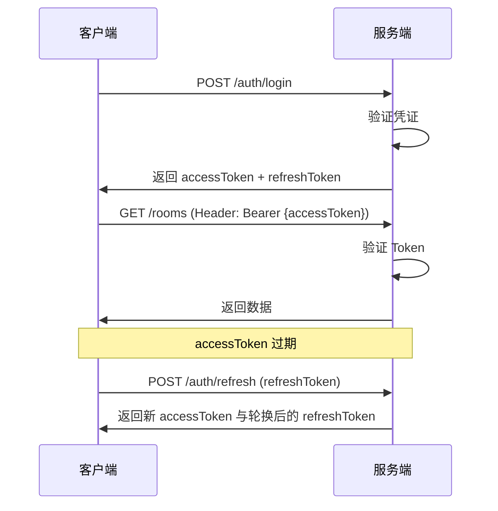

# 租客管理系统 - 接口规范

> 版本: v0.2  
> 更新: 2026-10-15

---

## 1. 接口设计原则

### 1.1 RESTful 规范

- **资源导向**：URL 表示资源，HTTP 方法表示操作
- **无状态**：每个请求包含所有必要信息，不依赖服务端会话
- **统一接口**：标准的 HTTP 方法和状态码
- **分层系统**：客户端无需知道是否直接连接到服务器

### 1.2 命名规范

| 规则 | 说明 | 示例 |
|------|------|------|
| **URL 小写** | 使用小写字母和短横线 | `/api/v1/maintenance-requests` |
| **复数名词** | 集合资源使用复数 | `/rooms`, `/contracts` |
| **资源嵌套** | 最多2层嵌套 | `/contracts/{id}/bills` |
| **查询参数** | 使用驼峰命名 | `?sortBy=createdAt&orderBy=desc` |
| **响应字段** | 使用驼峰命名 | `{ "roomNumber": "101" }` |

### 1.3 HTTP 方法语义

| 方法 | 语义 | 幂等性 | 示例 |
|------|------|--------|------|
| GET | 查询资源 | ✅ | `GET /rooms/{id}` |
| POST | 创建资源 | ❌ | `POST /contracts` |
| PUT | 完整更新资源 | ✅ | `PUT /rooms/{id}` |
| PATCH | 部分更新资源 | ❌ | `PATCH /rooms/{id}/status` |
| DELETE | 删除资源 | ✅ | `DELETE /contracts/{id}` |

---

## 2. URL 结构

### 2.1 基础结构

```
https://{domain}/api/v1/{resource}[/{id}][/{sub-resource}]
```

**示例**：
```
https://api.tenant-system.com/api/v1/rooms
https://api.tenant-system.com/api/v1/rooms/abc123
https://api.tenant-system.com/api/v1/contracts/xyz789/bills
```

### 2.2 版本策略

- **URL 版本**：`/api/v1/`（第一版）
- **版本升级原则**：
  - 向后兼容的变更（新增字段）：不升版本
  - 破坏性变更（移除字段、改变语义）：升版本为 v2
- **版本支持周期**：旧版本至少支持6个月

### 2.3 特殊端点

| 端点 | 说明 |
|------|------|
| `/api/v1/health` | 健康检查（无需鉴权） |
| `/api/v1/auth/login` | 登录 |
| `/api/v1/auth/register` | 注册 |
| `/api/v1/auth/refresh` | 刷新 Token（轮换 Refresh Token） |
| `/api/v1/auth/logout` | 登出。幂等：无效/过期/已撤销的 Refresh Token 也返回 200 |
| `/api/v1/auth/invite-codes` | 生成邀请码（POST，仅管理员）/ 查询邀请码列表（GET，仅管理员） |
| `/api/v1/auth/invite-codes/:id` | 作废邀请码（DELETE，仅管理员） |
| `/api/v1/auth/bind-invite-code` | 兑换/绑定邀请码（POST，需登录） |
| `/api/v1/public/rooms` | 公开房源（无需鉴权） |

---

## 3. 请求规范

### 3.1 请求头

| Header | 必填 | 说明 | 示例 |
|--------|------|------|------|
| `Authorization` | 是* | JWT Token | `Bearer eyJhbGc...` |
| `Content-Type` | 是** | 请求体格式 | `application/json` |
| `Accept` | 否 | 期望响应格式 | `application/json` |
| `X-Request-ID` | 否 | 请求唯一标识（用于追踪） | `uuid` |
| `X-Idempotency-Key` | 是*** | 幂等键（特定接口） | `uuid` |

**说明**：
- \* 公开接口除外
- \** POST/PUT/PATCH 请求必填
- \*** 收款、退款等接口必填

### 3.2 查询参数

#### 分页参数

| 参数 | 类型 | 默认值 | 说明 |
|------|------|--------|------|
| `page` | number | 1 | 页码（从1开始） |
| `pageSize` | number | 20 | 每页条数（最大100） |

#### 排序参数

| 参数 | 类型 | 说明 | 示例 |
|------|------|------|------|
| `sortBy` | string | 排序字段 | `createdAt` |
| `orderBy` | string | 排序方向（asc/desc） | `desc` |

#### 过滤参数

| 参数 | 类型 | 说明 | 示例 |
|------|------|------|------|
| `status` | string | 状态过滤 | `?status=ACTIVE` |
| `startDate` | ISO8601 | 开始日期 | `?startDate=2024-10-01` |
| `endDate` | ISO8601 | 结束日期 | `?endDate=2024-10-31` |
| `search` | string | 关键词搜索 | `?search=张三` |

**示例**：
```
GET /api/v1/contracts?page=2&pageSize=20&status=ACTIVE&sortBy=createdAt&orderBy=desc
```

### 3.3 请求体

**创建合同示例**：
```json
{
  "roomId": "abc123",
  "tenantId": "def456",
  "rentAmount": 200000,
  "depositAmount": 200000,
  "paymentCycle": "MONTHLY",
  "paymentDay": 25,
  "startDate": "2024-11-01",
  "endDate": "2025-10-31",
  "lateFeeRule": {
    "graceDays": 3,
    "dailyRate": 0.003,
    "cap": 50000
  }
}
```

---

## 4. 响应规范

### 4.1 响应结构

#### 成功响应（单个资源）

```json
{
  "success": true,
  "data": {
    "id": "abc123",
    "roomNumber": "101",
    "status": "VACANT",
    "createdAt": "2024-10-11T08:00:00Z"
  },
  "meta": {
    "requestId": "req-uuid-123",
    "timestamp": "2024-10-11T10:30:00Z"
  }
}
```

#### 成功响应（列表）

```json
{
  "success": true,
  "data": [
    { "id": "abc123", "roomNumber": "101" },
    { "id": "def456", "roomNumber": "102" }
  ],
  "meta": {
    "pagination": {
      "page": 1,
      "pageSize": 20,
      "total": 45,
      "totalPages": 3
    },
    "requestId": "req-uuid-123",
    "timestamp": "2024-10-11T10:30:00Z"
  }
}
```

#### 错误响应

当前接口直接返回资源对象。出错时返回下面这一层结构，4xx 和 5xx 都带 `code` 与 `requestId`：

```json
{
  "code": "ROOM_VERSION_CONFLICT",
  "message": "房间状态已被其他用户修改，请刷新后重试",
  "details": ["字段错误可以放在这里"],
  "requestId": "req-uuid-123"
}
```

唯一键冲突（Prisma `P2002`）返回 409 `COMMON_CONFLICT`。找不到记录（`P2025`）返回 404 `COMMON_RESOURCE_NOT_FOUND`。生产环境的 500 只返回 `COMMON_INTERNAL_ERROR` 和「服务器内部错误」，不包含堆栈或 SQL。

### 4.2 HTTP 状态码

| 状态码 | 说明 | 使用场景 |
|--------|------|----------|
| **2xx 成功** |
| 200 | OK | 查询、更新成功 |
| 201 | Created | 创建资源成功 |
| 204 | No Content | 删除成功（无返回内容） |
| **4xx 客户端错误** |
| 400 | Bad Request | 请求参数错误、验证失败 |
| 401 | Unauthorized | 未登录或 Token 失效 |
| 403 | Forbidden | 无权限访问 |
| 404 | Not Found | 资源不存在 |
| 409 | Conflict | 资源冲突（如房间已被占用） |
| 422 | Unprocessable Entity | 业务逻辑错误（如房间未清洁无法出租） |
| 429 | Too Many Requests | 请求频率超限，或密码登录连续失败触发锁定 |
| **5xx 服务端错误** |
| 500 | Internal Server Error | 服务器内部错误 |
| 503 | Service Unavailable | 服务暂不可用（维护中） |

---

## 5. 错误码体系

### 5.1 错误码结构

```
{模块}_{错误类型}_{具体错误}
```

**示例**：
- `AUTH_INVALID_CREDENTIALS` - 认证模块，凭证无效
- `ROOM_NOT_AVAILABLE` - 房源模块，房间不可用
- `CONTRACT_ALREADY_EXISTS` - 合同模块，合同已存在

### 5.2 错误码列表

#### 通用错误码（COMMON）

| 错误码 | HTTP 状态码 | 说明 |
|--------|-------------|------|
| `COMMON_VALIDATION_ERROR` | 400 | 请求参数验证失败 |
| `COMMON_BAD_REQUEST` | 400 | 其他无法归类的请求错误 |
| `COMMON_RESOURCE_NOT_FOUND` | 404 | 资源不存在，含 Prisma P2025 |
| `COMMON_CONFLICT` | 409 | 唯一键冲突（Prisma P2002）或其他冲突 |
| `COMMON_INTERNAL_ERROR` | 500 | 服务器内部错误 |
| `COMMON_RATE_LIMIT_EXCEEDED` | 429 | 请求频率超限 |

#### 认证错误码（AUTH）

| 错误码 | HTTP 状态码 | 说明 |
|--------|-------------|------|
| `AUTH_INVALID_CREDENTIALS` | 401 | 邮箱或密码错误 |
| `AUTH_TOKEN_EXPIRED` | 401 | Token 已过期 |
| `AUTH_TOKEN_INVALID` | 401 | Token 无效 |
| `AUTH_INVITE_CODE_INVALID` | 400 | 邀请码无效或已使用 |
| `AUTH_INVITE_CODE_EXPIRED` | 400 | 邀请码已过期 |
| `AUTH_INVITE_CODE_CONFLICT` | 409 | 邀请码已被使用，请重新获取 |
| `AUTH_EMAIL_ALREADY_EXISTS` | 409 | 邮箱已被注册 |
| `AUTH_ACCOUNT_NOT_PROVISIONED` | 403 | 账号尚未开通，请联系管理员预建并邀请 |
| `AUTH_GOOGLE_EMAIL_UNVERIFIED` | 401 | Google 邮箱未验证，无法登录 |
| `AUTH_IDENTITY_ROLE_CONFLICT` | 409 | 邀请码角色与当前账号角色不匹配 |

#### 权限错误码（PERM）

| 错误码 | HTTP 状态码 | 说明 |
|--------|-------------|------|
| `PERM_FORBIDDEN` | 403 | 无权限访问 |
| `PERM_INSUFFICIENT_ROLE` | 403 | 角色权限不足 |
| `PERM_BUILDING_ACCESS_DENIED` | 403 | 无权访问该楼栋 |
| `CAPABILITY_DENIED` | 403 | 租客此项功能已被管理员暂停 |

#### 房源错误码（ROOM）

| 错误码 | HTTP 状态码 | 说明 |
|--------|-------------|------|
| `ROOM_NOT_AVAILABLE` | 422 | 房间不可用 |
| `ROOM_NOT_CLEAN` | 422 | 房间未清洁 |
| `ROOM_ALREADY_OCCUPIED` | 409 | 房间已被占用 |
| `ROOM_VERSION_CONFLICT` | 409 | 房间状态被其他用户修改 |

#### 合同错误码（CONTRACT）

| 错误码 | HTTP 状态码 | 说明 |
|--------|-------------|------|
| `CONTRACT_ROOM_OCCUPIED` | 422 | 房间已有生效合同 |
| `CONTRACT_INVALID_DATE_RANGE` | 400 | 合同日期范围无效 |
| `CONTRACT_CANNOT_TERMINATE` | 422 | 合同不可终止（状态不允许） |
| `CONTRACT_ALREADY_RENEWED` | 422 | 合同已续签 |

#### 账单错误码（BILL）

| 错误码 | HTTP 状态码 | 说明 |
|--------|-------------|------|
| `BILL_ALREADY_PAID` | 422 | 账单已缴清 |
| `BILL_PAYMENT_EXCEEDS_AMOUNT` | 400 | 收款金额超过应缴金额 |
| `BILL_CANNOT_CANCEL` | 422 | 账单不可取消 |

#### 预付账户错误码（PREPAY）

| 错误码 | HTTP 状态码 | 说明 |
|--------|-------------|------|
| `PREPAY_INSUFFICIENT_BALANCE` | 422 | 余额不足 |
| `PREPAY_INVALID_AMOUNT` | 400 | 金额无效（必须为正数） |

#### 报修错误码（MAINTENANCE）

| 错误码 | HTTP 状态码 | 说明 |
|--------|-------------|------|
| `MAINTENANCE_INVALID_STATUS_TRANSITION` | 422 | 无效的状态转换 |
| `MAINTENANCE_CANNOT_CANCEL` | 422 | 工单不可取消 |
| `MAINTENANCE_TOO_MANY_PHOTOS` | 400 | 照片数量超限（最多9张） |

#### 退租错误码（CHECKOUT）

| 错误码 | HTTP 状态码 | 说明 |
|--------|-------------|------|
| `CHECKOUT_CONTRACT_NOT_ACTIVE` | 422 | 合同未生效或已终止 |
| `CHECKOUT_ALREADY_EXISTS` | 409 | 该合同已有退租记录 |
| `CHECKOUT_CANNOT_MODIFY` | 422 | 结算单已锁定，不可修改 |

---

## 6. 幂等性设计

### 6.1 需要幂等性的接口

| 接口 | 幂等键来源 | 说明 |
|------|------------|------|
| `POST /bills/{id}/payments` | `X-Idempotency-Key` | 收款 |
| `POST /prepay-accounts/{id}/recharge` | `X-Idempotency-Key` | 充值 |
| `POST /checkout-records/{id}/confirm` | `X-Idempotency-Key` | 确认退款 |
| `POST /contracts/{id}/terminate` | `X-Idempotency-Key` | 终止合同 |

### 6.2 实现方式

```typescript
// payments.controller.ts
@Post(':billId/payments')
async confirmPayment(
  @Param('billId') billId: string,
  @Body() dto: ConfirmPaymentDto,
  @Headers('x-idempotency-key') idempotencyKey: string,
) {
  if (!idempotencyKey) {
    throw new BadRequestException('缺少幂等键 X-Idempotency-Key');
  }
  
  return this.paymentsService.confirmPayment(billId, dto, idempotencyKey);
}

// payments.service.ts
async confirmPayment(billId: string, dto: ConfirmPaymentDto, idempotencyKey: string) {
  // 1. 检查幂等键是否已存在
  const existing = await this.redis.get(`idempotency:${idempotencyKey}`);
  if (existing) {
    return JSON.parse(existing); // 返回缓存的结果
  }
  
  // 2. 执行业务逻辑
  const result = await this.prisma.$transaction(async (tx) => {
    const payment = await tx.paymentRecord.create({
      data: {
        billId,
        amount: dto.amount,
        paymentMethod: dto.paymentMethod,
        paidAt: new Date(),
        confirmedBy: currentUser.id,
      },
    });
    
    // 更新账单状态
    await this.updateBillStatus(tx, billId);
    
    return payment;
  });
  
  // 3. 缓存结果（24小时）
  await this.redis.setex(
    `idempotency:${idempotencyKey}`,
    86400,
    JSON.stringify(result)
  );
  
  return result;
}
```

---

## 7. 鉴权规范

### 7.1 JWT Token 结构

```json
{
  "sub": "user-id-123",
  "email": "tenant@example.com",
  "role": "TENANT",
  "tenantId": "tenant-id-456",
  "buildingId": "default-building",
  "iat": 1697012345,
  "exp": 1697098745
}
```

### 7.2 Token 使用流程



### 7.3 Token 有效期

| Token 类型 | 有效期 | 存储位置 |
|-----------|--------|----------|
| Access Token | 7天 | 内存/LocalStorage |
| Refresh Token | 30天 | HttpOnly Cookie（推荐）或 LocalStorage |

### 7.4 登录失败与验证码防护

- 密码登录连续失败 `LOGIN_MAX_FAILED_ATTEMPTS`（默认 5）次后锁定 `LOGIN_LOCK_MS`（默认 15 分钟），锁定期间返回 **429**；成功登录立即清零。
- 未知账号、无密码账号与密码错误统一返回 **401**「邮箱/手机号或密码错误」，响应不区分账号是否存在。
- 邮箱验证码为 6 位数字、5 分钟有效、验证成功即失效；连续输错 5 次整条作废。服务端只保存 HMAC-SHA256 摘要与随机盐，不保存明文。
- 发送验证码：同一邮箱 60 秒冷却，并叠加每邮箱/每 IP 每小时限流（见 §9）。
- **首次登录/注册（DEC-03）**：`login-email-code` 与 `google` 的新账号必须同时提供 `inviteCode`，且存在 `userId = null` 的邮箱精确匹配预建租客；否则返回 403 `AUTH_ACCOUNT_NOT_PROVISIONED`。`register` 同样要求预建租客，不再自动创建 `Tenant`。
- 邀请码 `role` 在注册/绑定时生效；并发核销失败返回 409 `AUTH_INVITE_CODE_CONFLICT`。

### 7.5 收款幂等与作废

- `POST /api/bills/:id/payments` 支持 `Idempotency-Key` 请求头或 body `idempotencyKey`：
  - 同键、同账单、同金额重放 → 返回原收款（HTTP 201，`idempotent=true`），不重复入账；
  - 同键不同请求 → 409。
- 同一账单并发收款由数据库行锁串行化，超过未缴金额返回 400。
- 收据号 `R{业务日}{6 位序号}` 由数据库序列原子分配。
- `POST /api/bills/:id/payments/:paymentId/void`（ADMIN）：作废原收款并生成负额冲正；
  重复作废幂等返回已有冲正；已取消账单返回 400。

### 7.6 文件可见性

- `POST /api/files/upload?purpose=ROOM_PHOTO|CONTRACT|MAINTENANCE|AVATAR|RECEIPT|OTHER&visibility=PRIVATE|PUBLIC`
  - 默认 `purpose=OTHER`、`visibility=PRIVATE`；
  - `visibility=PUBLIC` 仅 **ADMIN** 可用，其他角色 403；
  - 仅接受 JPG/PNG/WebP，magic-byte 校验 + 重编码去 EXIF，单张上限 10MB。
- `GET /api/files/:key`：需登录；ADMIN、上传者本人或同 `tenantId` 租客可读，其余 404。
- `GET /api/public/files/:key`：无需登录；仅 `visibility=PUBLIC` 可读，缓存 `public, max-age=3600`，其余 404。
- 房源照片必须引用已登记资产；绑定后自动置为 `PUBLIC`，公开页返回 `/api/public/files/<key>`。

---

### 7.6.1 租金出账周期

- 月付/季付/半年付/年付分别每 1/3/6/12 个月生成一张 RENT 账单。
- 以**合同起始月**为锚点，不按自然年固定季度。
- 首期从合同起始日、末期截到合同结束日，按实际在租天数折算；账单 snapshot 记录 `cycle/periodStart/periodEnd/proratedDays`。
- 重跑幂等：同合同 + RENT + period 只生成一张。

### 7.6.3 员工与密码管理
- `GET/POST/PATCH /staff`、`POST /staff/:id/reset-password`（ADMIN）：仅管理 ADMIN/CLEANER；不可停用自己或最后一位有效管理员；停用即撤销全部会话。
- `POST /auth/password/change`（JWT）：验证旧密码，成功后撤销该用户所有 refresh 会话。
- `POST /auth/password/forgot`：统一响应，不泄露邮箱是否存在。
- `POST /auth/password/reset`：邮箱 + 6 位 OTP + 新密码（≥8），成功后撤销所有会话。
### 7.6.2 押金台账
- `POST /bills` 支持 `billType=DEPOSIT`；同一合同只能有一张押金账单（`dedupKey=DEPOSIT:{contractId}`）。
- 押金账单收款自动记入 `DepositLedger`（`COLLECT`）；作废收款写 `REVERSAL` 并扣回余额。
- `GET /deposits/:contractId`：ADMIN 任意，TENANT 仅自己的合同。
- `POST /deposits/:contractId/deduct`、`/refund`：ADMIN，余额不足 400；退还至 0 时状态 `REFUNDED`。
- `POST /deposits/:contractId/transfer`：ADMIN，将余额转入续签合同（DEC-09）。

### 7.7 财务资料不可删除

- `DELETE /bills/:id`、`DELETE /checkout/:id`：一律 **409**，改用 `PATCH status=CANCELLED`。
- `DELETE /contracts/:id`：已有账单或退租记录时 **409**；无财务关联的草稿合同可删。
- `DELETE /prepay-accounts/:id`：有流水或余额 ≠ 0 时 **409**；空账户可删。
- Prisma `P2003`（外键冲突）统一映射为 **409** `COMMON_CONFLICT`「存在关联数据，不能删除或修改」，不再返回 500。

---

## 8. 接口清单

路由、请求体、响应和是否需要登录以 `backend/openapi.json` 为准。非生产环境打开 `/api/docs` 可以查看同一份文档。

这里只保留不随单条路由变化的约定：URL、分页、错误体、错误码、幂等、鉴权和限流。前文第 1 到第 7 节以及第 10、11 节就是这些约定。

---

## 9. 前端类型

请求体类型由 OpenAPI 生成，文件是 `frontend-admin/src/types/api.generated.ts`。页面上为了表格和排序额外准备的字段仍写在 `frontend-admin/src/types/index.ts`，那些不是接口请求 DTO。

重新生成：

```bash
cd backend && npm run openapi:generate
```

CI 会执行 `npm run openapi:check`。改了 DTO 却没有提交新的 `openapi.json` 和生成类型时，检查失败。

```typescript
import type { components } from './api.generated';

type LoginDto = components['schemas']['LoginDto'];
```

---

## 10. 限流策略

T175 / OPT-02 已落地。存储仍是进程内存，OPT-08 再换 Redis。按用户的「普通接口 1000 次/分钟」「收款 100 次/分钟」尚未实现。

### 10.1 限流规则

| 端点 | 规则 | 计数 |
|------|------|------|
| 其余全部接口 | 100 次/分钟 | IP。公开看房走这一档 |
| `POST /api/auth/login`、`/api/auth/login-email-code`、`/api/auth/google`、`/api/auth/register`、`/api/auth/bind-invite-code` | 10 次/分钟 | IP。各接口分开计数 |
| `POST /api/auth/send-email-code` | 5 次/小时 | 邮箱。无合法邮箱时退回 IP |
| `POST /api/auth/send-email-code` | 30 次/小时 | IP。与上一行是**两层**，两层都必须通过；换邮箱不能绕过按 IP 这一层（T206） |

超过限制返回 429。`default` 限流器的响应头为 `Retry-After`；命中具名限流器时头名带后缀，例如邮箱维度被挡是 `Retry-After-otpEmail`（`Limit`/`Remaining`/`Reset` 同理）。`NODE_ENV=test` 且未设置下面的环境变量时，次数抬到 100000，避免测试和 e2e 被误伤。可用 `THROTTLE_GLOBAL_LIMIT`、`THROTTLE_AUTH_LIMIT`、`THROTTLE_OTP_LIMIT`、`THROTTLE_OTP_IP_LIMIT` 覆盖。

生产环境默认 `trust proxy = 1`，以便在一层反向代理后取到真实 IP。本地直连默认关闭。`TRUST_PROXY` 可覆盖。

### 10.2 实现位置

- 全局守卫：`AppModule` 注册 `ThrottlerGuard`
- 次数：`backend/src/config/throttle.config.ts`
- 收紧装饰器：`AuthThrottle`、`OtpEmailThrottle`

---

## 11. CORS 配置

```typescript
// main.ts
app.enableCors({
  origin: [
    'https://admin.tenant-system.com',  // 网页后台
    'https://mp.weixin.qq.com',         // 微信小程序
  ],
  credentials: true,
  methods: ['GET', 'POST', 'PUT', 'PATCH', 'DELETE'],
  allowedHeaders: ['Content-Type', 'Authorization', 'X-Idempotency-Key'],
});
```

---

## 12. 验收标准

### 12.1 接口规范验收
- [ ] 所有接口遵循 RESTful 规范
- [ ] URL 命名统一使用小写和短横线
- [ ] 响应结构统一（success/data/error/meta）
- [ ] 错误码清晰且易于理解
- [ ] 所有敏感接口支持幂等性

### 12.2 文档验收
- [ ] OpenAPI 文档自动生成
- [ ] 前端类型定义自动生成
- [ ] 所有接口有清晰的说明和示例
- [ ] 错误响应示例完整

### 12.3 安全验收
- [ ] 敏感接口有限流保护
- [ ] 公开接口有防爬虫限流
- [ ] JWT Token 正确实现和验证
- [ ] CORS 配置正确且安全

---

**下一步**: 查看 [安全与合规清单](./06-安全与合规清单.md)
