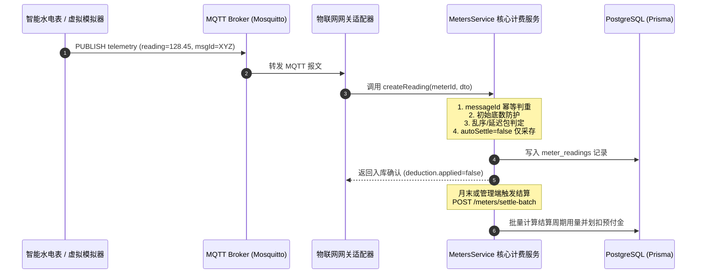

# ADR 003：智能水电表 MQTT 物联网协议与接入规范

> 状态: active  
> 决策日期: 2026-10-15  
> 负责人: 统筹者 / 架构组（strong 档位）  
> 适用范围: 后端水电表模块 (`backend/src/modules/meters/**`)、本地与生产基础设施 (`docker-compose.yml`)、物联网仿真脚本 (`backend/scripts/**`)

---

## 1. 背景与业务痛点

在公租房/集中式公寓租赁运营中，水电表读数抄录与计费是资金周转的核心环节。在物理硬件尚未全面到位或多品牌混合部署的情况下，系统面临以下挑战：

1. **协议异构与硬件缺失**：市场上存在电科院规范、NB-IoT 4G、LoRaWAN、Modbus、Wi-Fi 等多种硬件，缺少标准化的上层物模型与统一接入网关。
2. **高频写入冲击与计费风暴**：智能表支持每小时甚至每 15 分钟高频上报，若每次上报均触发实时计费与扣费，会导致数据库流水膨胀数万条，并产生大量零碎补缴账单。
3. **初次绑定底数误扣**：现存已有运转表计接入时，初始读数通常远大于 0。若直接从 0 计算消耗量，会造成巨额虚假扣费。
4. **弱网延迟、重发与乱序**：蜂窝网络不稳定会导致同一数据包重复投递、历史延迟包越过新包到达，或产生读数倒走报错。
5. **远程跳闸/复电控制缺乏标准交互**：对于欠费拉闸与充值复电，缺乏下行指令的投递、设备执行反馈（ACK）以及超时重试的闭环机制。

---

## 2. 决策目标与考量因素

- **标准化与解耦**：制定不绑定特定硬件厂家的开放式 JSON 物模型与 MQTT Topic 层级。
- **采集与结算解耦**：支持高频数据入库（`source: 'DEVICE', autoSettle: false`），形成未结算待结用量，结合每月定时任务或管理员操作执行周期结算。
- **高可靠防御机制**：内置 `messageId` 幂等去重、同一时间戳防重、乱序延迟到达包标记归档（`[OUT_OF_ORDER]`）且不扣费、矛盾倒走 400 拦截保护。
- **低成本全链路仿真**：提供轻量级 MQTT Broker（Mosquitto）容器配置、Web 工作台一键仿真面板、CLI 模拟器以及虚拟 MQTT 客户端。

---

## 3. 架构方案比选

| 方案 | 传输机制 | 优势 | 劣势 | 结论 |
|------|----------|------|------|------|
| **方案 A：仅 HTTP 轮询/推送** | REST HTTP POST | 简单直观，无额外 Broker | 无法实现服务端主动下行秒级拉闸合闸，设备长连接开销高 | 仅作为备用兜底接口 |
| **方案 B：MQTT Pub/Sub 协议（本决策）** | TCP / TLS + MQTT 3.1.1/5.0 | 轻量省流、双向通信、支持下行指令与 QoS 保证、行业物联网标准 | 需要部署 MQTT Broker（如 Mosquitto/EMQX） | **采纳为标准协议** |
| **方案 C：工业 Modbus TCP** | 工业总线 TCP 轮询 | 适合现场集中式导轨电表与 DTU 网关 | 需网关转换，协议报文为寄存器字节，缺乏业务语义与端侧智能 | 作为局域网物理网关接入层扩展 |

---

## 4. 架构设计与协议规范

### 4.1 MQTT 主题（Topic）层级规范

所有主题统一采用前缀 `tenant-system/meters/`，按表类型与表号进行隔离，并支持通配符订阅：

| 方向 | 主题格式 (Topic Schema) | QoS | 描述与用途 |
|------|-------------------------|-----|------------|
| **上行 (Device -> Server)** | `tenant-system/meters/{meterType}/{meterNumber}/telemetry` | 1 | 智能表定时上报读数、电压、电流、功率与信号强度 |
| **上行 (Device -> Server)** | `tenant-system/meters/{meterType}/{meterNumber}/event` | 1 | 异常告警事件（如反向走字、开盖防拆、漏水告警、过载） |
| **下行 (Server -> Device)** | `tenant-system/meters/{meterType}/{meterNumber}/command` | 1 | 服务端下发控制指令（如拉闸断电、充值合闸、即时点抄） |
| **上行 (Device -> Server)** | `tenant-system/meters/{meterType}/{meterNumber}/command/ack` | 1 | 设备执行控制指令后的确认报文（执行成功/失败/继电器状态） |

> **通配符订阅示例**：  
> 服务端物联网网关订阅：`tenant-system/meters/+/+/telemetry`、`tenant-system/meters/+/+/command/ack`

---

### 4.2 数据载荷（JSON Payload）规范

#### 1) 上行遥测数据报文 (Telemetry Payload)

**Topic**: `tenant-system/meters/{meterType}/{meterNumber}/telemetry`

```json
{
  "messageId": "msg-20261015-elec101-0001",
  "meterNumber": "ELEC-101",
  "meterType": "ELECTRICITY",
  "timestamp": "2026-10-15T12:00:00.000Z",
  "reading": 128.45,
  "relayStatus": "ON",
  "metrics": {
    "voltage": 220.5,
    "current": 2.15,
    "power": 474.08,
    "powerFactor": 0.98,
    "signalRssi": -65,
    "batteryPercent": 100
  }
}
```

**字段说明**：
- `messageId` (string, 必须): 消息全局唯一 UUID，系统根据该键做幂等去重。
- `meterNumber` (string, 必须): 对应系统数据库 `meter.meterNumber`。
- `meterType` (string, 必须): `ELECTRICITY`（电表，单位 kWh）、`WATER`（水表，单位 m³）、`GAS`（燃气表，单位 m³）。
- `timestamp` (ISO 8601 string, 必须): 表端实时采集时间。
- `reading` (number, 两位小数, 必须): 当前累计累计总示值。
- `relayStatus` (string, 可选): 继电器状态 `ON`（合闸/通）/ `OFF`（分闸/断）。
- `metrics` (object, 可选): 电气扩展工况，用于后期能耗分析。

---

#### 2) 下行控制指令报文 (Downlink Command Payload)

**Topic**: `tenant-system/meters/{meterType}/{meterNumber}/command`

```json
{
  "commandId": "cmd-switch-20261015-081",
  "action": "SWITCH_OFF",
  "reason": "ARREARS_OVERDUE",
  "issuedAt": "2026-10-15T12:05:00.000Z",
  "timeoutSeconds": 30
}
```

**支持指令 (`action`)**：
- `SWITCH_OFF`：分闸/断电/断水（通常在租客长期逾期欠费或退租结清时下发）。
- `SWITCH_ON`：合闸/复电/通水（租客预付充值到账或补缴清欠后自动下发）。
- `TRIGGER_READING`：主动召测/即时抄表（系统需紧急同步读数时下发）。

---

#### 3) 设备执行确认报文 (Command ACK Payload)

**Topic**: `tenant-system/meters/{meterType}/{meterNumber}/command/ack`

```json
{
  "commandId": "cmd-switch-20261015-081",
  "meterNumber": "ELEC-101",
  "action": "SWITCH_OFF",
  "status": "EXEC_SUCCESS",
  "relayStatus": "OFF",
  "executedAt": "2026-10-15T12:05:01.850Z",
  "errorCode": null,
  "errorMessage": null
}
```

---

## 5. 采集、计费与防御处理流程



---

## 6. 本地开发与测试工具链

1. **MQTT Broker 容器环境**：
   - `docker-compose.yml` 内置 `mosquitto` 服务，监听标准 1883 端口与 9001 WebSocket 端口。
2. **虚拟表模拟器 (方案 A)**：
   - 后端路由：`POST /meters/simulator/run`
   - 管理后台 UI：`frontend-admin/src/views/meters/MeterSimulatorDialog.vue`（提供 24 小时波峰波谷日曲线、30 天月度穿梭与异常防御自检可视化面板）。
   - CLI 脚本：`npm --prefix backend run simulate:meters -- --scenario=DAILY_HOURLY`。
3. **虚拟 MQTT 智能表上报脚本 (方案 B)**：
   - 脚本：`backend/scripts/mqtt-meter-simulator.ts`
   - 命令：`npm --prefix backend run simulate:mqtt`
   - 支持自动订阅下行拉闸/合闸命令，并在收到 `SWITCH_OFF`/`SWITCH_ON` 时自动翻转内部继电器并响应 ACK。

---

## 7. 影响与后续演进

- **文档一致性**：已在 `docs/INDEX.md` 注册，符合规范。
- **兼容性**：不修改既有 Prisma 24 张表结构，与既有 `Meter` / `MeterReading` 实体完全兼容。
- **安全保障**：生产环境部署时必须开启 TLS（MQTTS 8883 端口）并配置每台设备的 Client-ID 与密码 ACL 授权。
